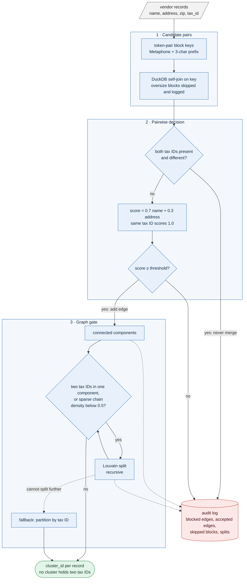

# entity-resolution-gate — deciding which records are the same company, with hard rules that similarity can never override


**Status: v0.3, portfolio project.** Blocking, scoring, the graph gate, an audit log, a synthetic data generator and a benchmark are built and tested. The synthetic benchmark reaches 39,369 records. Three real-data studies (the third is the graph-splitting ablation, see [Results](#results)), the first two each with a protocol written in advance and a held-out half scored once: on a **random sample of Department of Defense contract recipients** the name-only pipeline beat a tuned plain fuzzy matcher by 2.6 B-cubed F1 points (95% interval +1.9 to +3.3) and better blocking did not help; and on **UK company register data with a registry ID on half the records** the full gate (hard veto plus same-ID evidence) beat the same pipeline without the ID by 2.7 points (+2.5 to +2.9), almost entirely through the same-ID evidence, with zero rule-breaking clusters against 49 without the veto ([Results](#results)). The registry ID is a company number, not a tax ID, and the 100k+ record benchmark is not done.

```text
$ python examples/demo.py                      # 7 vendor records; entity_id is the hidden truth
 rid  name                      tax_id      entity_id  cluster_id
  0   Aegis Falcon Defense LLC  11-1111111  A          0
  2   AEGIS FALCON DEFENSE INC  11-1111111  A          0
  1   Aegis Falcon Defence      null        A          1      <- no tax ID: looks like A and B equally
  3   Aegis Falcon Defense LLC  22-2222222  B          1
  4   Boreal Systems Inc        null        C          2
  5   The Boreal Systems        null        C          2
  6   Zenith Logistics Co       33-3333333  D          3

audit log (what the gate decided and why):
  {'kind': 'edge_blocked', 'a': 2, 'b': 3, 'reason': 'tax_id_contradiction'}
  {'kind': 'edge_blocked', 'a': 0, 'b': 3, 'reason': 'tax_id_contradiction'}
  {'kind': 'component_split', 'method': 'louvain', 'depth': 0, 'size': 4, 'parts': 2, 'reason': 'tax_conflict'}
  ... plus 5 accepted edges
```

*Real output of [examples/demo.py](examples/demo.py), table lightly reformatted. Look at record 1: the gate never put A's and B's verified IDs together (records 0 and 2 stayed away from record 3), but record 1 has no tax ID and matches both look-alike companies equally well, so it was grouped with B, which is wrong. The gate guarantees clusters never contradict a known ID; it cannot guarantee correctness when the data does not decide. That limit is deliberate to show, and it is discussed below.*

## What is this? (plain-language overview)

Organisations keep records of the same company in many places, spelled differently: "Aegis Falcon Defense LLC", "AEGIS FALCON DEFENSE INC", "Aegis Falcon Defence". To analyse suppliers, contracts or ownership you first have to decide which records refer to the **same real-world entity**. That is entity resolution, and it fails in two opposite ways:

- **Missed matches:** the same company counted as three, so spend looks smaller and relationships are lost.
- **False merges:** two *different* companies with similar names fused into one, which is worse: it can attribute one firm's contracts to another.

Fuzzy name matching alone cannot tell "Aegis Falcon Defense LLC" with one tax ID from "Aegis Falcon Defense LLC" with another. They are different legal entities that happen to look identical.

entity-resolution-gate adds a **hard rule that similarity can never override**: if two records both carry a verified identifier (here, a tax ID) and the identifiers differ, they can never end up in the same group. Everything else is soft evidence, scored and thresholded; that rule is a gate:

1. **Candidate pairs.** Records are compared only if they share a block key built from sounds and prefixes of their name words, so you do not compare every record to every other.
2. **Hard constraint.** A pair with two different tax IDs is dropped immediately and logged.
3. **Score.** Remaining pairs get a similarity score from name and address. A shared tax ID scores 1.0.
4. **Graph and gate.** Pairs above the threshold become edges; connected groups are checked. A group holding two tax IDs, or a group that is only a thin chain of weak links, is split by community detection; if that cannot fix it, a final fallback splits by tax ID.
5. **Audit log.** Every blocked pair, accepted pair, skipped block and split is recorded.

**What it is not.** It is not a learned matcher, and it does not use embeddings, executive names or geography yet. It does not decide which of two ambiguous records is right; it only guarantees it will not break a rule it was told is absolute.

### Who it is for, and when it earns its place

| If you are... | the project gives you... |
| --- | --- |
| working with supplier, vendor or contract data from several systems | a way to merge records while guaranteeing identifiers are never contradicted |
| an analyst who must explain a merge | an audit log saying why each pair was joined, blocked or split |
| building a matching pipeline | a pattern of candidate blocking, scoring, then deterministic constraints on a graph |
| evaluating matchers | a seeded synthetic generator with known ground truth, trap cases included |

It is a poor fit if your records have no reliable identifier to constrain on, if you need a learned or probabilistic matcher today, or if you need results proven on real data.

### Why constraints on the graph, and not a better similarity score?

Any similarity score can be fooled by two look-alike companies. A rule that holds regardless of the score is the only thing that makes a merge guarantee possible. The score decides what is *likely*; the constraints decide what is *allowed*.

**What's real and what's not.** The pipeline, the constraints, the audit log and the benchmark run today and are tested, including a property test that no cluster ever contains two tax IDs. The scale claims rest on **synthetic data**. A name-only study on a random sample of real USAspending recipients exists ([docs/RESULTS_SAMPLE.md](docs/RESULTS_SAMPLE.md)). The hard constraint has now also been tested on real identifiers ([docs/RESULTS_GATE.md](docs/RESULTS_GATE.md)), with UK company numbers standing in for tax IDs and their availability simulated, so it is evidence about the mechanism, not about tax IDs.

## At a glance

| | |
| --- | --- |
| Input | a table with `rid`, `name`, `address`, `zip`, `tax_id` (nullable) |
| Output | the same table plus `cluster_id`, and an audit log |
| Guarantee | no cluster contains two different non-null tax IDs (property-tested over seeds, trap rates and thresholds) |
| Measured (synthetic, held-out seeds) | F1 0.91 at 2,000 records, 0.80 at 39,000 records; 0 tax-ID violations in every run |
| Measured (real USAspending names, random sample, name-only) | held-out B-cubed F1 0.911 against 0.885 for tuned plain fuzzy matching (+0.026, 95% interval +0.019 to +0.034) and 0.893 for Splink; 17% of true pairs are renames no string method finds |
| Measured (real UK company register, registry ID visible on 50% of records) | held-out B-cubed F1 0.928 for the full gate against 0.901 without the ID (+0.027, 95% interval +0.025 to +0.029); 0 clusters break the ID rule against 49; a supervised Splink gets within 0.5 points but with 29 rule-breaking clusters |
| Speed | 39,369 records in 6.7 s on one machine, single thread |
| Stack | Polars, DuckDB, NetworkX, RapidFuzz, jellyfish (Metaphone) |
| Tests | 43, including property-based; `mypy --strict`; ruff |

## Architecture at a glance



*There is no learned model in this version: the "soft" step is a hand-built similarity score. What makes it a gated system is that the tax-ID rule and the graph check hold whatever that score says, and a later learned or embedding-based scorer could replace the score without touching the gate.*

## Quickstart

```bash
git clone https://github.com/PCSchmidt/entity-resolution-gate && cd entity-resolution-gate
uv venv && uv pip install -e ".[dev]"

python examples/demo.py              # the output shown above
python scripts/benchmark.py          # the held-out synthetic table below
pytest -q                            # 43 passed
```

```python
from entity_resolution_gate import generate, resolve, pairwise_prf

df = generate(1000, seed=2)          # rid, name, address, zip, tax_id, entity_id (truth)
resolved, audit = resolve(df)        # adds cluster_id; audit.events lists every decision
pairwise_prf(resolved)               # (precision, recall, F1) against entity_id
```

## Approach: why it is built this way

- **Allowed versus likely.** Similarity says what is likely; constraints say what is allowed. Only the second can be guaranteed.
- **Guarantee by construction, then test it.** The fallback in the graph gate makes an inconsistent cluster impossible; a property test tries to break that over many seeds, trap rates and thresholds.
- **Explainable merges.** Each decision lands in an audit log, so a reviewer can see why two records are, or are not, together.
- **Honest about ambiguity.** Where the data does not decide (record 1 above), the gate does not pretend to.
- **Measure on data you did not tune on.** The threshold was picked on one synthetic seed; results are reported on others.

## Motivation

This is the entity-resolution step behind the kind of analysis I do on defense and federal-contracting data (the Hard Power Intelligence and Grey-Resolve projects touch the same problem from other angles): cross-referencing suppliers across public databases fails if you rely on fuzzy strings or vector similarity alone. It is the portfolio's "probabilistic evidence, deterministic boundary" idea applied to record linkage.

## Method (what the pipeline actually does)

1. **Normalise** names: lowercase, strip punctuation, drop legal words (`llc`, `inc`, `corp`, `co`, `ltd`, `the`, `company`, ...).
2. **Block keys** (`block_keys`): for the first four name tokens, every token pair gives a Metaphone key and a 3-character prefix key, so one typo still leaves a shared pair. Single-token names use single keys.
3. **Candidate pairs**: a DuckDB self-join on key; blocks larger than 200 records are skipped and logged.
4. **Hard constraint**: both tax IDs present and different means the pair is dropped (`edge_blocked`).
5. **Score**: `0.7 * name + 0.3 * address`, where name is the larger of Jaro-Winkler and token-sort ratio, address is a string ratio halved if ZIPs differ. A shared tax ID scores 1.0. Edges are kept at or above 0.93.
6. **Graph gate**: connected components; a component is split if it holds two tax IDs, or has more than three nodes and density below 0.5. Splitting uses recursive Louvain (fixed seed); if a tax-conflicted component still cannot be split, nodes are partitioned by tax ID, and untaxed nodes join the ID with most edge weight.
7. **Output** `cluster_id` and the audit log.

## Results

Synthetic data only: typos, case changes, trading prefixes and suffixes, address drift, 40% of entities without a tax ID, and 10% "trap" twins sharing a name and address with a differently-taxed entity. The threshold (0.93) and the density rule were chosen on seed 1; the rows below use other seeds. Pairwise precision, recall and F1 against the hidden truth. Reproduce: `python scripts/benchmark.py`.

| Entities | Records | Precision | Recall | F1 | Tax-ID violations | Seconds |
| --- | --- | --- | --- | --- | --- | --- |
| 1,000 (seed 2) | 2,021 | 0.858 | 0.973 | 0.912 | 0 | 0.3 |
| 1,000 (seed 3) | 1,964 | 0.856 | 0.972 | 0.910 | 0 | 0.2 |
| 5,000 (seed 2) | 9,870 | 0.816 | 0.977 | 0.889 | 0 | 4.4 |
| 20,000 (seed 2) | 39,369 | 0.770 | 0.842 | 0.804 | 0 | 6.7 |

- Zero tax-ID violations in every run, which is the guarantee the gate exists to give.
- Precision is capped near 0.86 at small scale by the trap twins' records that carry no tax ID: nothing in the data separates them (the demo's record 1).
- Quality falls at 20,000 entities. The synthetic name space has only 4,032 base names, so many distinct vendors collide; this is partly the generator and partly a real scaling cost, and the two are not separated here.
- Two design flaws were found by running the benchmark: a threshold of 0.82 chained unrelated vendors into one component (precision 0.61), and single-token blocking keys collapsed recall to 0.005 at 5,000 entities. Both are fixed and described in [docs/RESULTS.md](docs/RESULTS.md).

### Real data: federal-contractor names (USAspending, random sample)

A study planned before any sampled name was downloaded ([docs/PROTOCOL_SAMPLE.md](docs/PROTOCOL_SAMPLE.md)) draws a simple random sample of 3,000 recipients of Department of Defense contracts in fiscal year 2024 from the full population of 45,959, and scores nine matchers on 1,527 held-out registry entities (4,542 name strings), with the registry's own identifier as the hidden answer key. Each matcher has one number tuned on development data and the held-out half was scored once. The metric is B-cubed F1 (precision and recall averaged over records, so one very large entity cannot dominate).

| Matcher | Precision | Recall | F1 [95% interval] |
| --- | --- | --- | --- |
| Exact normalised name | 0.994 | 0.727 | 0.840 [0.821, 0.857] |
| Plain fuzzy, tuned | 0.977 | 0.809 | 0.885 [0.870, 0.898] |
| Splink, one comparison | 0.988 | 0.814 | 0.893 [0.878, 0.907] |
| **This pipeline, tuned** | 0.974 | 0.855 | **0.911** [0.898, 0.922] |
| Pipeline with the extra blocking keys | 0.958 | 0.875 | 0.915 [0.903, 0.925] |
| Pipeline, token-sort-only score | 0.958 | 0.836 | 0.893 [0.880, 0.905] |

- The pipeline beats the tuned plain fuzzy matcher by 0.026 F1 (95% interval +0.019 to +0.034), through recall at about the same precision; the pairwise-F1 gap is larger (+0.070). Post-hoc, it also beats Splink by 0.018 (+0.012 to +0.025).
- **Better blocking is not the lever.** Extra keys raise the share of findable true pairs proposed by 4 to 8 points at up to 1.7 times the candidates, but F1 moves by at most 0.004, not distinguishable from zero.
- A token-sort-only name score, which I expected to help, was worse (-0.018), so the Jaro-Winkler part of the score earns its place.
- 17% of true pairs are renames that share almost no text; **no matcher recovers any of them**.
- Public data has no tax IDs or addresses, so this study does **not** test the hard constraint or address evidence the design is built around, and it cannot say the graph step is why the pipeline wins.
- Three choices were changed after seeing development results and before the held-out half was scored (the primary metric, one excluded pass-through entity, wider threshold grids); all are logged in the protocol, and the key result holds under pairwise F1 and with the largest entities removed.

An earlier **pilot** used only the first 10,000 awards per month in name order, so it sampled names beginning with a digit or "A"; its results ([docs/RESULTS_REAL.md](docs/RESULTS_REAL.md), [docs/RESULTS_BLOCKING.md](docs/RESULTS_BLOCKING.md)) are kept, with a correction notice, but are superseded.

### Real identifiers: does the hard rule matter? (UK company register)

A third study ([docs/PROTOCOL_GATE.md](docs/PROTOCOL_GATE.md), written before any matcher ran) tests the design's central idea directly. It uses the UK Companies House register: each company's current and previous names are the records, the company number is the answer key and, on a random half of records, a **registry ID** the pipeline may use. Sixty dense name neighbourhoods (800 names each, 30 development and 30 held-out, each a separate deduplication job) keep the lookalike companies that the rule exists for. The metric is B-cubed F1; **read it against a no-merge row, which scores 0.903 because 83% of companies have one name**.

| Held-out, ID visible on 50% of records | B-cubed F1 [95%] | Pairwise F1 | Clusters with two different IDs |
| --- | --- | --- | --- |
| No merge (reference) | 0.903 | 0.000 | 0 |
| Plain fuzzy | 0.900 | 0.017 | 67 |
| Pipeline, name and address, ID ignored | 0.901 [0.895, 0.907] | 0.022 | 49 |
| + hard veto only | 0.902 | 0.022 | **0** |
| + same-ID evidence only | 0.927 | 0.405 | 48 |
| **+ both (the full gate)** | **0.928** [0.923, 0.932] | 0.408 | **0** |
| Splink trained on labelled development pairs | 0.923 | 0.349 | 29 |

- The full gate beats the same pipeline without the ID by **0.027 F1** (+0.025 to +0.029) and improves **all 30 held-out slices**. Almost all of that is the **same-ID evidence** (+0.026), which recovers renames that no name similarity can; the veto alone adds only +0.0007.
- **The guarantee holds on real data:** zero clusters contain two different visible IDs, against 49 to 77 without the veto, and the veto prevents 66 to 93 wrongly merged record pairs.
- **Name similarity alone does not beat linking nothing here** (tuned fuzzy matching is 0.003 below the no-merge row): most true pairs are renames and numbered-series lookalikes punish any loose threshold.
- A supervised Splink gets within 0.5 points on F1, but with 1,349 wrongly merged pairs and 29 clusters that break the ID rule; an unsupervised one learned the wrong solution on this data and linked nothing.
- The effect scales with how often the ID is visible (+0.007 at 25%, +0.027 at 50%; at 100% it is a ceiling), and the veto matters only when IDs are visible on both records of a lookalike pair.
- **Limits:** the identifier is a company number, not a tax ID; the 50% visibility is simulated; it is UK live companies only; and the graph-splitting step is ablated separately ([docs/RESULTS_SPLIT.md](docs/RESULTS_SPLIT.md)): at the tuned threshold it adds only +0.0001 F1 but it is what makes the "never two IDs in a cluster" guarantee true (6 rule-breaking clusters without it) and it keeps the pipeline usable at looser thresholds (+0.20 F1 at threshold 0.80).

## Limitations

- **Scale claims are synthetic-only.** The USAspending study covers names only, one agency and one fiscal year; the UK study uses a simulated identifier visibility and company numbers, not tax IDs. Mergers, subsidiaries and transliteration are barely represented.
- **The answer key is noisy.** The registry's alias lists sometimes include unrelated organisations (one sampled entity had 256 aliases and was excluded; a few others list several institutions), so absolute scores are approximate.
- **One hard rule.** Only the tax-ID contradiction is enforced. CAGE codes, parent-subsidiary rules and other absolute constraints are not built.
- **Missing identifiers defeat the gate.** A record with no tax ID can be grouped with the wrong twin, as the demo shows; the gate guarantees consistency, not correctness.
- **Thresholds are not portable.** 0.93 and density 0.5 were picked on synthetic data and will need re-tuning.
- **Small name space.** The generator saturates near 20,000 entities, so the largest rows are pessimistic in a way unrelated to the algorithm.
- **Not at scale.** No 100k+ run and no F1-versus-latency curve. Splink was compared only on the real-data study, with a fixed hand-set configuration, so that comparison says little about a tuned Splink.
- **No embeddings or extra features** (executive names, geography, vector search) yet.

## Known gaps against the original roadmap

The project began as an item in a longer roadmap that named a larger stack and scope. These parts of that plan were **not built**; the results above say nothing about them.

- BM25 or dense-embedding blocking, `pgvector`, and an embedding-distance feature: blocking uses phonetic and prefix token-pair keys in DuckDB.
- Executive-name and geographic-proximity features, and Leiden clustering (Louvain is used).
- A 100k+ record run and an F1-versus-latency curve.
- Real tax IDs or CAGE codes: public data has none, so the UK company number stands in for a registry ID. SEC EDGAR EINs were not tried (the SEC requires a contact address in the User-Agent, which I did not supply); OpenCorporates was not used.

## Operational notes

### What runs where

Everything runs locally on one machine, single-threaded. No services, database server or network access.

### Data and keys

No keys. The synthetic benchmark data is generated from a seed. The USAspending study uses the public API (US government data, no key needed). The registry-ID study uses the UK Companies House free company data snapshot (a public register of companies, not individuals); I did not find a licence statement on the pages I could read, so it is used for research only. Both are downloaded on demand into a git-ignored `data/` folder and never committed; only derived numbers are in the repository. SEC EDGAR and GLEIF refused automated requests without a contact address, and I did not work around that. Any further real data should come from public sources and never include non-public or employer data.

### Verify the claims (a reviewer's path)

```bash
pytest -q                         # 43 passed, includes the property test of the guarantee
mypy src tests scripts            # strict, clean
python examples/demo.py           # the table and audit log shown at the top
python scripts/benchmark.py       # the held-out synthetic table
```

The real-data study needs the `study` extra and a download from the public USAspending API; the exact commands are in [docs/RESULTS_SAMPLE.md](docs/RESULTS_SAMPLE.md#reproduce). The held-out stage refuses to run twice.

### Documentation map

| Doc | What it covers |
| --- | --- |
| [docs/RESULTS_GATE.md](docs/RESULTS_GATE.md) | the registry-ID study on UK company data: results, criteria, dose-response, limits |
| [docs/PROTOCOL_SPLIT.md](docs/PROTOCOL_SPLIT.md), [docs/RESULTS_SPLIT.md](docs/RESULTS_SPLIT.md) | the graph-splitting ablation on fresh slices: what the Louvain step does and does not buy |
| [docs/PROTOCOL_GATE.md](docs/PROTOCOL_GATE.md) | its plan, written before any matcher ran, and the four deviations |
| [docs/RESULTS_SAMPLE.md](docs/RESULTS_SAMPLE.md) | the random-sample real-data study: results, criteria, post-hoc checks, limits |
| [docs/PROTOCOL_SAMPLE.md](docs/PROTOCOL_SAMPLE.md) | its plan, written before any sampled name was downloaded, and the four deviations |
| [docs/RESULTS_REAL.md](docs/RESULTS_REAL.md), [docs/RESULTS_BLOCKING.md](docs/RESULTS_BLOCKING.md) | the superseded alphabetical-prefix pilot, kept with a correction notice |
| [docs/PROTOCOL_REAL.md](docs/PROTOCOL_REAL.md), [docs/PROTOCOL_BLOCKING.md](docs/PROTOCOL_BLOCKING.md) | the pilot's plans and deviations |
| [docs/RESULTS.md](docs/RESULTS.md) | synthetic protocol, the table, how to read it, the two development findings |
| [examples/demo.py](examples/demo.py) | the worked example above |
| [src/entity_resolution_gate/pipeline.py](src/entity_resolution_gate/pipeline.py) | blocking, scoring and the graph gate |

## License

MIT. See [LICENSE](LICENSE).

## Author

Chris Schmidt ([PCSchmidt](https://github.com/PCSchmidt)). Part of a portfolio on evaluator-gated AI systems: probabilistic components propose, deterministic gates decide.
