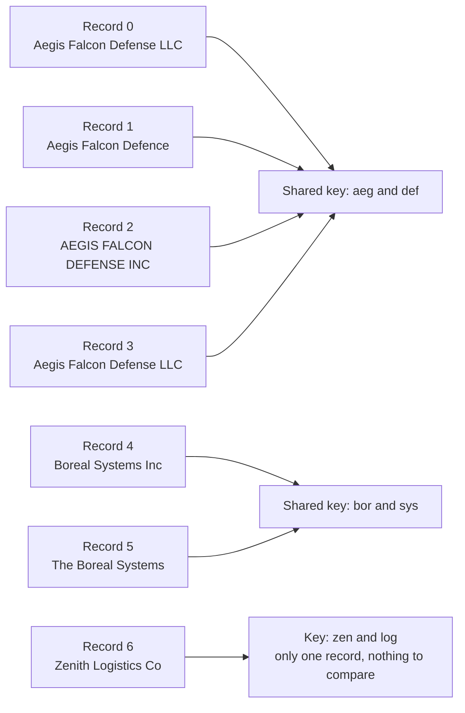
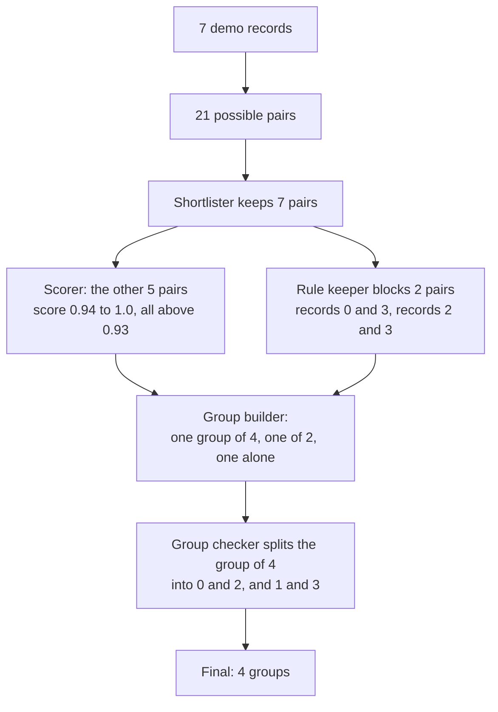
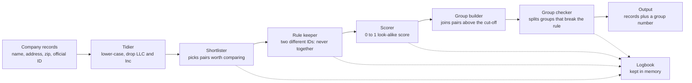
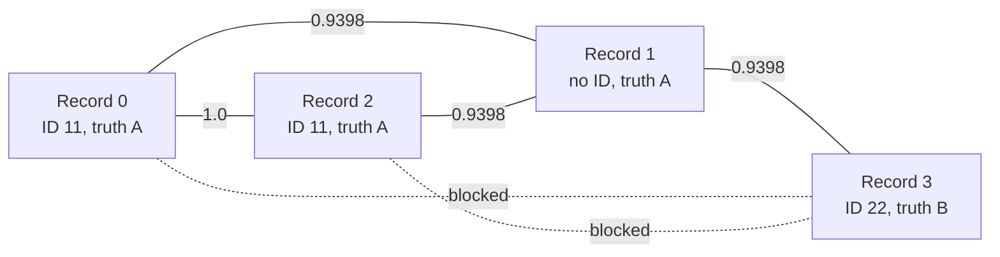
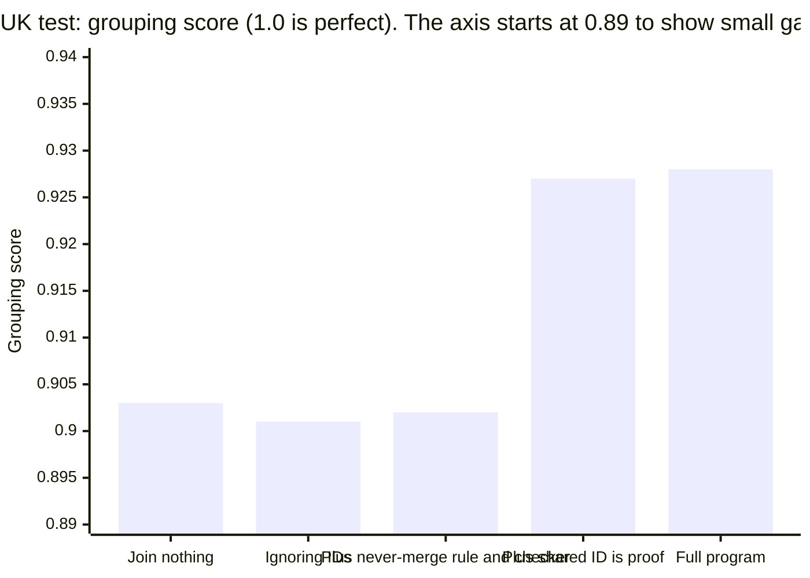

# entity-resolution-gate: a plain-language explainer

Project: https://github.com/PCSchmidt/entity-resolution-gate (public, MIT licence, version 0.3.0). Written 2026-10-24. The detailed proof (commands run, line references, claim checks) is kept in a separate companion file, `entity-resolution-gate_EVIDENCE_NOTES.md`.

**Who is "I"?** I am an AI reviewer (Claude) who read the project's files, ran its tests and demo, and wrote this. "I ran" means I ran it myself. "The project's own write-up says" means I read it but could not check it. Where a paragraph is a draft in the author's voice, it says so. Two words from the project: its *README* is the front-page description in the repository, and *GitHub* is the website where programmers share code and where this project's tests run automatically.

**Words used throughout.** Each is explained again where it matters; this box is for reference.

- **Official ID:** a registration number issued to a company. In the project's design it is a tax ID; in its UK test it is the company registration number.
- **Record:** one row in a list: a company name, usually an address, and sometimes an official ID.
- **Group:** the records the program decides belong to one company.
- **Shortlisting:** comparing every record with every other is far too slow, so the program first picks a short list of pairs that look worth comparing. A pair makes the list if the two names share a *key*, a short code built from the name (examples in Section 3 and Section 5).
- **Cut-off:** the look-alike score (0 to 1) a pair must reach to be joined. The default is 0.93.
- **Grouping score:** one number from 0 to 1 for how good a set of groups is, where 1 is perfect. It blends two questions: of the records the program put together, how many truly belong together, and of the records that belong together, how many did it find. The project's main version is called "B-cubed F1"; it grades each record in turn and averages. Section 5 shows the arithmetic on the demo.
- **Do-nothing baseline:** the grouping score you get by joining no records at all. Every result in this document is compared with it. It can be high: if most companies appear only once (83% of the UK companies do), leaving every record alone is already right for most of them.
- **Held-out data:** test data kept locked away while settings are chosen on other data, then used once at the end, like an exam paper nobody saw in advance.
- **Simulated:** made up by the author for the experiment, not found in real life.
- **Trap twins:** two different companies that share a name and address and differ only in their official ID. Companies with the same name exist in real data (the UK data has roughly 200 to 240 such pairs per half, per the plan); the practice data invents the same-name, same-address case on purpose.

---

## Section 1. At a glance

**What is it?** A program that takes a list of company records and decides which ones are the same company. It has one strict rule: two records with different official IDs are never put together, however alike they look.

**Who is it for?** People who merge supplier or contractor lists from several places and would rather miss a match than credit one firm's contracts to another. Today that means the author alone; nobody else is known to use it.

**Finished, working, or an experiment?** A working prototype (version 0.3) plus a set of careful experiments. The core is complete and tested. The author's original plan was bigger, and the README lists what was never built: embedding-based matching, runs above about 40,000 records, tests with real tax IDs.

**Does it work?** Modestly, and the project measures this honestly. The clearest test used real UK company names, where the author *hid* the official ID on half the records on purpose (a simulation) to see what the ID adds. Scores are out of 1, where 1 is perfect:

- joining no records at all: 0.903
- the same program ignoring the IDs (it still uses names and addresses): 0.901
- the full program, using the IDs that were visible: 0.928

So the full program beats doing nothing by 0.025, a small gain (Section 8 has one table saying what each gain figure is measured against). That result also needed a switch that is off by default (Section 2). The guarantee held: no group contained two different visible IDs, against 49 such groups when the program ignored IDs. On US defense-contractor names (no IDs at all) the program scored 0.911, against about 0.50 for doing nothing and 0.885 for a carefully tuned simple matcher. Section 8 explains how to read these.

**How close to real use?** It runs and passes its tests on a laptop and on GitHub's test service. It is not deployed and has no users. On a simple four-step scale (an idea, works locally, deployable, operated) it is at step two, "works locally" (Section 9).

**How was it built?** The author set the scope, plan and preferences, and AI coding assistants wrote nearly all the code. The saved history credits Claude on 28 of 29 changes, and the author says very little was hand-written by him.

**If you only have ten minutes,** read Sections 2 and 3, the start of Section 8, and the "reality check" in Section 9.

**Three things to know**
1. *The idea:* a similarity score can suggest that two records match, but a fixed rule decides what is allowed. The score handles "probably"; the rule handles "never".
2. *What drives the results:* most of the accuracy gain comes from treating a shared ID as proof of a match, not from the never-merge rule, which mainly buys the guarantee (with half the IDs visible it barely moves the score). Section 2 lays out the three ID ideas.
3. *The main limit:* the rule needs an ID. A record with no ID that looks equally like two companies is still guessed.

**In one sentence:** a small, well-tested prototype that groups company records under a hard "different IDs never merge" rule, with solid evidence that the rule holds and modest evidence that using IDs improves accuracy.

---

## Section 2. The problem, the idea and the goal

**The problem.** One supplier appears as "Aegis Falcon Defense LLC" in one list, "AEGIS FALCON DEFENSE INC" in another and "Aegis Falcon Defence" in a third. A person sees one company; a computer comparing exact text sees three. Deciding which records describe the same real company is called **entity resolution**. It can fail two ways:

- *Missed matches:* one company is counted as three, so its spending looks small.
- *False merges:* two different companies are fused, so one firm gets credit for another's contracts. This is usually worse, and it is what this project targets. Two different companies can share a name and address and differ only in their official ID, and no amount of "looking alike" separates them.

**Who has the problem, and what do they do today?** Anyone combining organisation lists: procurement analysts, people studying government contracts, data teams cleaning supplier tables. The project gives no count of such people. Today they use spreadsheets, exact matching, fuzzy-matching tools that score how alike two names look, or hours of manual checking. (That last sentence is my general knowledge, not the repository's.)

**Why does the project exist?** The README says it is "the entity-resolution step behind the kind of analysis I do on defense and federal-contracting data". It applies the author's portfolio theme, "systems checked before they are trusted": guesses on one side of a line, fixed rules on the other. It "began as an item in a longer roadmap". Why this item was picked is not written down, so it goes to the questions for the author at the end.

### The idea, in three parts

The whole project rests on three ideas about official IDs. They are easy to mix up, so here they are together, in the order you need them.

1. **The never-merge rule.** If two records both have an official ID and the IDs differ, they are different companies. They are never joined, even if the names and addresses are identical. This is the "gate" in the project's name. It is meant to give a *guarantee*: no returned group holds two different visible IDs. That also needs the group checker of Section 5 and well-formed input (IDs are compared as exact text, and record numbers are unique). It cannot make groups *correct*, because many records have no ID at all.
2. **A shared ID counts as proof.** If two records have the same ID, they are the same company, even if the names look nothing alike. This is what finds *renamed* companies, such as "Borealis Marine" that became "Quartz Holdings". It is the idea that most improves accuracy.
3. **ID-based shortlisting (a switch).** Idea 2 only helps if the two records are compared at all, and by default the shortlist is built from names only, so a renamed company is never compared with its old self. A switch makes the program also shortlist every pair of records that share an ID. **It is off by default**, and the project's best UK result had it on.

*Which does the most work?* The guarantee comes from idea 1. The accuracy gain comes almost entirely from ideas 2 and 3 working together. The project's own measurements say so (Section 8). The project's name describes the idea that matters less for accuracy and more for trust.

**What other tools exist?** The repository compares itself with **Splink**, a free, widely used tool that learns from labelled examples how much each kind of agreement should count. From my general knowledge, others exist (dedupe, Zingg, paid products); the repository does not compare against them. This project's difference is enforcing the ID rule across whole groups and measuring carefully. It is worse in having no learned scoring, a small range of tested sizes, one rule only, no screen, and no way for a person to review doubtful cases.

**The goal and how it is measured.** Success means (1) never putting two different IDs in a group (measured: zero such groups whenever the rule and the group checker are on); (2) beating simple methods on real names, using test data kept locked away (measured, with ranges); (3) reporting honestly, including disappointing results. Hoped for but not measured: usefulness to real users, speed on 100,000 or more records, behaviour with real tax IDs.

**What it refuses to do.** Per the README it is not a learned matcher, uses no "embeddings" (numeric fingerprints of what a text means), no executive names or locations, and "does not decide which of two ambiguous records is right; it only guarantees it will not break a rule it was told is absolute". It has no screen, no web service and no review queue. It is not declared finished and has no "not planned" list; what would make the author reopen it is a question for him.

**What would a skeptic ask?**
- *Why not just use the ID?* Only some records have one. IDs help a lot when visible and little when rare.
- *Why not Splink?* In the UK test a trained Splink scored 0.923 against 0.928 here, but left 29 groups that broke the ID rule (none here). The project did not test whether Splink can be set up to enforce such a rule, and a better-tuned Splink might close the gap.
- *Zero broken groups means no wrong merges?* No. Even the full program left 246 wrongly joined pairs of records in the UK test. The rule guarantees consistency with visible IDs, not correctness.

**In one sentence:** the project shows that a hard ID rule prevents the worst mistake in company matching, and measures how much treating IDs seriously helps accuracy.

---

## Section 3. What it does, and who it is for

**What it does.** You give it a table of company records. It tidies the names, picks pairs worth comparing, refuses to join any pair whose IDs differ, scores how alike the rest are, joins pairs that score high enough, and checks that no joined group breaks the ID rule. You get your table back with one new column, a group number: same number, same company (the program's best guess). It also keeps a logbook of its decisions.

**One example, start to finish.** The project ships a seven-record demo, and I ran it. The "truth" column is the hidden right answer, used only for grading; the program never sees it.

| Record | Name | Address | Zip | Official ID | Truth |
| --- | --- | --- | --- | --- | --- |
| 0 | Aegis Falcon Defense LLC | 120 Main St | 20001 | 11-1111111 | company A |
| 1 | Aegis Falcon Defence | 120 Main Street | 20001 | (none) | company A |
| 2 | AEGIS FALCON DEFENSE INC | 120 Main St | (none) | 11-1111111 | company A |
| 3 | Aegis Falcon Defense LLC | 120 Main St | 20001 | 22-2222222 | company B |
| 4 | Boreal Systems Inc | 9 Harbor Rd | 10002 | (none) | company C |
| 5 | The Boreal Systems | 9 Harbor Rd | 10002 | (none) | company C |
| 6 | Zenith Logistics Co | 77 Oak Ave | 30003 | 33-3333333 | company D |

Records 0 and 3 are trap twins: same name and address, different IDs, so different companies.

I give each step a plain name: the *tidier*, *shortlister*, *rule keeper*, *scorer*, *group builder* and *group checker*.

1. **Tidy.** Lower-case the names and drop filler words (LLC, Inc, Co, The). Records 0, 2 and 3 become "aegis falcon defense"; record 1 becomes "aegis falcon defence".
2. **Shortlist.** Seven records make 21 possible pairs. Each tidied name produces several keys; each key is built from two of its words (for example "a word starting aeg and a word starting def"), and two records are compared only if they share a key. Records 0 to 3 all share that key, so all six pairs among them make the list. Records 4 and 5 share a key. Record 6 shares nothing, so it is never compared. That leaves 7 of 21 pairs.

*Reading it: records that share a key land in the same pigeonhole and get compared; a record alone in its pigeonhole is never compared. (In reality each record has several keys; one is shown.)*

3. **Apply the rule.** Pairs (0, 3) and (2, 3) have two different IDs, so they are thrown out and noted. Record 1 has no ID, so no rule stops its pairs.
4. **Score** each remaining pair from 0 to 1. The pair (0, 2) shares an ID, so it scores 1.0 (idea 2: a shared ID is proof). The pair (4, 5) also scores 1.0, because after tidying the names and addresses are identical. Pairs (0, 1), (1, 2) and (1, 3) each score 0.9398, a near-match on name and address.
5. **Join** pairs scoring 0.93 or more: all five. They form three clumps: records 0, 1, 2 and 3; records 4 and 5; and record 6 alone.
6. **Check each clump.** The first clump holds two different IDs, which is forbidden, so the group checker splits it. The splitting method does not look at who is company A or B. It asks which cut keeps the strongest links together on each side, compared with chance. Here the best cut is {0, 2} and {1, 3} (the numbers are in Section 5).

*Reading it: the journey of the demo, top to bottom, with the real counts.*

**Result:** groups {0, 2}, {1, 3}, {4, 5} and {6}. Records 0, 2, 4, 5 and 6 are grouped correctly. The group {1, 3} is a mix: record 1 is company A but sits with record 3, which is company B. So two records are affected: record 1 is parted from its company A records, and record 3 now shares a group with a company A record.

**Why did record 1 land with record 3, and is that a mistake?** Three things are true at once.

- *At the level of pairs it is a tie.* A tie here means equal pair scores: record 1 scores exactly 0.9398 against records 0, 2 and 3. Records 0 and 3 have the same name and address, so record 1 looks identical to each of them; only their IDs differ, and record 1 has none. No single pair points to A over B.
- *The wider network is not symmetric.* Company A has two records in the clump (0 and 2) and B has one (3), so record 1 has two links to A's records and one to B's. Adding up link strength would favour A (1.88 against 0.94). But that sum mostly reflects A having two records, not stronger evidence about record 1, and if record 1 had truly been company B the sum would have been wrong.
- *The splitter did not add anything up.* It does not know which record is which company. It picks the cut that keeps the most link strength inside groups compared with chance, and the balanced cut {0, 2} and {1, 3} scores best (0.0078, against -0.0303 for putting record 1 with 0 and 2 and leaving record 3 alone; Section 5). The "last-resort" rule (an ID-less record joins the ID group it is most strongly linked to) did not run here, because the first method already produced two clean groups. Had it run, it would have chosen A.

So I do not call this a proven mistake: with equal pair evidence either answer is a guess, and another reasonable rule would guess differently. It is worth logging because today the logbook does not say that this record was a coin-toss, so a reviewer cannot see it.

**Analogy.** A librarian merging two card catalogues groups cards for the same book spelled differently, but never puts two cards with different ISBN numbers (the unique number printed in each book) in one pile. When two cards have the same ISBN she files them together whatever the titles say. When a card has no ISBN and looks equally like two books, she must guess. *Where it stops:* a real librarian sets the card aside and asks someone; the program cannot. And ISBNs are rarely wrong, while real IDs get mistyped or go missing.

**A user (my illustration; no real user is documented).** Dana studies defense contracts and has about 30,000 contractor rows from two databases. Without the tool she matches names exactly, missing every variant, or fuzzy-matches and then checks merges by hand for days. With it she gets groups whose visible IDs always agree, plus a logbook for when someone challenges a merge. She still checks groups containing records with no ID, and needs a little Python because there is no app.

| User story | Works today? |
| --- | --- |
| Never merge records with different official IDs | **Works**, on well-formed input; tested |
| Link a renamed company's records when they share an ID | **Partly**: needs the switch that is off by default |
| See why records were joined or kept apart | **Partly**: an in-memory logbook; no tie-breaks; not saved |
| Practice data with known answers and trap twins | **Works** |
| Process 100,000 or more records | **Planned only**; never tried above 39,369 |

**What the user does and gets.** A few lines of Python: load a table, run the matcher, read the new column. There is no screen and no web page. Everything inside is automatic, with no review step. A person chooses the settings, and nothing warns if the cut-off is wrong for their data. Good cut-offs differed a lot: 0.93 on practice data, 0.87 on US names, 0.99 on UK names.

**Uses it was not built for.** Matching people (privacy issues the project ignores); treating the output as final truth; data with unreliable IDs; non-English company names ("Berg GmbH" and "Berg" were never even compared); very large lists. A regulated setting would also need fixed software versions, ID clean-up, a saved logbook that cannot be quietly altered, human review and a security review (my reading; the project does not discuss it).

**In one sentence:** you hand it a table of company records and it returns group numbers, joining look-alikes, refusing to join records with different IDs and treating a shared ID as proof, but it can only guess when a record has no ID.

---

## Section 4. How it works: the parts, the data and the tools

**The parts, as one short story.** Records come in. The *tidier* cleans each name. The *shortlister* picks the pairs worth comparing, which on the practice data is about 2% of all possible pairs. The *rule keeper* throws out any pair whose IDs differ. The *scorer* gives each remaining pair a look-alike score from 0 to 1, and a pair with the same ID scores a perfect 1.0. The *group builder* joins pairs that reach the cut-off (0.93 by default) into clumps. The *group checker* looks at every clump and splits any that hold two IDs, or that are just a thin chain of weak links. Each record leaves with a group number. All along, the *logbook* notes what was decided.

*Reading it: solid arrows are the main flow; dotted arrows show which parts write to the logbook. The rule is applied twice, once to pairs (rule keeper) and once to whole clumps (group checker). Section 5 explains why both are needed.*

**What the program promises.** Four things are meant to always hold. No group holds two different IDs (switchable off, which the experiments do on purpose). Every record ends in exactly one group; since the latest fix, a list with repeated or missing record numbers is refused with a clear message instead of being silently mangled. The same input gives the same answer; I reversed the demo's rows and got the same groups. And any key shared by more than 200 records is skipped, because such a crowded pigeonhole would create far too many pairs. That last one is a trade, not a promise: matches hiding in skipped crowds are lost, and only the logbook records it.

**The settings that matter.** The cut-off (0.93). Whether the never-merge rule is on. Whether a shared ID counts as proof (on). Whether records sharing an ID are shortlisted even when their names differ (**off by default**; Section 2, idea 3). On the practice data, turning that switch on changed the grouping score only from 0.912 to 0.913; on real data with many renamed companies, the effect under default settings was not measured. The net for a newcomer using defaults: the never-merge guarantee holds, but renamed companies will probably be missed.

**The data, in plain words.** Three sources were used.
- *Practice data,* made by the project itself: invented companies with typos, case changes, address drift and trap twins, so the right answers are known. The name space is small (4,032 possible base names), so at 20,000 companies many unrelated invented names collide.
- *US contractor names,* from the US government's public spending site. The author drew a random 3,000 of 45,959 Defense Department contract recipients for 2024. Each recipient has a main name and "aliases" (other names it appears under), and each name written down is one record. The final test half has 4,542 records belonging to 1,527 companies. The right answers come from the site's own list of aliases, which is noisy: one company listed 256 aliases, many unrelated, and was left out. This data has no IDs and no addresses.
- *UK company register,* a free public snapshot of 5.7 million live companies. Here the author cut 60 *slices*, each a block of 800 names that are neighbours in alphabetical order, so look-alike names are close together; each slice is a small matching job of its own. Half were used to pick settings, and the other half (28,278 records of 23,280 companies) was the final exam. Each company's current and previous names are separate records. The program is shown the company number as its official ID on a random half of the records, and the author chose that half. The real company number is also the answer key, so the visible ID is never wrong, which makes the best UK result a best case.

An early pilot sampled the US data in alphabetical order, which over-represented names starting with a digit or "A". The author caught this, replaced it, and kept the old results with a correction notice. The raw downloads are not stored in the repository, only the derived numbers, so I could not inspect real rows. All data are about companies, not people. The README says no licence statement was found for the UK data, so it is used for research only.

**The tools, briefly.** The code is Python, using a few free libraries for tables, for finding records that share a key, for networks of dots and lines, and for comparing text. The studies also use a free matching tool, Splink, as a rival, and GitHub runs the tests automatically on every change. The README does not say why these were chosen or who chose them.

**What happens if something fails?** Everything lives in the computer's working memory during a run, and the matcher writes no files, so a crash is harmless and a re-run gives the same answer. It uses no outside service. Bad input can stop it: a missing ID column or a missing (null) company name makes it stop with an unhelpful error message; blank text in a name is accepted.

**The weakest link** is the shortlister. The project's own analysis of the US test found that of the 1,183 findable matches the program missed, 877 (74%) had never made the shortlist.

**What breaks first if the list grows?** On practice data, going from 2,021 to 39,369 records (about 20 times) made the crowded-key skip start: 336 keys were skipped, and the share of true matches found fell from about 0.97 to 0.84. With the skip removed, that share came back to 0.97, but the run took 102 seconds instead of 9 and the share of correct matches among those made fell. So accuracy breaks first and speed second; at 100 times the size, memory would probably be next (my reading, not tested).

**In one sentence:** a short chain of small parts, all in the computer's memory, that applies the ID rule twice, with the shortlister as the part most likely to hold accuracy back.

---

## Section 5. The methods and the maths

An **algorithm** is a step-by-step method. A **data structure** is a way of organising information so a method can use it. Most of this project is standard ideas combined sensibly; the one original piece is a short last-resort step in the group checker. *Plain guide:* Methods 1 to 5 tell the story. The maths cards give the arithmetic for readers who want it; cards 1, 3 and 4 are skippable, for engineers. Card 2 explains the scores that Section 8 uses, so read that one.

| Method | Its job | Standard or original? | Written by the project or borrowed? |
| --- | --- | --- | --- |
| Tidying names | Make names comparable | Standard | Project |
| Shortlisting | Choose which pairs to compare | Standard idea, custom keys | Project, with borrowed sound codes |
| Scoring a pair | How alike two records are | Standard text measures, hand-set blend | Measures borrowed; blend by the project |
| The ID ideas | Forbid, reward and shortlist by ID | Standard idea | Project |
| The group checker | Cut a clump so no group holds two IDs | Community finding is standard; the last-resort step is original as far as I know (I did not search for it elsewhere) | Community finding borrowed; rest by the project |
| The fair test | Keep the final exam honest | Standard practice | Process, with a script check |

### Method 1. Tidying names

Lower-case the name, keep letters and digits, and drop the filler words llc, inc, corp, co, ltd, the, company, corporation and incorporated. *Without it,* "AEGIS FALCON DEFENSE INC" and "Aegis Falcon Defense LLC" would look different for no real reason. Think of peeling the labels off tins so you compare what is inside. *Example:* "The Aegis Defense LLC" becomes "aegis defense", and "Boreal Systems Inc" and "The Boreal Systems" both become "boreal systems". *Weakness:* only English endings are removed, so "Berg GmbH" stays "berg gmbh" and is never compared with "Berg". The project's UK write-up notes that "limited" and "plc" are not removed either.

### Method 2. Shortlisting

A list of 9,870 records has 48.7 million possible pairs; the shortlister keeps 935,873, about 1.9%. *How:* from each tidied name it takes the first four words and builds keys from every pair of them. Each word pair gives two keys: a *sound key* (the two words turned into rough pronunciation codes, where "aegis" becomes EJS, "falcon" FLKN and "defense" TFNS) and a *spelling key* (the first three letters of each word, such as "aeg and def"). "Aegis Falcon Defense" has three word pairs, so it gets 3 x 2 = 6 keys. Two records are compared only if they share at least one key. *Think of* sorting letters into pigeonholes, except that each record sits in several. *Why word pairs:* a typo in one word still leaves the other pairs intact. "Aegis Defense" and the misspelt "Aegsi Defense Inc" get different sound keys (EJS against EKS) but share the spelling key "aeg and def", so they are still compared. "Defense" and "Defence" both give TFNS. Keys made from single words were tried and failed: at 5,000 companies they were so common that nearly all were skipped, and the share of matches found collapsed to 0.005.

*The skip rule:* a key shared by more than 200 records is skipped, because it would flood the system with pairs. *Weaknesses:* fully renamed companies share no name key; common word pairs hit the skip rule; matches inside skipped crowds are lost silently. *Alternatives:* compare sorted neighbours, or compare numeric "meaning fingerprints" of the names (on the author's roadmap, not built). The project tried three richer key sets: they found 4 to 8 more percentage points of the matches that are findable, at 1.25 to 1.7 times the cost, but the grouping score moved by 0.004 at most, which is within chance.

### Method 3. Scoring a pair

The score runs from 0 to 1. If both records have the same ID, it is 1.0. Otherwise: the name score is the larger of two text measures (Maths card 1); if either record lacks an address, the score is the name score alone; if both have addresses, the score is 0.7 times the name score plus 0.3 times the address score, and the address score is halved if both zip codes exist and differ. A pair joins if it reaches the cut-off.

*Example, records 0 and 1:* name score 0.98, address score 0.846, both zip codes 20001: 0.7 x 0.98 + 0.3 x 0.846 = 0.686 + 0.2538 = **0.9398**, above 0.93, so they join. *Same names and street but different zips:* 0.7 x 1.0 + 0.3 x 0.5 = **0.85**, no join. *One address missing:* 0.98 on the name alone, joined. *Reordered words:* "Defense Falcon Aegis" against "Aegis Falcon Defense" scores only 0.72 on the first text measure but 1.0 on the second, so 1.0 is used. That is why there are two measures.

*Why this way:* it can be explained to anyone and needs no training data. The weights 0.7 and 0.3 and the cut-off 0.93 are hand-set; the README says the cut-off was chosen on one practice dataset. *The alternative* is to learn the weights from labelled examples, which is what Splink does: more adaptable, but it needs labels and is harder to explain. *Weaknesses:* the score is not a probability, since 0.94 does not mean "94% likely"; trap twins score identically; and the best cut-off differed by dataset (0.93, 0.87, 0.99).

### Method 4. The ID ideas in action

The three ideas of Section 2 work like this. *Never-merge rule:* when both IDs are present and differ, the pair is dropped before scoring. In the demo, records 0 and 3 would otherwise score a perfect 1.0 (I checked). *Shared ID is proof:* equal IDs score 1.0, which is why records 0 and 2 join despite different spelling and a missing zip. *Shortlisting by ID* (the switch) adds every pair sharing an ID to the shortlist. A test shows the difference: "Borealis Marine" and "Quartz Holdings" with the same ID are never compared with the switch off, and join with it on. *Weaknesses:* the program trusts IDs completely. The same ID typed two ways ("11-1111111" and "111111111") counts as two IDs. An empty text counts as no ID. A wrong ID can never be corrected.

### Method 5. The group checker

The first check, on pairs, is not enough. In the demo, record 1 has no ID, so the rule never stops it linking to both company A's and company B's records, and that single record chains the two companies into one clump. The checker splits a clump when it holds two IDs, or when it is a *thin chain*: more than three records with fewer than half of all possible links. For example, a row of eight records, each linked only to its neighbour, has 7 links out of 28 possible (a quarter), so it looks like a chain of unrelated names, not a company.

*How it splits:* first it uses a standard "community finding" method (Maths card 3, skippable), which looks for the cut that keeps the most link strength inside each side compared with chance. It does not look at IDs when choosing the cut. If every group is free of two IDs and none is a thin chain, it stops there, as in the demo. Only if two IDs are still together does a last-resort step run: one group per ID, and each ID-less record joins the ID group it is most strongly linked to (or stays alone if linked to none). That last step is what makes the guarantee hold even when the first method fails. It holds only while the rule and the group checker are both on (with the checker off, 6 groups held two IDs in the splitting study), only for IDs that are exactly the same text, and only for well-formed input. *Think of* two feuding families connected through one mutual acquaintance: the room is re-seated so the families sit apart. *Where the picture stops:* the first cut does not know who is feuding; only the last-resort step does.

A test builds the problem exactly: "Alpha Trading" with ID X, "Alpha Trading Co" with no ID, "Alpha Trading" with ID Y. With the checker off, one group holds both X and Y; with it on, they separate.

*Reading it: the demo clump as dots and lines. Solid lines are joins with their scores; dotted lines were blocked by the ID rule. Record 1 has equal pair scores to records 0, 2 and 3, but two of its links go to company A records and one to company B.*

*Weakness: ties.* A pair-level tie, like record 1's, is settled by whichever cut scores best; in the last-resort step, equal weights are settled by the program's internal ordering. Both are repeatable, and neither is written in the logbook. *What the checker is worth:* with the carefully tuned cut-off (0.99 on UK data) it barely changes the grouping score (+0.0001), but without it 6 groups held two IDs. With a loose cut-off of 0.80 it is worth +0.20, because without it chains of look-alike names merge into giant groups. It is a safety net.

### Method 6. The fair test

Choose settings on one half of the data, the *development* half, then score the *held-out* half once. Before running anything on the held-out half, write the plan down and publish it on GitHub (a code-sharing website that stamps the time), so nobody can claim the plan was bent to fit the results. Think of a driving test: practise on any road you like, but the test route is revealed once. In the UK study, 30 slices tuned the settings and 30 were the exam, and each script refuses to run twice, because it stops if its results file already exists. *Weaknesses:* that refusal is a file check, not a lock. Twenty program variants were compared, which gives chances for a lucky win; the project corrected for this on only two of the comparisons. And several tuned cut-offs sit at the very top of the tried range (0.99), so higher was never tried.

### The data structures

The program mostly uses ordinary tables and look-up lists. Two are worth picturing: the *key table*, a two-column sheet of (record, key) whose matching rows are the shortlist, and the *graph*, dots (records) joined by lines (links carrying their scores), which makes questions about clumps and communities simple.

### Maths card 1. How alike are two names? (skippable, for engineers)

*The idea:* a score from 0 to 1 for how much two pieces of text overlap, letter by letter. *Example, the demo pair "aegis falcon defense" and "aegis falcon defence":* both are 20 letters long and differ in one place, the 19th letter (s against c). Measure A, **Jaro-Winkler**, counts 19 letters that match, none swapped: (19/20 + 19/20 + 19/19) / 3 = 0.9667. It then adds a bonus for agreeing starts: the first 4 letters match, so add 4 x 0.1 x (1 - 0.9667) = 0.0133, giving **0.98**. Measure B, **token-sort**, sorts each name's words alphabetically, then counts the fewest single-letter insertions and deletions needed to turn one into the other. One letter differs, so one deletion plus one insertion, 2 edits out of 20 + 20 = 40 letters: 1 - 2/40 = **0.95**. The program keeps the larger, 0.98. For an address, "120 main st" fits inside "120 main street" with 4 insertions out of 11 + 15 = 26 letters: 1 - 4/26 = **0.846**. *Reading it:* 1.0 is identical; 0.9 and up is near-identical; unrelated names score low ("aegis falcon defense" against "zenith logistics" gets 0.61 and 0.33). *Assumes:* that similar spelling means the same company. That fails for twins, other languages, and names differing only by a number. These are old, standard measures from record-linkage research (Jaro 1989, Winkler 1990), borrowed from a library. I recomputed them by hand and they match.

*The formula, if you want it:* Jaro = (m/a + m/b + (m - t)/m) / 3, where m is the number of matching letters, a and b are the two lengths, and t is half the number of matches that are out of order. Jaro-Winkler = Jaro + l x 0.1 x (1 - Jaro), where l is the number of agreeing opening letters, up to 4. Token-sort = 1 - (insertions + deletions) / (length 1 + length 2).

### Maths card 2. Grading a set of groups

*The idea:* two questions. **Precision:** of the pairs the program joined, how many truly belong together? **Recall:** of the pairs that truly belong together, how many did it join? **F1** blends them and is low if either is low. *Example, the demo:* the truth has 4 same-company pairs (0-1, 0-2, 1-2 and 4-5). The program joined 3 pairs: (0, 2), (1, 3), (4, 5), of which 2 are right. Precision 2/3 = 0.667; recall 2/4 = 0.5; F1 = 2 x 0.667 x 0.5 / (0.667 + 0.5) = **0.571**.

The project mostly uses the **B-cubed** version, which grades each *record* instead of each pair. For a record, precision is the share of its group-mates that are truly its company, and recall is the share of its true company-mates that sit in its group. In the demo the seven precisions are 1, 0.5, 1, 0.5, 1, 1, 1 (average 0.857) and the seven recalls 0.67, 0.33, 0.67, 1, 1, 1, 1 (average 0.810), so B-cubed F1 = **0.833**. *This is the "grouping score" of this document.*

*Do-nothing baseline:* joining nothing scores 0 on the pair version but 0.727 on the demo's B-cubed version, since many records are alone anyway. Joining everything scores 0.32 and 0.469. *Why B-cubed:* pair counts are dominated by big companies, since one company with 100 records has 4,950 pairs while ten single-record companies have none. The author switched after one company with 256 aliases swamped the pair score. *The formula, if you want it:* precision = right pairs / pairs joined; recall = right pairs / true pairs; F1 = 2PR / (P + R). B-cubed averages the per-record versions. *Checked:* strongly; the project compares its fast code with slow brute-force definitions on random inputs.

### Maths card 3. Cutting a clump well (skippable, for engineers)

*The idea:* a score, called **modularity**, for how well a way of cutting a network keeps strong links inside groups compared with what chance would do. Higher is better. *Think of* seating a party so friends share tables. *Example, the demo clump:* the four links have strengths 1.0, 0.9398, 0.9398 and 0.9398, total 3.8194. Three possible cuts: {0, 2} and {1, 3} scores **0.0078**; {0, 1, 2} and {3} scores -0.0303; {0, 1}, {2}, {3} scores -0.2217. The first wins, so the checker uses it. (Group {0, 2} keeps 1.0 of link strength: 1.0 / 3.8194 = 0.2618, minus the chance level 0.2580, is 0.0039. Group {1, 3} gives 0.2461 minus 0.2422 = 0.0039. Together 0.0078.) The method is a smart shortcut, not guaranteed to find the very best cut: the standard "Louvain" method (Blondel and colleagues, 2008) built on Newman's modularity (2006), borrowed from a library. *The formula, if you want it:* Q = the sum over groups of [L / m - (S / 2m)^2], where m is the total link strength, L the strength inside a group, and S the sum of the strengths of its records.

### Maths card 4. How much could a result change by chance? (skippable, for engineers)

*The idea:* re-draw your own results many times and see how much a number moves. *Toy example (not the project's):* five test slices show gains of 0.016, 0.022, 0.026, 0.031 and 0.037, average 0.0264. Draw five of them at random, allowing repeats (say 0.026, 0.026, 0.031, 0.037, 0.016, average 0.0272), and repeat that 2,000 times. The middle 95% of the averages ran from 0.020 to 0.033 (I ran this), so "about 0.026, give or take 0.007". *The project's real case* does this with its 30 exam slices: the full program's gain over the same program without IDs was +0.0267, with a range of +0.0248 to +0.0288. I recomputed the 30 per-slice gains: all are positive, from +0.016 to +0.037. A range wholly above zero means luck is an unlikely explanation. *Assumes* the slices are independent and typical; these are packed with look-alikes, so the range says nothing about other kinds of data. This is Efron's "bootstrap" (1979).

**Other questions.** *Does the score report confidence?* No, and nobody tested whether "0.94" means 94% correct. *Rounding and shortcuts:* the logbook shows scores to four decimals but decisions use the full values, and exact ties are settled by record order. The more rigorous standard approach is a learned probability model, which Splink fits; the project tested one, found it close on accuracy but worse on the rule, and adopting it would cost labelled data and the explainable hand-set score.

**In one sentence:** a handful of standard ideas (word-pair shortlisting, text similarity, ID rules, community finding, honest grading) are combined, and the one original piece is a short last-resort step that backs the ID rule with a guarantee (under the conditions above).

---

## Section 6. The models: does it use AI?

**No.** The look-alike score is a hand-written formula (0.7 name, 0.3 address), and nothing in the matcher was trained. That fits a project whose point is a guarantee: fixed rules are easiest to guarantee, and they are cheap, work offline, give the same answer every time and can be explained. The cost is that a hand-made score cannot adapt to new data, which is why the cut-off had to be re-tuned for each dataset. Human review, prompts and model retirement do not apply.

**The one learned thing** is Splink, used only as a rival in the studies. It learns from examples how much each kind of agreement (same name, same postcode, same ID) should raise the odds of a match. In the US test it was set up by hand. In the UK test two versions ran. One was left to teach itself with no answers, and it went wrong: because many look-alike pairs had different IDs, it concluded that matching records usually disagree on the ID, and it joined almost nothing. The other was trained on the labelled pairs from the tuning half, and it scored 0.923 against 0.928 for the full program, but left 1,349 wrongly joined pairs (246 for the full program) and 29 groups holding two IDs (none). No safeguards surround it, which is the point of the comparison. In plain terms: a rival can match the score and still not give the guarantee (last row of the table in Section 8).

A simpler method lost (matching exact names scored 0.840 against 0.911 on US names). A learned scorer placed under the same ID rule would be the natural next experiment, settled by the same held-out test. The model adds nothing here because none is used. That is a position, not a gap.

**In one sentence:** there is no AI here, only a hand-made score plus fixed rules, which suits a project whose purpose is a guarantee.

---

## Section 7. Edge cases, testing and safeguards

An **edge case** is an unusual situation the program might not have been designed for. These are the ones that matter, and what I found when I tried them.

| Situation | What happens | Handled well? |
| --- | --- | --- |
| Two records share a record number | Stops with a clear message. Before the latest fix it silently merged them and could break the ID rule | Yes, now |
| A company name is missing (null) | Crashes with a confusing error. Blank text is accepted | Poorly |
| Identical names, different IDs | Kept apart | Yes |
| A record with no ID links two companies | The group is split | Yes |
| A record with no ID is equally close to two companies | Arbitrary but repeatable pick, not logged | Weak |
| The same ID typed two ways | Treated as two IDs, so the records stay apart | Safe, but misses matches |
| A very crowded key (200+ records) | Skipped; matches inside it are lost | Cost is bounded, loss is silent |
| Same ID, unrelated names | Not compared unless the ID-shortlisting switch is on | A surprise to many users |

**Trying to break the rules.** The never-merge rule was my main target. I fed the matcher two records with the same record number but different IDs, in three layouts. The current version refuses them all with a clear message. I then ran a copy of the version before the fix: it put both IDs in one group with no warning, and the two new tests written for the fix fail on that copy. I also tried IDs written in two formats or with a trailing space (kept apart, not merged), and a record with no ID bridging two companies (split correctly). The rule can be broken only by switching it off, which the experiments do deliberately. Reversing the order of the rows gave the same groups. I did not test malicious input beyond these probes. Names are only compared as text, never run as code, but a huge list could use a lot of memory, and a missing name crashes the run.

**What the author planned for and what surprised him.** Look-alike twins, thin chains, missing addresses and repeatable results were planned for, and several bugs were found and fixed in public (missing addresses scored as perfect matches, an unstable order of pairs, record numbers confused with row positions in a study, the biased first sample). The duplicate record number went untested until a review found it. A practitioner would also think at once of ID formats, parent companies and subsidiaries, IDs that change over time, and non-English names; most of these are not handled.

**What protects the project, in plain terms.**
- *The tests.* There are 45. I ran them and all passed, in under ten seconds. They check small pieces (name tidying, the ID rule), small whole runs (twins, a bridging record, the switches), and the grading arithmetic against slow, obviously correct versions. Nine are *random-input tests*: the computer invents many inputs and checks one rule, for example "no group ever holds two IDs". The ID-rule test tries 15 invented lists each time it runs; the others try up to 100. Together they touch about 99% of the library's code. The tests need no internet, no special hardware and no paid service.
- *A strict code checker,* a kind of spell-checker that catches type mistakes in the library and tests. It reports no problems there.
- *Automatic runs.* Every time the code changes, GitHub installs it fresh, runs the checker and the tests, and shows a pass or fail badge. This has passed every time recently.
- *The plan-first rule for experiments* (Method 6): for the three real-data studies, the plan was published before the results. Comparing the publishing times, the plans came 4 to 78 minutes before the results. That fits "plan first", but it cannot prove the exam data stayed locked until the plan was published. In the graph-splitting study the plan and its code went up together four minutes before the results.
- *Built-in safeguards:* the ID rule and group checker, the record-number check, the crowded-key skip that limits cost, a fixed starting point for all random choices, and the experiments' refusal to be scored twice.

**What does not protect it.** No test covers the 14 study scripts (about 2,260 lines), the formats of IDs, bad names, speed or the data downloads. The README says the type check on the study scripts is clean; it finds one error (eight in a setup without the optional study tools), and the automatic runs check only the library and tests, not the scripts or the code style. Nothing makes the build fail if accuracy drops, and the main branch is not locked, so a failing run would not stop a change. Library versions are not pinned, so a fresh install today pulls newer versions than the author's, and the saved results do not record which versions produced them. With today's versions the synthetic benchmark matched the README to the digit; I could not re-run the real-data studies. The tests were written by the AI assistant (the history credits Claude). Of three I read, two check real behaviour and one proves less than its name suggests.

**The biggest thing not tested** is whether anyone else can reproduce the real-data numbers.

**In one sentence:** the core is well tested, including random-input checks of its main promise, but the study scripts and bad-input behaviour are barely tested, and the automatic checks do less than the README suggests.

---

## Section 8. Does it work? The results

**How to read every table below.** Each number is a *grouping score* out of 1 (see the reference box and Section 5), unless it says otherwise. *Never read a score alone: ask what joining nothing would score.* The project's main measure is B-cubed F1: it grades each record and averages, so joining nothing already scores whatever share of records are alone anyway. On the UK data that is high (0.903) because most companies have only one name. Two other terms: a *range* shows how far a number could move by chance (Section 5, card 4), and *token-sort* is a name score that ignores word order.

### Result 1. Practice data (invented, answers known)

For this one the project uses the pair version of the score: precision (of pairs joined, the share that is right) and recall (of true pairs, the share found). Joining nothing scores 0 on it, and the project gives no simple-method row to compare with.

| Companies | Records | Precision | Recall | Groups holding two IDs |
| --- | --- | --- | --- | --- |
| 1,000 (first set) | 2,021 | 0.858 | 0.973 | 0 |
| 1,000 (second set) | 1,964 | 0.856 | 0.972 | 0 |
| 5,000 | 9,870 | 0.816 | 0.977 | 0 |
| 20,000 | 39,369 | 0.770 | 0.842 | 0 |

At 2,021 records, of the pairs joined 86% were right, and 97% of true pairs were found. The cut-off was chosen on a different invented set (per the README; I could not verify this from the history). I ran the benchmark and every number matched, and the biggest run took 7.1 seconds (README: 6.7). Precision tops out near 0.86 because of the trap twins: of 187 wrongly joined pairs at 1,000 companies, 179 involved one. The drop at 39,369 records is mostly the crowded-key skip: removing it restored recall (0.84 to 0.97) at about 11 times the run time, with precision falling to 0.74 as invented names collided.

### Result 2. Real US contractor names (no IDs)

Final half: 4,542 records of 1,527 companies. Each method had one setting tuned on the other half, then was scored once.

| Method | Grouping score | Range (95%) |
| --- | --- | --- |
| Join nothing | about 0.50 | not given; my calculation: it finds 1,527 of 4,542 records' company-mates, recall 1,527 / 4,542 = 0.34, precision 1, which blend to 0.50 |
| Exact name match | 0.840 | 0.821 to 0.857 |
| Tuned fuzzy match | 0.885 | 0.870 to 0.898 |
| Splink, set up by hand | 0.893 | 0.878 to 0.907 |
| **This program, names only** | **0.911** | 0.898 to 0.922 |

The program beat the tuned fuzzy rival by 0.026, with a range of +0.019 to +0.034 that stays above zero, so luck is unlikely. The gain is mostly in finding more true matches (0.855 against 0.809) at about the same precision. **This does not test the ID ideas,** because these records have no IDs or addresses; the gain may come from the scoring and the shortlisting. Also: 17% of the true pairs (1,450 of 8,493) are renames that no name-based method can find; richer shortlisting changed the score by 0.004 at most; and a name score using token-sort alone was worse by 0.018, the opposite of what the author guessed.

### Result 3. UK register, with IDs visible on half the records (the test of the ID ideas)

This is the central test. The author showed the program the real company number on a random half of the records, as a stand-in for a tax ID. The final half is 28,278 records of 23,280 companies. Two error counts appear: *wrongly joined pairs* counts pairs of records put together by mistake; *groups holding two IDs* counts whole groups that break the never-merge rule. For scale: there are roughly 13 million possible pairs inside the slices (my estimate) and about 6,600 pairs that truly belong together (the plan's figure), so 246 wrong joins is small beside them and 1,349 is not; and 49 broken groups is about 1 in 475 companies.

| Method | Grouping score | Wrongly joined pairs | Groups holding two IDs |
| --- | --- | --- | --- |
| Join nothing | 0.903 | 0 | 0 |
| Tuned fuzzy match | 0.900 | 289 | 67 |
| This program, ID ignored | 0.901 | 246 | 49 |
| Plus the never-merge rule (and group checker) only | 0.902 | 180 | **0** |
| Plus "shared ID is proof" only | 0.927 | 339 | 48 |
| **Full program (both ideas)** | **0.928** (0.923 to 0.932) | 246 | **0** |
| Splink, trained on labelled pairs | 0.923 | 1,349 | 29 |

*Reading it: the first two bars show that matching on names and addresses alone does no better than joining nothing. The jump happens only when a shared ID counts as proof. The never-merge rule alone moves the score by under a thousandth. Differences are small on this scale; the axis is cut to make them visible.*

**Gain over what?** Each gain is the difference between two rows of the table, and the baseline changes from one to the next:

| Gain | Measured against | Size |
| --- | --- | --- |
| Full program over joining nothing | the do-nothing row (0.903) | +0.025 |
| Full program over the same program ignoring IDs | the "ID ignored" row (0.901) | +0.027 (range +0.025 to +0.029) |
| "Shared ID is proof" alone | the "ID ignored" row | +0.026 |
| Never-merge rule alone | the "ID ignored" row | +0.0007 |
| Full program when every record shows its ID | the "ID ignored" row | +0.099, a ceiling: with the ID on every record the ID alone identifies each company, and the score is a perfect 1.000 |

How to read the table: first the do-nothing row. Methods that ignore IDs score *below* doing nothing; the project does not say why, and one candidate is that even tight cut-offs join look-alike companies. I recomputed that all 30 exam slices improved (+0.016 to +0.037). Nearly all of the full program's gain comes from "shared ID is proof"; at half ID visibility the never-merge rule alone adds almost nothing to the score (with every ID visible it alone is worth +0.029). What the rule delivers is the guarantee: zero broken groups, against 49 without it (the rule together with the group checker; with the rule but no checker, 6 groups still broke it in the splitting study) (48 to 77 across the name-only variants). The trained Splink is close on score but breaks the rule in 29 groups, so a rival can match the score and still not give the guarantee.

How much the IDs help depends on how often they are visible, which the author controlled. With 25% of records showing an ID the gain is +0.007; with 50%, +0.027; with all records, +0.099, which is a ceiling and not a test. The share of renamed companies found tracks the square of that visibility (0.0625, 0.25, 1.0 expected; 0.066, 0.258, 1.0 found), because both records of a renamed pair must show the ID.

### Result 4. Does the group checker earn its place?

On fresh UK slices, at the tuned cut-off, barely: +0.00013 (26 of 30 slices identical), but without it 6 groups held two IDs. With looser, untuned cut-offs it is a safety net: +0.036 at 0.90 and +0.20 at 0.80.

### The caveat that matters most

In the UK test the visible ID is the real answer key, so ID evidence is never wrong. The 0.928 is the score for a perfectly reliable ID, a best case. With real IDs that have typos or get reused, expect less. The project says the visibility is simulated and the ID is a company number, but does not stress this.

### What did not work, and how fair the comparison was

The project reports its failures plainly: the first US sample was biased and replaced; a cut-off of 0.82 chained unrelated vendors into one clump (precision 0.61); keys from single words collapsed the share of matches found to 0.005; token-sort alone did not help; richer shortlisting did not help; the self-taught Splink joined almost nothing; the never-merge rule alone adds almost nothing to the score at half ID visibility; address adds about 0.001; and name similarity alone never beat doing nothing on UK names. The comparison was mostly fair: each method got one tuned setting and one final scoring. The US Splink was set up by hand, which says little about a tuned Splink. The trained UK Splink was added after seeing tuning results (logged before the final scoring). Twenty variants were compared, so a lucky win was possible; only two comparisons were adjusted for that.

The results are also sensitive to settings: good cut-offs were 0.93, 0.87 and 0.99 on the three datasets. In the splitting study, which used a fresh and separate set of UK slices (so its numbers differ slightly from the table above), the full program scored 0.932 at its tuned cut-off of 0.99 and fell to 0.805 at an untuned 0.80.

**Can someone repeat it?** The practice data, yes (I did). The real-data studies need a live US government service whose data may have changed and a UK snapshot downloaded by hand, and the final scoring refuses to run twice. I checked those numbers only against the saved result files.

**Does the documentation overstate anything?** I checked 35 claims in the README and results files against the code and saved results: 24 held up, 6 held up partly, 3 were wrong (mostly out of date), and 2 could not be checked. None of the measured results was overstated. The wrong ones: the README says the type checker is clean on the study scripts (it reports an error), says Splink was only tested set up by hand (the UK study used a trained one), and draws a flow picture implying low-scoring pairs go to the logbook (they do not).

**In one sentence:** the program modestly beats strong simple methods on real names and the ID rule delivers its guarantee, but most of the accuracy gain comes from treating a shared ID as proof, and the UK result is a best case.

---

## Section 9. Could it be put into real use?

"Production" means running for real users, keeping it working, measuring it and fixing it when it breaks. This is a personal project, and I describe what it shows without stretching it.

**Reality check: never run outside the author's machine** (apart from GitHub's test service). It is not deployed. The repository is public, 15 days old, with no stars or forks, and I found no sign that anyone but the author has run it.

**An AI model or workflow a person could use?** No. It shows evaluation discipline (plans before results, baselines, ranges, failures reported), honest reporting, and safety thinking (a rule that holds whatever the score says). The checklist below still applies, because a matching tool can be run in production too.

| Trait | Yes / Partly / No | Why |
| --- | --- | --- |
| Someone else can run it from a clean start | Partly | The quickstart worked in an earlier clean install (its test count is now stale); library versions are not fixed (so a new install may differ); the demo crashes if its output is redirected on Windows |
| Automatic checks block a bad change | Partly | Tests and a code check run on every change; nothing checks accuracy |
| Quality measured against a goal and a simple baseline | Yes | Two baseline studies (US, UK) and one ablation, with exact-match, tuned and do-nothing baselines and ranges (the US do-nothing row is my calculation; a research goal, not a customer's) |
| Safe when things go wrong | Partly | Safe, repeatable re-runs and bounded cost; a missing name crashes it; no time limits |
| People can review, approve or stop the steps | No | Fully automatic |
| Settings and versions tracked | Partly | Settings and tuned values are saved in the code history; library versions are not recorded |
| Logs good enough to diagnose problems | Partly | An in-memory decision log; not saved; ties not noted; nothing monitored |
| Data and secrets handled safely | Partly | No secrets or personal data, raw downloads kept out of the repository; UK data licence unconfirmed; GitHub's automatic scan for leaked passwords is switched off |

That is 1 yes, 6 partly, 1 no. **Placement on the four-step scale: works locally.** The steps are: (1) an experiment or idea; (2) works locally, meaning it runs and passes its own tests on the author's machine; (3) deployable, meaning packaged so it could be hosted with modest extra work, repeatable by others, with automatic checks; (4) operated, meaning real use with monitoring, a way back, and notes from real failures. It runs and passes its tests here and on GitHub, and I reproduced its synthetic numbers. It is not "deployable": nothing packages it for hosting, the checks do not guard quality, and the log is not saved. "Operated" is far away.

**What mirrors real practice** (the strongest honest evidence): an exam half scored once, with a refusal to re-score; plans published before results, and expectations written down so they could be wrong (the token-sort expectation was); a failure reported and fixed (the commit titled "Own up to the alphabetical-prefix sampling flaw" replaced a biased sample and kept the old results with notices); a defect found by review and fixed with tests that fail without the fix (a simulated incident, since no user was affected); and a rule backed by random-input tests. *Reusable by others:* the practice-data maker with trap twins, the grading helpers, and the plan-before-results document pattern. It is not an installable package and has no runbook.

**What deploying it would still need:** hosting with an automatic "is it alive" check; monitoring and alerts; a saved, readable log with versions; fixed library versions; a way to go back to the last good version (saved versions exist); input checks; a security review; a one-page "what to do when it breaks" guide; and clarity on the UK data's licence. Sign-in and backups would only matter if it became a service.

**Three small steps toward deployable.**
1. *Make the checks guard quality* (small): add the style check, fix library versions, lock the main line of the code so changes need a passing check, and make the build fail if the benchmark's score drops. This proves a bad change gets blocked; it proves nothing about real users.
2. *Make failures diagnosable* (small to medium): check inputs, save the decision log with versions and settings, and write a one-page guide for when it breaks plus a short write-up of the duplicate-record-number defect. This proves a logging and write-up habit; it does not prove anyone watched it run.
3. *Host a tiny demo* (medium): a small web page on a free tier with an automatic "is it alive" check, using only invented records. This proves the author can deploy a service; it does not prove operation over time.

**Good candidate to take to production as a showcase? Possible, but low priority.** There is no model, so it fits the applied-AI-workflow jobs poorly. It fits evaluation and data-quality stories well, and loosely the forward-deployed kind of work (cleaning a customer's messy records). Hosting would be cheap and safe with invented data. But a project that runs a language-model workflow with human approval would show more of what job descriptions ask for, so this is not the one to push up the ladder.

**In one sentence:** a well-measured research prototype that works locally, with real production habits but no hosting, no users, no monitoring and no AI model.

---

## Section 10. Strengths, shortcomings and the work still to do

**Strengths.** The never-merge guarantee is built in, tested on random inputs and measured on real data (zero broken groups against 49). The comparisons use strong baselines and locked-away exam data, and the failures are reported. A bug was fixed properly: a clear error plus two tests that fail without the fix. The code is small (420 lines in the main library) and checked. It costs nothing to run and needs no keys.

**Main shortcomings** (each with the fix I would choose; full options and trade-offs are in the companion file):
1. *ID-based shortlisting is off by default,* so a newcomer gets less than the best result suggests, by an amount nobody measured. The README's summary does not say the headline needed the switch. Fix: turn it on by default in a new version, after re-checking the practice data (small effort, high payoff).
2. *Weak handling of bad input:* a missing (null) name crashes; IDs typed differently count as different. Fix: clear messages and an optional ID clean-up (small, medium).
3. *Ties are broken arbitrarily and not logged,* and the logbook disappears when the program ends. Fix: log tied choices, save the log to a file with the settings and versions, and later list uncertain records for a person to review (small to medium, medium to high).
4. *The crowded-key skip silently loses matches,* including one very large company's records linked by a shared ID. Fix: never skip ID keys (small, medium).
5. *Automatic checks, pinned versions and a locked main branch are missing,* in my opinion what a hiring reviewer would look at first (small, high).
6. *The best UK result is a best case.* Fix: add the caveat to the README now, and later run a new planned study that injects realistic ID errors (small, then medium).
7. *Out-of-date documentation* (the test count, the type-check claim, the Splink limitation, "single-threaded"), and the old, more technical explainer still sits in the repository. Fix: update the lines and replace the old explainer with this one (small, medium).

**Top three improvements,** by payoff for effort: stronger automatic checks (item 5); ID shortlisting on by default plus input checks (items 1 and 2); logging ties and saving the log (item 3). *The one change that would, in my opinion, most raise a hiring manager's confidence* is the first, with a build that fails when accuracy drops. **Fine to leave:** the Windows redirect crash (a one-line setting works around it), two small test flaws, code-formatting differences, the kept pilot folders.

**Cost, speed, practical use.** It costs nothing and needs only Python and a laptop. 9,870 records took about 5 seconds and 39,369 about 7 to 9. **Security and privacy:** the risks are small. I found no secrets in the files or history, and the data are about companies, not people. Confirm the UK data's licence before sharing results built on it, fix the library versions, and turn on GitHub's secret scanning.

**Completeness: promised against built.**

| What the project says it does | Status |
| --- | --- |
| Tidying, shortlisting, the ID rule, scoring, the group checker with its last-resort step, the practice-data maker, the grading helpers | Done and tested |
| Logbook of every blocked pair, join, skipped crowd and split | Done in part: memory only; ties not noted |
| The benchmark and the demo | Done; I ran both (the demo crashes if its output is redirected on Windows) |
| The three real-data studies | Done, results saved; I did not re-run them |
| "Type check clean on the scripts" | Partly: one error |
| Meaning-based shortlisting, a vector database, executive and location features, the Leiden method | Planned only; the README says "not built" |
| A run of 100,000 or more records | Planned only |
| Real tax IDs or CAGE codes (US defense-supplier codes); other hard rules | Planned only; public data has none |

There are no empty stubs, TODO notes or skipped tests. **Overall:** the core and the research record are complete and tested for the stated purpose. What is missing is what the README already lists as unbuilt, plus input robustness and fresh documentation.

**Finished enough for its purpose?** The purpose is to show a hard ID rule on fuzzy matching, measured honestly, and that is met. The smallest set of work that makes it genuinely done: fix the stale documentation and the bad-input crash, decide the default for ID shortlisting, tighten the automatic checks, and add the best-case caveat.

**The remaining work, in four groups** (S = small, M = medium, L = large effort; payoff low/medium/high):
- *Finish:* a 100,000-record run with a speed curve (M, medium); a test with real tax IDs (L, high if possible, but public data has none); the roadmap's meaning-based shortlisting and extra features (L, low; I would move these to a "not planned" list).
- *Fix:* the missing-name crash and unhelpful messages (S, medium); stale documentation and the old explainer (S, medium); the Windows demo crash and two test flaws (S, low).
- *Improve:* stronger automatic checks with pinned versions (S, high); ID shortlisting on by default (S, high); tie logging and a saved log (S to M, medium to high); not skipping ID keys (S, medium); optional ID clean-up (S, medium).
- *Add:* a runbook and a write-up of the duplicate-number defect (S, medium); a list of uncertain records for a person to review (M, high); a tiny hosted demo (M, medium); a learned scorer placed under the same ID rule (L, medium to high, mostly for the author's learning).

**Recommended order.** *Next milestone, "honest and gated" (days):* the stronger checks, the documentation fixes, the missing-name fix, and the best-case caveat. *Done when:* a fresh copy installs with fixed versions, the automatic run fails if the benchmark's score drops, no README number disagrees with the saved results, and the missing-name case has a test. *Then* "honest defaults and a usable log": ID shortlisting on by default, tie logging, a saved log, and no skipping of ID keys. *Then* "show deployment habits": the runbook, the defect write-up and a tiny demo.

**Biggest difference for each audience.** An ordinary user: clear errors and ID clean-up. A domain expert: a real tax-ID test. A hiring manager: checks that fail when accuracy drops, then a hosted demo. The author's own learning: plug a learned scorer in under the same rule and rerun the held-out test. **Leave alone:** the score-once design and the kept pilot as a record.

**Is it worth finishing? Polish and freeze.** It already does what it set out to do, and the remaining useful work is small and about trust. I would do the first milestone, probably the second, then stop; bigger work (scale, learned scoring) is better spent on a project that runs a language-model workflow. How much time the author can give it is a question for him.

**In one sentence:** the core is complete and well measured, the gaps are small and fixable in days, and the right call is to tidy it, gate it, then freeze it.

---

## Section 11. How it was built, and who did what

The author directed the design and AI coding assistants wrote nearly all the code. In such projects the human part is usually deciding what to build, setting rules, reviewing and testing; what this author did is limited to what he says below.

**Tools.** 28 of the 29 saved changes carry a "Co-Authored-By" credit for Claude (27 name Claude Sonnet 5.5; one, the old explainer, names Claude Opus 5.5). One change, which removed two log files, has none. All are authored under the name Chris Schmidt. The repository holds no instruction files for coding agents. The author's own note says his main tool is Claude Code and that he uses others across his projects; this repository shows only Claude.

**What the author decided.** By his own statement: the scope, plans, architecture and preferences. The repository shows first-person decisions: running a random-sample study after the first sample proved biased, expectations written down before the results, and not trying a data site that wanted a contact address (the README says "which I did not supply"). **But I cannot tell who wrote those first-person sentences or made each choice.** Whether the author typed the plans or reviewed text an assistant drafted is not recorded.

**How the AI's work was checked:** by the 45 tests, the code checker, GitHub's automatic runs, written plans, held-out scoring, and one independent review. The fix commit says the duplicate-number defect was "found by an adversarial input probe in an independent review". The commit does not say who ran it. An earlier written review of an explainer draft (a report by an AI model acting as fact-checker, which I read) found the same defect, which is probably the one meant. No human or second-model approval step is recorded anywhere in the repository.

**Mistakes.** The history shows errors caught and fixed in public: the biased first sample, record numbers confused with row positions in a study, an unstable order of pairs, missing addresses scored as perfect matches, and the duplicate record number. All of those changes carry Claude's credit, but **the history does not show whether a person or an assistant made each faulty choice,** so I do not call them AI mistakes. They are defects found and fixed. Whether the author ever overrode the assistant, or the assistant wrongly claimed success, is not recorded.

**Share and shape.** By credit lines, nearly all of it. The work came in bursts: 18 of the 29 changes were made on one day, 12 October, and a few large changes (one of them mostly saved results) cannot be followed step by step. There is no notes file for the assistant; the plans and README serve as the project's memory. The author has not written down what he learned or would do differently; that is a question for him.

**What could the author explain without the AI present?** My draft; only he can confirm it. Probably comfortable: the central idea, held-out testing, the results tables, the limits. Probably needing study: Jaro-Winkler, modularity, the B-cubed score, resampled ranges, the last-resort step.

**In one sentence:** commit credits name Claude on 28 of 29 changes and the author says agents wrote nearly all the code under his direction; the history shows defects caught and fixed in public, and the repository cannot tell us which human decisions were made by whom.

---

## Section 12. For recruiters and interviewers

**In 30 seconds, and in 2 minutes** (drafts in the author's voice, built from the evidence; the author should edit them). In this section, text in quotation marks is the author's voice; everywhere else "I" is the reviewer.

*30 seconds:* "I built a small program that decides which company records are the same company. Its key idea is a hard rule: two records with different official IDs never merge, however alike the names look. I measured it on real public data against strong simple methods, with the plan written down first. On the test data the rule held: zero broken groups, against 49 when IDs were ignored. The accuracy gain is modest and I report it that way. AI coding assistants wrote most of the code under my direction."

*Two minutes, add:* "A fixed rule overrides the similarity score when IDs differ, and a final check splits any group still holding two IDs. I tested on invented data with trap twins, on US defense-contractor names, and on UK company data where I hid the ID on half the records. On the UK data, name matching alone did no better than joining nothing; the gain came from treating a shared ID as proof. That result is a best case, because the ID there is the answer key, and one important setting is off by default. A review found that a duplicate record number could break the rule, and I fixed it with tests. It runs on a laptop; it is not deployed and has no users."

**What it demonstrates:** evaluation and honest reporting (exam data scored once, baselines, ranges, failures reported); safety thinking and judgement (a rule that overrides a score, a last-resort step that backs the guarantee, random-input tests, the choice of a fairer grading score); and directing AI tools (by the author's account, scope, plans and architecture set by him, with tests, a code checker and a review as checks).

**Job-requirement map** (themes from typical AI-engineering job postings; "Demonstrated" means actually done and checkable)

| Typical requirement | What this shows | Strength | How to say it honestly |
| --- | --- | --- | --- |
| Evaluation: baselines, metrics tied to goals | Three held-out studies; a grading module checked against slow versions | **Demonstrated** | "I built the evaluation first and judged every claim against doing nothing." |
| Testing and quality assurance | 45 tests including random-input tests | **Demonstrated** (library only) | "The core is well tested; the study scripts are not." |
| Production-quality code: automatic checks, logging, versioning, docs | Automatic runs on tests; no pinned versions; memory-only log; strong docs | **Partly** | "I have the first half; pinning and saved logs come first." |
| Data pipelines | Study scripts that fetch, build and run, started by hand | **Partly** | "Research scripts, not scheduled production ones." |
| Incidents and corrective action | A defect found in review and fixed with tests; no real incident, no users | **Simulated** | "I haven't been on call; I fixed a defect found in testing, which mirrors incident handling without real users." |
| Documentation of assumptions and limits | Plans, limits sections, a known-gaps list | **Demonstrated** | "I document limits; I haven't done a compliance review." |
| Shipped and operated systems, monitoring, human review, LLM workflows | None | **Not shown** | "Not in this project." |
| Cloud and containers | A container recipe that runs the tests; I did not build it | **Not shown** | "There is a recipe for a container that runs the tests; it has not been built by me or hosted." |

**What it does not prove:** building from scratch live (the AI built it); operating for real users; teamwork; scale (never above 39,369 records); being on call; any use of language models or agents; behaviour on real customers' messy tax IDs.

**Role family.** None of the three families fits this project well. The closest is **ML/AI engineer with MLOps** (building, testing and running machine-learning systems and the data steps around them), and only on its evaluation, testing and documentation half: this project trains no model, deploys nothing and monitors nothing. The next closest is **forward-deployed engineer** (embedding with a customer to make AI work on their data; cleaning messy customer records is typical, though there is no customer here). The weakest is **applied language-model and agent workflow engineer** (building with chat-style AI models), since none is involved. A "data-quality or evaluation engineer" role would fit better than any of them. Legitimate keywords: entity resolution, record linkage, evaluation, baselines, precision and recall, held-out testing, random-input (property-based) testing, Python. Avoid: LLM, RAG, agents, monitoring, "in production".

**Ten likely questions** (draft answers in the author's voice, each with a follow-up; wherever an answer says what the author did or decided, he must confirm it)

1. *Hardest problem?* "Making the ID rule hold. Checking pairs isn't enough, because a record with no ID can bridge two companies, so the program checks whole groups, splits them, and finishes with a last-resort split by ID." *Follow-up: how do you know the last step works?* It builds one group per ID, so two IDs cannot stay together, provided the rule and checker are on and IDs match as exact text; the random tests found no counterexample, though each run tries only 15 cases.
2. *A decision that turned out wrong?* "The project's written expectation was that a token-sort-only name score would help. It was worse by 0.018, and the document says so. Earlier, the first US sample was biased toward names starting with a digit or 'A', so I replaced it." *Follow-up: the old results?* Kept, with a correction notice.
3. *How do you know it works?* "Exam data scored once, plans published first, do-nothing and tuned rivals, ranges. On UK data the full program beat the no-ID version by 0.027 in all 30 slices with zero broken groups against 49." *Follow-up: the catch?* The UK ID is the answer key, so it is a best case.
4. *What would you change?* "Turn ID shortlisting on by default, log ties, save the log, and make the build fail when accuracy drops." *Follow-up: why is it off by default?* I have no written reason; the author must say.
5. *How did you use AI tools without losing control of quality?* "By my account I set the scope, plans and architecture preferences and the assistants built it; the project was checked with a strict code checker, 45 tests and a review. A review found a bug the tests missed, and it was fixed with tests." (The author must confirm which of these he did himself.) *Follow-up: what did you not check?* The study scripts have no tests.
6. *How would you put it in production?* "I haven't. It needs hosting, saved logs with versions, input checks, pinned versions, monitoring and a security and licence review. In 30 days: gate the build, add logging, host a small demo." *Follow-up: what would you monitor?* The share of records in uncertain groups, group sizes over time, and skipped crowded keys.
7. *Explain it to an executive.* "Software that guesses can be fooled by look-alikes. We let it guess, but give it rules it cannot break, like 'two different registration numbers are never the same company'." *Follow-up: the cost?* A few missed matches when IDs are wrong.
8. *Why not Splink or an AI model?* "I compared a trained Splink: close on score, but 29 groups with two IDs; I did not test whether it can enforce the rule. A learned scorer under my rule is the next experiment." *Follow-up: what would settle it?* The same held-out test.
9. *Your rule barely changed the score. Why bother?* "At half ID visibility the gain came from using a shared ID as proof; with every ID visible the rule alone is worth +0.029. The rule delivers the guarantee and protects against a badly chosen cut-off: +0.20 at a loose one." *Follow-up: when would you drop it?* If IDs were unreliable.
10. *What breaks first at ten times the size?* "Accuracy, through the crowded-key skip, then run time." *Follow-up: the fix?* Split big crowds with a second key instead of skipping them.

**Five tough questions**
1. *"Isn't this a wrapper around an AI service?"* No. There is no AI service or model in the matcher; it is plain code with a hand-made score.
2. *"If the AI wrote the code, what did you do?"* By his own account: he set the scope, plans, architecture and preferences and gave feedback, and agents did the development. Which design choices and experiments were his, and who wrote the plan documents, he must say. Very little code was typed by him, and he must be able to explain every part.
3. *"Why believe the numbers?"* An independent reviewer reproduced the practice-data table exactly. The real-data numbers match the saved result files but could not be re-run. Plans were published before results, sometimes only minutes before. And the UK result is a best case.
4. *"Have you run anything like this for real users?"* No. It has never left my laptop and GitHub's test runner.
5. *"What if the input is malicious?"* Names are only compared as text, never run. A missing name crashes it, a huge list could use a lot of memory, and I have not done a security review.

**A five-minute demo.** (1) Show the README's demo table: records 0 and 3 are look-alikes with different IDs. (2) Run the demo; show 0 and 3 kept apart and record 1 grouped with the wrong company: "no ID and equal pair scores, so the data does not say; the log should flag it". (3) Show the logbook lines. (4) Run the tests: 45 passed. (5) Show the UK table: the do-nothing row, ignoring-IDs rows below it, the full program on top, and the "two IDs" column: "read the differences, not the levels". (6) Show a plan document, then the duplicate-number fix and its tests. End with the gaps list.

**The author must be able to explain unaided:** why a score cannot enforce a rule; what shortlisting is and what the skip costs; how a pair score is built; what the group checker does and why ties are arbitrary; the grading scores with the do-nothing row; what a held-out test and a resampled range mean; why the UK result is a best case; and what the project does not do. **Study first:** Jaro-Winkler, modularity, B-cubed, the bootstrap.

**Do not exaggerate:** "production-ready", "deployed" or "used" (it works locally); "solves entity resolution" (it aims to guarantee consistency with visible IDs, not correctness); "the rule improves accuracy" (the gain is the shared-ID proof); "predicts real tax-ID performance" (the UK ID is the answer key); "I wrote the code" (say you directed it).

**In one sentence:** a clean evaluation-and-safety project that best supports a conversation about measurement and testing, not one about deployed or language-model systems.

---

## Back matter

### Glossary

- **Answer key:** the hidden right answers used to grade a method.
- **B-cubed F1:** the grouping score that grades each record and averages (Section 5).
- **Baseline:** what a simple method, or doing nothing, scores.
- **Bootstrap:** re-drawing your own results many times to see how much a number could move by chance.
- **Clump:** records joined through links, directly or by a chain.
- **Cut-off:** the score a pair must reach to be joined (0.93 by default).
- **Development and held-out halves:** data for choosing settings, and data kept for one final scoring.
- **Entity resolution:** deciding which records describe the same real-world thing.
- **Key:** a short code built from a name; records sharing one are compared.
- **Logbook:** the matcher's in-memory list of decisions.
- **Louvain, modularity:** a fast method for cutting a network into tight groups, and the score it improves.
- **Official ID, tax ID:** an identifying number issued to a company.
- **Precision, recall:** of what you joined, how much was right; of what should be joined, how much you found.
- **Property (random-input) test:** a test of one rule on hundreds of random inputs.
- **Slice:** one of 60 blocks of 800 alphabetically neighbouring names in the UK study.
- **Splink:** a free tool that learns from examples how much each agreement should count.
- **Tie:** two choices scoring exactly the same.
- **Trap twins:** pairs of different companies that share a name and address but have different IDs; the project's practice data invents them on purpose.

### Questions for the author

*Overall.* (1) Why did you build this, and why this item from the roadmap? (2) What was hardest, what surprised you, what would you change? (3) Which parts do you understand least? (4) Has anyone besides you used or run it? (5) **Do you consider it finished? Which remaining-work items do you want to do, and how much time can you give it?**
*About the project.* (6) Are real tax IDs or CAGE codes (US defense-supplier identifiers) the target, or is the UK ID enough, and what would make you reopen the project? (7) Who chose each tool, you or the assistant? (8) Why is ID shortlisting off by default; was the UK headline meant to be the default? (9) Why Splink as the rival, and why set up by hand at first? (10) Would you run a study with injected ID errors? (11) Did you look at held-out data before any plan was published? (12) What licence terms apply to publishing results built on the UK data?
*About how it was built.* (13) Who wrote the first-person text in the README and plans, and who decided each change of plan? (14) Did you ever reject or redo something the assistant did? (15) Did you use any tool other than Claude here? (16) Did you commit the old technical explainer deliberately, and should this one replace it?

### Where to look in the code

- `src/entity_resolution_gate/pipeline.py`: the whole matcher (219 lines); start with the `resolve` function. `evaluation.py` holds the grading, `synth.py` the practice-data maker.
- `tests/`: the 45 tests. `tests/test_er.py` has the random-input test of the ID rule; `tests/test_split_modes.py` shows why the group checker exists.
- `examples/demo.py`: the seven-record demo. `scripts/`: the study scripts and the benchmark.
- `docs/PROTOCOL_GATE.md` then `docs/RESULTS_GATE.md`: the central study. `README.md`: the claims.
- To try it: install with `uv` as the README says, then run the tests, the demo and the benchmark. A fresh install worked in an earlier run; this review reused an existing environment.

### Not read, not run, not applicable

I did not build the Docker recipe, re-run the real-data studies, scan the libraries for known vulnerabilities, or read every study script and early pilot write-up line by line; the companion file lists exactly what was read. Model call sites and approval records do not apply, as there are no models and no approvals recorded.

