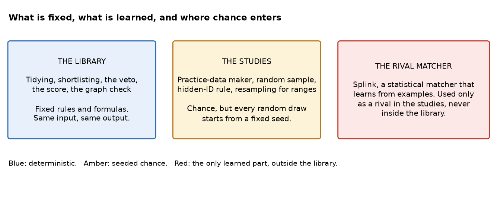
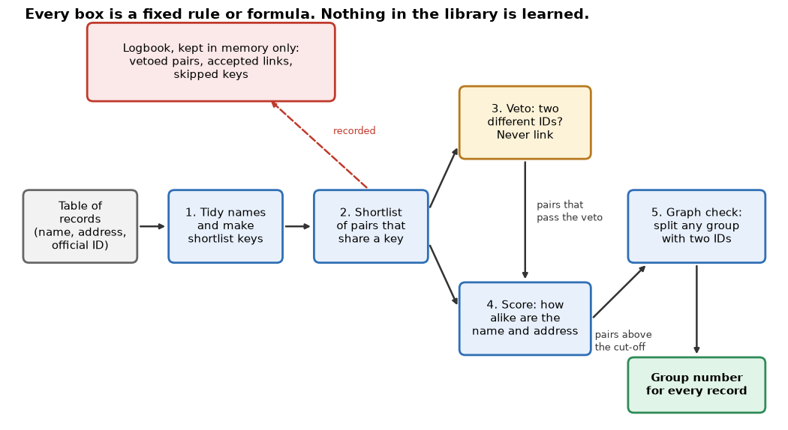
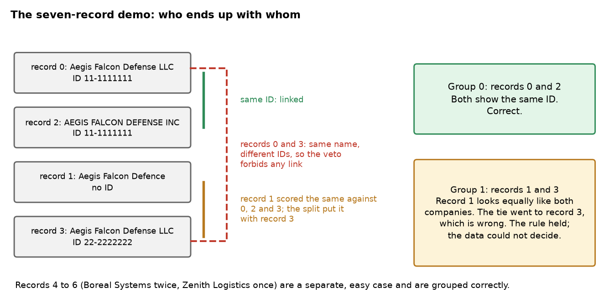
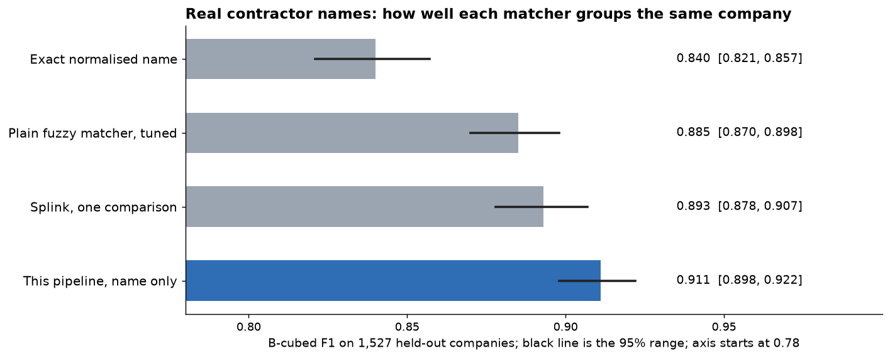
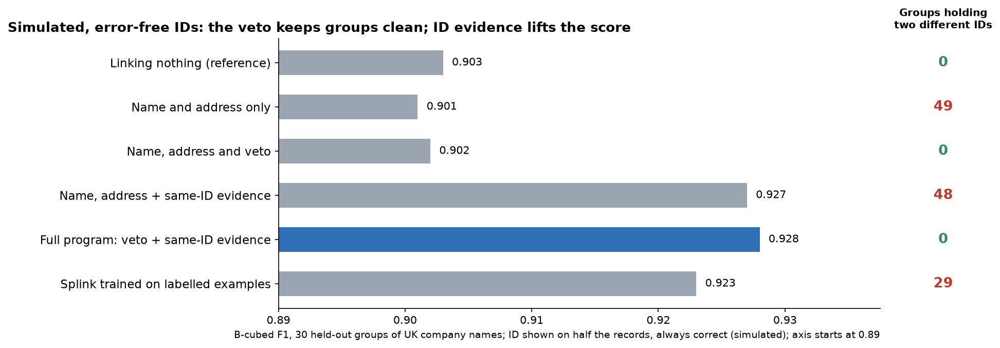

# entity-resolution-gate

*A small program that decides which company records are the same company, with one rule that no similarity score can override, plus a set of measured studies of how well it works.*

Status: a working research prototype (version 0.3), last changed in October 2026. Code: https://github.com/PCSchmidt/entity-resolution-gate (MIT, Massachusetts Institute of Technology, licence: a permissive open-source licence). It is not deployed, and nothing shows that anyone but me has used it.

Suppose a list of suppliers holds "Aegis Falcon Defense LLC", "AEGIS FALCON DEFENSE INC" and "Aegis Falcon Defence". A person sees at once that these may be one company. A computer has to decide that thousands of times, and it can fail in two opposite ways. It can miss a match, so one company is counted as three. Or it can merge two different companies that happen to have look-alike names, and then one firm's contracts are credited to another. The second mistake is usually worse.

I built entity-resolution-gate to test one idea. Many records carry an official ID (identifier), such as a tax number. If two records show two different IDs, they are different companies, however alike the names look. The program treats that as a rule that no similarity score may override. Around the rule it does the usual work: tidy the names, score how alike pairs are, and group the pairs that pass. The larger part of the project is a set of studies on public data that measure whether the rule and the other steps help. The idea is "allowed versus likely": a score says what is likely, and a rule says what is allowed.

Here are the key results, with their scale. The studies grade each matcher with the F1 score, a number from 0 to 1 that is high only when a matcher both finds most of the true matches and avoids false ones. (The chapter on how to read the scores explains it with an example.) First, in every test and study run with the rule and the graph check switched on (both are on by default), no finished group held two different IDs; the one study that switched the graph check off found 6 such groups. Second, using company names alone, the program scored 0.911 on real US defense contractors, 0.026 above a plain fuzzy matcher (one that scores how alike two spellings are) that I tuned as well as I could. Third, on UK company records the full program scored 0.928, about 0.027 above the same program with the ID ignored. For comparison, simply linking nothing scores 0.903 on that data, so that improvement is small in absolute terms.

Three caveats apply to those results, and they matter more than the headline. The UK IDs are simulated: the study took a real company number and showed it on a random half of the records, so whenever it shows it is perfectly correct, which real IDs are not. Most of that UK improvement comes from a switch I call ID shortlisting (an option that also compares any two records showing the same ID, even if their names look nothing alike), and it is off by default, so an ordinary user gets less than the headline unless they turn it on. And the rival matcher I compared against, Splink (a freely available record-matching library that learns from examples), was only lightly tuned, so "beat Splink" means "beat one light setup of it".

The project grew from a longer roadmap item and was trimmed to what could be built and measured. The same matching problem sits behind two of my other projects, Hard Power Intelligence and Grey-Resolve, and defense contracting, whose public records the real-data study uses, is a subject that interests me. AI coding agents wrote almost all of the code. I directed the scope, plan, architecture and preferences.

Here is what is fixed and what is learned. A calculator is deterministic: the same input always gives the same answer. A weather forecast is probabilistic: it is a best guess that can be wrong. The matching program is a calculator. It contains no learned model, and every step is a fixed rule or formula. The same records give the same groups, even when the rows arrive in a different order. A check on a generated table of 300 companies, run twice with the rows shuffled, gave identical groups. Repeatable does not mean correct, though: a deterministic program can be repeatably wrong, and the demo below is one case.

Chance enters only in the studies. The practice data and the sample of real companies are drawn at random, and the studies that report ranges also resample at random. Each draw starts from a fixed starting number (a "seed"), so a rerun repeats it. The only learned part is the rival matcher, which sits outside the program.

If you have ten minutes, read the chapters on what it does, the results, and the strengths and shortcomings.

## What problem this solves

Organisations keep records of the same company in many places, spelled in many ways. To add up contracts, follow suppliers or study ownership, you first have to decide which records are one real company. This is called entity resolution, or record linkage. People do it today with spreadsheets, exact-name matching or fuzzy matching. Fuzzy matching alone cannot tell one "Aegis Falcon Defense LLC" with one tax number from another "Aegis Falcon Defense LLC" with a different one. They are two legal entities that look identical.

The people who face this are analysts working with supplier, vendor or contract data pulled from several systems. The README (the front-page description of a code project) names a few other readers: someone who must explain a merge, someone building a matching tool, and someone comparing matchers. None is shown to exist beyond me.

The goal has two parts. The first is a rule that holds: no group of records may hold two different known IDs. That can be checked by counting rule-breaking groups. The second is evidence about accuracy, measured against plain baselines on data the program was not tuned on. Those measures exist for practice data and two real-data studies. Speed at a hundred thousand records and real tax numbers are hoped for but not measured.

Better matchers already exist. Splink is one. It estimates, from the data, how much each kind of agreement between two records should count. This project does not try to beat such tools everywhere. It is a small, readable test bench for one question: what do hard ID rules add on top of similarity? A skeptic would ask, "Why not just use Splink?" The fair answer is that a Splink trained on labelled examples (pairs a person marked as same or different) came within half a point of this program on the UK data, but it still produced groups that broke the ID rule. Whether a better-tuned Splink would close the gap is not tested.

The project deliberately does less than it could. It enforces one hard rule only. It uses no learned model, no meaning-based text comparison, no executive names and no geography, and it does not try to decide between two equally good candidates. Matching by meaning with vector search, a database extension for it, a run at a hundred thousand records and real tax numbers were all on the original roadmap and were not built.

In short, the project asks whether a hard ID rule earns its place in record matching, and it answers with measurements.

## What it does, step by step

The program takes a table of records. Each record has a number, a name, optionally an address and postcode, and an ID. It returns the same table with a group number added to each record, plus a logbook of what it decided and why. The logbook lives in memory only.

The best everyday comparison is a clerk sorting business cards into piles. The clerk first tidies each card. The clerk does not compare every card with every other card, only cards that start alike. Two cards with different official registration numbers never go in one pile, whatever the names say. Cards that look alike go together, and a last look splits any pile that holds two registration numbers. The comparison breaks down because a clerk can phone someone to check. The program can only use what is written on the cards.

The project's seven-record demo shows the whole path, so here is the picture first.

Four of the seven records are the Aegis Falcon puzzle: two with the same ID (records 0 and 2), one with a different ID but the same name (record 3), and one with a look-alike name and no ID at all (record 1). The two with the same ID link. The two with different IDs are forbidden to link. Record 1 has no ID, so nothing in the data can say which company it belongs to, and the program puts it with the wrong one. The README keeps that wrong answer on purpose, because it shows what the rule can and cannot do: it stops a forbidden merge, but it cannot supply evidence the data do not hold. Put another way, record 1 scores the same against all three other Aegis records, so the data give the program no reason to prefer either company. When the repair step splits the tangled group, it has to place record 1 somewhere, and it places it with record 3. A person with a phone and a few minutes would settle it. The program, which sees only the page, cannot. The other three records are an easy case and are grouped correctly.

Everything is automatic. There is no screen and no review step. A person reads the table and the logbook and decides what to do with them. It is not designed for records with no reliable ID, or for merges that must be proven correct. Use in a government or regulated setting would need approved data, access control and a saved audit trail, and none of these exists here.

In short, records go in and group numbers come out, with a fixed rule standing between a look-alike name and a forbidden merge.

## The parts, the data and the rules

The program has five parts, each with one job. The tidier lower-cases a name, strips punctuation and drops legal words such as LLC (Limited Liability Company) and Inc (Incorporated). The shortlister decides which pairs are worth comparing. The veto refuses any pair with two different IDs. The scorer rates how alike a pair looks. The graph check looks at the finished groups and repairs any that break the rule or look like a chain of weak links. A separate study side holds a practice-data maker, the grading code and the study scripts.

Three rules are enforced in the code. First, a pair with two different known IDs is never linked. Second, no finished group holds two different IDs. The graph check enforces this even when the veto did not catch it. Third, every record needs a unique, present record number. A duplicate or missing number is now refused with an error. Before the latest code change, two records sharing a number merged silently and could put two IDs in one group. That hole was found while an earlier write-up of the project was being checked, and it was fixed with two new tests. The first two rules hold only while the veto and the graph check are switched on, which they are by default, and only for records that actually show an ID.

There are three kinds of data. The first is practice data from the project's own generator: made-up company names with typos, upper-casing and address drift, and "trap twins", which are different companies given the same name and address but different IDs. The second is real contractor names. From USAspending, the US (United States) government's public spending site, the study drew a random sample of 3,000 US Department of Defense contract recipients out of 45,959 in fiscal year 2024 (the US government's budget year). For each one it downloaded the registry profile, which lists the company's names and a UEI (Unique Entity Identifier), the ID the US contractor registry gives each company. The UEI is the hidden answer key and never an input to a matcher. The third is the Companies House register, the official company list of the UK (United Kingdom), with each company's current and previous names and a company number. A company number is not a tax number. The study makes it visible on a random half of records to simulate an ID that is only sometimes present.

Raw downloads are never committed to the repository, only derived numbers. The register's licence was not found, so the project treats that data as research-only.

## How it decides

This chapter follows a record through the steps. The next chapter explains how the results are scored.

Tidying comes first. "The Boreal Systems Inc" and "Boreal Systems Inc" both become "boreal systems". Without this, "Inc" or a leading "The" would count as a difference.

Next is the shortlist. Comparing every record with every other would take far too long on a big table. So each record gets keys, and only records that share a key are compared, as when you sort library books into bins by the first letters of title words and compare only books in the same bin. The program takes the first four words of the tidied name and, for every pair of words, makes two keys. One comes from how the two words sound, using Metaphone (a method that turns a word into a rough pronunciation code). The other comes from their first three letters. "Aegis Falcon Defense" has three words, so it gets six keys. A typo in one word still leaves the other word pairs alike. This is the name shortlist, and it is always on. The optional ID shortlist adds every pair of records that show the same ID, which is how a rename can be found when the new name shares nothing with the old one. Toy example: a firm called "Acme Holdings" is bought and becomes "Zephyr Systems", but both records carry the same tax number. No name key links them, so the name shortlist never proposes the pair. With ID shortlisting on, the pair is proposed, the same-ID rule scores it 1.0, and the two records join. With it off, they stay apart, and the program quietly misses a match it had the evidence to make.

Then the veto. Before scoring, if both records show an ID and the IDs differ, the pair is dropped and logged. Two records named "Aegis Falcon Defense LLC" with IDs 11 and 22 would score a perfect 1.0 on name alone, yet they never link. With the veto switched off, the same input does link them. This is the central rule.

A pair that survives is scored, and the score is a fixed formula. The program rates the names with two measures and keeps the higher. Jaro-Winkler, a measure named for its two inventors, rewards two strings that share a beginning. Token-sort ratio sorts the words alphabetically first, so word order does not matter. For "aegis falcon defense" against "aegis falcon defence", Jaro-Winkler gives 0.98 and token-sort gives 0.95, so the name score is 0.98. If both records have an address, the final score is 70% name and 30% address. The address score for "120 Main St" against "120 Main Street" is 0.85, so the total is 0.7 × 0.98 + 0.3 × 0.85, about 0.94. If either address is missing, the name score stands alone. If the two records show the same ID, the score is 1.0 whatever the names. A pair becomes a link when its score reaches a cut-off, 0.93 by default, so 0.94 links.

Last is the graph check. Links join records into groups. The veto checks pairs, but it cannot see a bridge. In the demo, record 1 has no ID, links to all three other Aegis records and so ties the two companies into one tangled group. The program therefore inspects every group. It repairs a group if it holds two IDs, or if it has more than three records and fewer than half of the possible links, which looks like a long thin chain of weak links. The repair uses Louvain, a standard method that cuts a tangled group along its natural seams: it tries different cuts and keeps the one where records are linked more tightly inside each piece than across pieces. If that cannot separate the IDs, a last fallback sorts the records by ID and attaches each record without one to the ID it is most strongly linked to.

These methods are standard and borrowed from libraries. The project wrote the way they are combined.

In short, the program tidies, shortlists, scores, vetoes and then repairs groups, and each step is small enough to follow by hand.

## How to read the scores

Every result that follows is a score, so this chapter explains them once.

Precision and recall are two ways to be wrong. Precision asks: of the pairs the program linked, what share are truly the same company? Recall asks: of the pairs that truly belong together, what share did the program find? Toy example: suppose 10 pairs of records are truly the same company. A program links 8 pairs, and 6 of them are right. Precision is 6 of 8, or 0.75. Recall is 6 of 10, or 0.60. A program that links almost nothing has high precision and low recall, and one that links everything has the reverse. F1 combines them into one number from 0 to 1 that is high only when both are high. Here it is about 0.67. In the seven-record demo, 4 pairs are truly the same company and the program linked 3 pairs, 2 of them right, so precision is 2 of 3, recall is 2 of 4 and F1 is 0.57.

Counting pairs has a flaw. A company with 300 names has tens of thousands of pairs and swamps everything else. So the studies mainly use B-cubed, the name of a scoring method for groupings that grades each record separately. For each record it asks how much of the group is truly its own company (precision) and how much of its own company the group captured (recall), and then averages over all records. Toy example: a company has four records, and the program puts three of them in one group together with one record of a different company. For each of those three records, precision is 3 of 4, because one of the four group members is a stranger, and recall is 3 of 4, because one of its own company's records is missing. The stranger record is graded the same way, and gets a low recall too. Averaging across all records gives the B-cubed scores. Every F1 in the results chapter is B-cubed F1.

A score only means something against a do-nothing baseline: a program that links nothing at all. Its precision is perfect and its recall is the number of companies divided by the number of records. On the real US contractor data that is 1,527 companies in 4,542 records, so it scores 0.50. On the UK data it scores 0.903, because most companies appear under one name. If linking nothing already scores 0.90, then 0.91 is not impressive.

Two more terms. Held-out data are examples kept aside, never used when adjusting settings, and scored once. A range is a way to show that a score from a finite test is not exact. The studies resample the test companies at random 2,000 times, recompute the score each time, and report the middle 95% of the results. A range that excludes zero for a difference means the difference is probably not luck. It does not prove the test was fair.

The formula, if you want it: the pair score is 0.7 × N + 0.3 × A when both addresses exist, where N is the name score (the larger of Jaro-Winkler and token-sort) and A is the address similarity, halved when the postcodes differ. F1 is 2PR divided by (P + R), where P is precision and R is recall.

In short, F1 rewards finding matches without inventing false ones, and it is only meaningful next to the score of linking nothing.

## What is learned and what is not

The program uses no learned model. There is no language model, no image model and no text-meaning vectors. For this question that is a sensible choice, because the point is a rule that can be checked by counting, and a learned scorer would blur it. The README notes that a learned scorer could later replace the score without touching the veto or the graph check.

The only learned thing is Splink, used as a rival in the studies. Its classic idea is to estimate, from the data, how often matching and non-matching pairs agree on each clue. A table of records goes in, and a match probability for each candidate pair comes out. It runs on a laptop at no cost, which suits a study with a budget of nothing. The repository does not say why Splink was chosen over other tools. The studies use it in three forms: names only without labels, a richer version that adds a few word clues, and a version for the UK study that learns from labelled development pairs. In the UK data the label-free version concluded that matching records usually disagree on the ID, so it linked nothing. The labelled version fixed that, but it still left 29 groups that broke the ID rule. These are light setups, and no test shows how a harder-tuned Splink would do.

In short, the program learns nothing, and the one learned tool is a rival used only for comparison.

## Testing and trying to break it

The test suite has 45 tests, and all 45 pass with none skipped. Nine are property tests, which generate many random inputs and check that a rule always holds. One builds random practice data at random trap rates and cut-offs and checks that no finished group holds two IDs. The tests touch 99% of the program's statements, but they do not cover the 14 scripts or the real-data runs. The tests cannot tell a matcher that is right from one that is wrong. Quality is measured in the studies, not the tests.

Small bad inputs were tried against the rules. Two records sharing a record number, or a missing record number, are now refused with an error. An empty table returns an empty result, and a name of 5,000 letters works. Two records with the same name and different IDs never link, and with the veto off they do. The unfriendly cases are the ones messy real data would hit first. A missing name crashes the program with an unhelpful error. And the same ID written two ways ("11-1111111" and "111111111") counts as two different IDs, so those records are kept apart.

For a stronger test of the main rule, a stress run built 120 practice tables at random trap rates and cut-offs from 0.4 to 0.93. None had a group with two IDs, and 110 of them needed the graph check, so the check was exercised.

The way the studies were run is the project's strongest process feature. Each study's plan was pushed to GitHub before its results, by commit times about 78 minutes before for the random-sample study and about 40 minutes before for the UK study. Each held-out half was scored once, and the scripts refuse to run a second time. The order of events is visible in the history, but nothing shows the held-out data were unseen before the plan was pushed.

Some tests are weaker than their names suggest. One test of the default settings checks two of its three switches, and in another a multiplication by zero makes one check do less than it claims. Neither hides a failure of the main rule, but they show that a passing test count is not the same as proof. The study scripts, where the results are produced, have no tests of their own, so the saved result files and the plan-first habit carry that weight.

In short, the main rule is well tested and hard to break, while messy real-world input is the weak side.

## Does it work? The results

There are three results that matter.

On practice data the rule held, and the program scored well. On tables of 1,000 companies it reached F1 0.91, and not one finished group held two IDs at any size tried. With the veto and the same-ID evidence switched off, 47 groups broke the rule. Scores fell to 0.80 at about 39,000 records, mostly because of a safety limit on the shortlist (described under shortcomings). All practice-data numbers come from data the project made itself, so they show the mechanism, not real-world performance.

**Real contractor names, no IDs.** The study scored matchers on 1,527 held-out companies (4,542 name strings). Each matcher had one setting tuned on a separate half, and then the held-out half was scored once. In the chart, the bars are F1 and the black line is the 95% range.

The names-only program scored 0.911. That is 0.026 above the tuned plain fuzzy matcher (range 0.019 to 0.034) and 0.018 above one light Splink setup. Linking nothing scores 0.50 and the exact tidied name scores 0.84. The difference is mostly in recall, at about the same precision. About 17% of truly matching pairs are renames that share almost no text, and no matcher recovered any. This study cannot say the graph step is why the program won, because public data carry no IDs or addresses, so neither the veto nor the address clue was used.

**Real IDs, UK companies.** This study tests the central idea directly. It cut the Companies House register into 60 groups of 800 look-alike names and held out 30 of them (28,278 records, 23,280 companies). The company number was visible on a random half of the records and was always correct when visible.

The full program scored 0.928 (range 0.923 to 0.932). The same program with the ID ignored scored 0.901, and linking nothing scored 0.903. So the ID evidence is worth about 0.027, and it improved all 30 held-out groups. Almost all of that came from using a matching ID as positive evidence, which lets the program link renames that no name similarity can find, and it needs ID shortlisting to be switched on. The veto alone added only 0.0007 to the score. What the veto does is keep the groups clean: without it 48 groups held two IDs (49 when the IDs were ignored altogether), with it none did. The labelled Splink scored 0.923 but left 29 groups that broke the rule. Because the IDs here are error-free by construction, this is a best case, not a forecast for real tax numbers.

A follow-up asked whether the graph check earns its place. At the tuned cut-off it added almost nothing to F1 (0.0001), though without it 6 groups broke the ID rule. At a loose, untuned cut-off of 0.80 it was a safety net worth 0.20 (0.805 against 0.604), because chains of similar names otherwise merge into giant groups.

Two further limits. The tuned cut-offs sit at the top of the search grid, so a higher grid might change them. And twenty configurations were compared in the UK study, while the printed ranges cover only a few pre-chosen contrasts, so the true uncertainty is wider. The real-data results were not re-run for this guide, because they need large downloads and the held-out stage is one-shot. The key numbers match the committed result files.

What should a reader take from all this? Three things. The rule does what it says: every run with the veto and the graph check on had clean groups, and the runs without them did not. The names-only improvement is real but modest, a few points on a scale where the plain matcher already scored 0.885. And the larger ID improvement shows the idea can work when a trustworthy ID is present and the right switch is on, which is a narrower claim than "the rule makes matching better". The evidence does not yet say how much of it would survive real, error-prone tax numbers.

In short, the rule kept groups clean in every run with the veto and graph check on, names alone gave a few points over a tuned fuzzy matcher, and the larger UK improvement depends on simulated IDs and a switch that is off by default.

## Could it be put into real use?

It has never run outside my own machine and GitHub's test runner. It is not deployed, and no user is shown. If you picture a ladder with four rungs (an experiment, something that works locally, something deployable, something operated), it sits on the second: it runs, passes its own tests and has been measured, but it has no hosting, no monitoring and no users.

As ordinary software it is in reasonable shape. Someone else can run it from the documented quickstart. Automatic checks run the tests and a type check, but nothing stops a drop in quality. It reads a table and returns one, so a re-run does no harm. No person reviews its decisions, and the logbook is not saved, so a failure could not be diagnosed afterwards. No secrets are needed, and a scan of the files and history found none. Package versions are not pinned, so a fresh install picks newer libraries than the numbers came from, yet in a scratch copy the practice-data benchmark reproduced to the digit and all 45 tests passed.

To become deployable it would need packaging, a service wrapper and hosting, a saved log, pinned versions, a quality check in the automatic runs, a rollback plan and a security and licence review. Three small steps would move it most: make ID shortlisting the default or warn when IDs go unused, add a benchmark check that fails when quality drops, and save the log to a file. The reusable pieces are the seeded practice-data generator with trap twins, the grading helpers checked against a slow brute-force version, and the plan-then-results document pattern. It is not a drop-in package.

In short, it works on my machine and is measured, but it is a research prototype, not something to deploy.

## Strengths, shortcomings and the work still to do

The strongest thing about the project is how it treats its own results. The main rule is stated narrowly, tested with random inputs and checked on real data. The baselines include a tuned fuzzy matcher, a link-nothing row and a Splink trained on labels. Negative results are reported as results, and the first real-data pilot, which sampled names alphabetically and so skewed toward names starting with "A", was kept with a correction notice and replaced by a random sample.

The shortcomings fall into three themes.

The first is how far the headline reaches. The best UK result needs ID shortlisting, which is off by default, so a user with IDs would get less than the headline unless they switch it on, and the README summary does not say so. The result also assumes error-free IDs. A study that injected wrong IDs would show how quickly the advantage decays. Then there is the shortlist limit: any key shared by more than 200 records is skipped, so that a very common name cannot create millions of pairs. At 39,369 practice records it skipped 336 key lists and lost many true matches, because the practice generator reuses a small pool of names and so common keys grow very long. The same limit would also skip any list of more than 200 records sharing one ID (checked with 201 records) when ID shortlisting is on. With the limit removed, recall rose from 0.84 to 0.97 but precision fell, and the run took 133 seconds instead of 11. The README calls the drop at large scale "unrelated to the algorithm", which this test contradicts. The simple fix is never to apply the limit to ID lists.

The second theme is input handling and silent drops. A missing name crashes the program, and the same ID in two formats counts as two IDs. Cheap fixes exist: clearer errors, and an optional ID clean-up that stays off by default because an aggressive clean-up could equate different IDs. The logbook records vetoed pairs and links, but not the pairs rejected for a low score, and it does not record when a group repair had to break a tie between equally good placements. It is also kept in memory only. Saving it to a file would make the claim of explainable merges stronger.

The third is documentation that lags the code. The README says 43 tests and there are 45. It says the type check over the scripts is clean, but a plain install reports 8 errors. The automatic runs do less than the README implies: no style check and no protection on the main branch. These are cheap to correct, and an automatic quality check is the change most likely to raise a hiring manager's confidence. The study scripts are also untested.

The cost is nil: no paid service, key or graphics card. A 2,021-record table takes about half a second, and 39,369 records about 11 seconds. The real-data studies need large downloads. Promised versus built, the core is complete and tested, and the three real-data studies are built with results committed but not re-run here. The repository has no stubs, no to-do notes and no skipped tests.

The next milestone I would suggest is small: fix input handling, correct the README, turn on the ID default or add a warning, and add a quality check that fails when a deliberate regression is introduced. After that comes a saved log, and then the wrong-ID study. The one-rule design and the absence of a learned model should be left alone, since both are the point. The project is worth polishing and freezing rather than growing.

In short, the shortcomings are mostly small and cheap to fix, and the one that matters most is that the best result needs a switch that is off by default.

## How it was built, and who did what

AI coding agents wrote almost all of the code, the tests, the study scripts and first drafts of the documents. The commit history credits Claude models on 29 of 30 commits: Claude Sonnet 5.5 on 28 and Claude Opus 5.5 on one. All commits are under my name. The repository holds no agent instruction files, and no credit for any other tool appears. I directed the scope, the plan and the architecture.

What I decided is visible in the documents: which question to ask, that each study's plan be written before any result, that the held-out half be scored once, and that failures be reported. The studies' deviation logs list each change made after development results were seen and before held-out scoring. The history says little about the agents' mistakes, since most of the work landed on one day and a few large commits are mostly saved result files. The duplicate-record-number hole was found in a review and fixed with tests, and the project itself disclosed the sampling flaw in its first pilot.

In short, this is an agent-written project that I directed, whose strongest process feature is its written plans and honest correction notes.

## For recruiters and interviewers

**In thirty seconds.** I directed AI coding agents to build a small company-matching program and then measured, on real public data, how much a hard "different official IDs mean different companies" rule helps. The rule held in every run with its default switches. On names alone the program beat a well-tuned standard matcher by a few points, and with ID evidence on simulated-perfect UK IDs it did a little better again. I report the weak results too. **In two minutes**, add that each study was written down before its results, the held-out test data were scored once, a rival tool was included, and nothing has been used by real users.

**What it shows, in plain terms.** The main thing is care in measuring: plans written first, honest comparisons against simple alternatives, ranges instead of single numbers, and corrections published rather than hidden. It also shows judgment about a narrow, checkable promise, and that I can direct AI coding agents toward a result I can defend. It does not show that I can build a machine-learning model, run a service for users, work on a team, scale to large data, or write the code by hand.

My current targets are AI engineer and forward-deployed AI engineer (an engineer who sits close to a customer and fits AI tools to their problem), and applied AI or machine-learning engineer roles. This project is a weak fit for all of them, because it contains no learned model and has never been deployed. The closest match is the measurement side of an applied machine-learning role: designing fair comparisons and being straight about what they show.

| What a role usually wants | What this project shows | How strong |
| --- | --- | --- |
| Measuring the quality of an AI system | Held-out tests, baselines, ranges, reported failures | Demonstrated |
| Clean, tested code | 45 passing tests, automatic test runs, but no quality check on results | Partly |
| Building data-handling code | A small matching library, not a full production flow | Partly |
| A person checking the AI's output | None; the log could support it | Not shown |
| Putting a system into use and running it | Never deployed, no model | Not shown |

Questions a recruiter could put, and what a sound answer sounds like. *How do you know it works?* Each study's held-out data were scored once, against simple baselines and with ranges, and the key numbers match the saved result files; the real-data studies were not re-run for this guide. *If AI wrote the code, what did you do?* Set the question, the plan and the rules of measurement, and decided what to publish. *What would you change first?* Turn the ID option on by default or warn when it is unused, fix the crash on a missing name, and add an automatic check that fails when quality drops. *Have you run it for real users?* No.

Two cautions for a reader skimming this section. First, "the rule held" is a statement about a counted property, groups that contain two different IDs, and not about overall accuracy, which is lower than the headline whenever records carry no ID. Second, the results come from one author's own studies on public data, run on a laptop; nobody independent has repeated them. Those are the facts a fair summary of the project should carry.

A five-minute demo would run the seven-record example and point out the wrong answer for record 1, open the UK results chart, and show a plan file next to its results file.

What not to exaggerate: the rule needs IDs and its switches on, the real-data improvement needs ID shortlisting switched on and perfect IDs, and there is no model, no deployment and no user.

In short, the evidence here is mainly about careful measurement on a small matching problem, and it is thin about production.

## Glossary

- **Entity resolution:** deciding which records describe the same real thing, like deciding which business cards belong to one company.
- **ID (identifier):** an official number for a company, such as a tax number or registry number.
- **Veto:** a rule that forbids a link whatever the score says.
- **Shortlist key:** a short code made from a name, so that only records sharing a code are compared. ID shortlisting also compares records that show the same ID.
- **Cut-off:** the score at which a pair is linked.
- **Precision, recall, F1:** the share of links that are right, the share of true matches found, and one number that combines them.
- **B-cubed:** a scoring method that grades each record, so one huge company cannot dominate.
- **Held-out data:** examples kept aside and scored once, after all tuning.
- **Baseline:** a simple method used as a yardstick.
- **Range:** the middle 95% of scores from rerunning a test on many random resamples of its data.
- **Seed:** the starting number that makes a random process repeat.
- **Louvain:** a method for cutting a tangled network into tightly linked pieces.
- **Trap twin:** in the practice data, a different company with the same name and address and a different ID.
- **Splink:** a statistical record-matching library.
- **UEI (Unique Entity Identifier):** the ID the US contractor registry gives each company.
