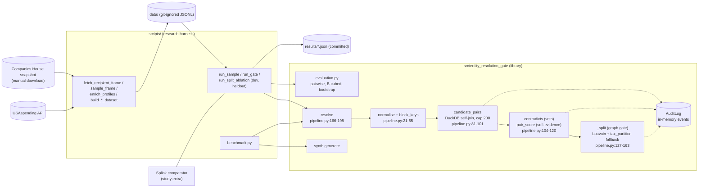
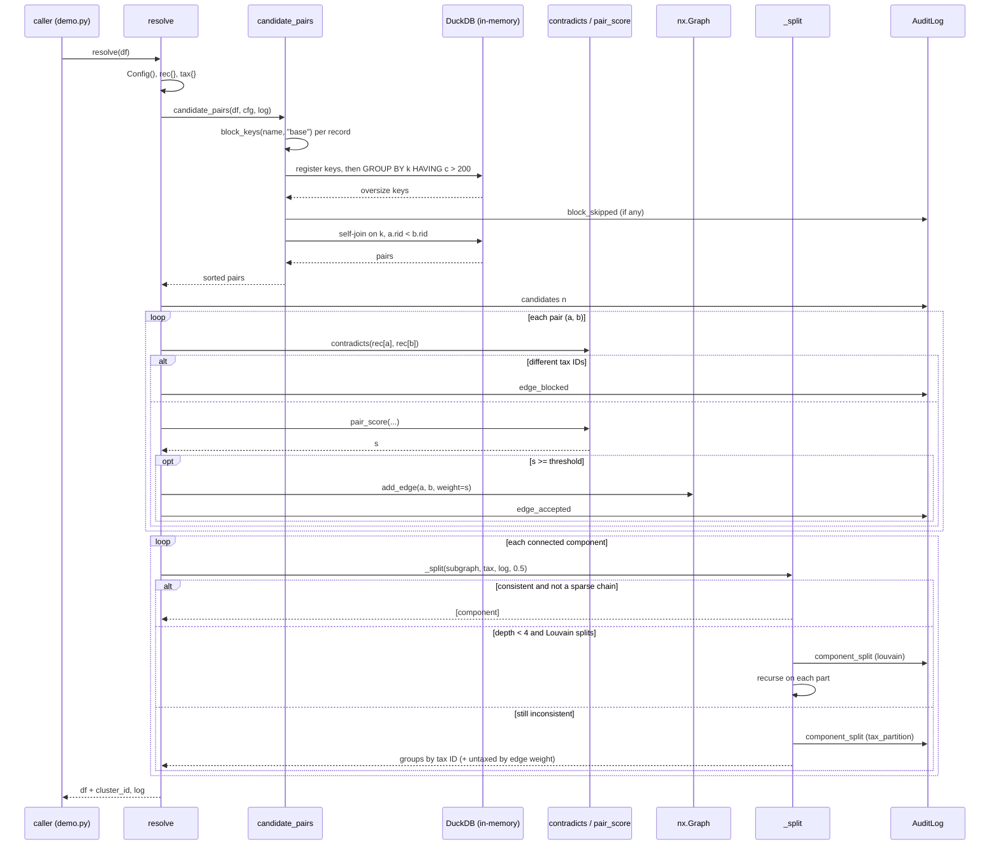
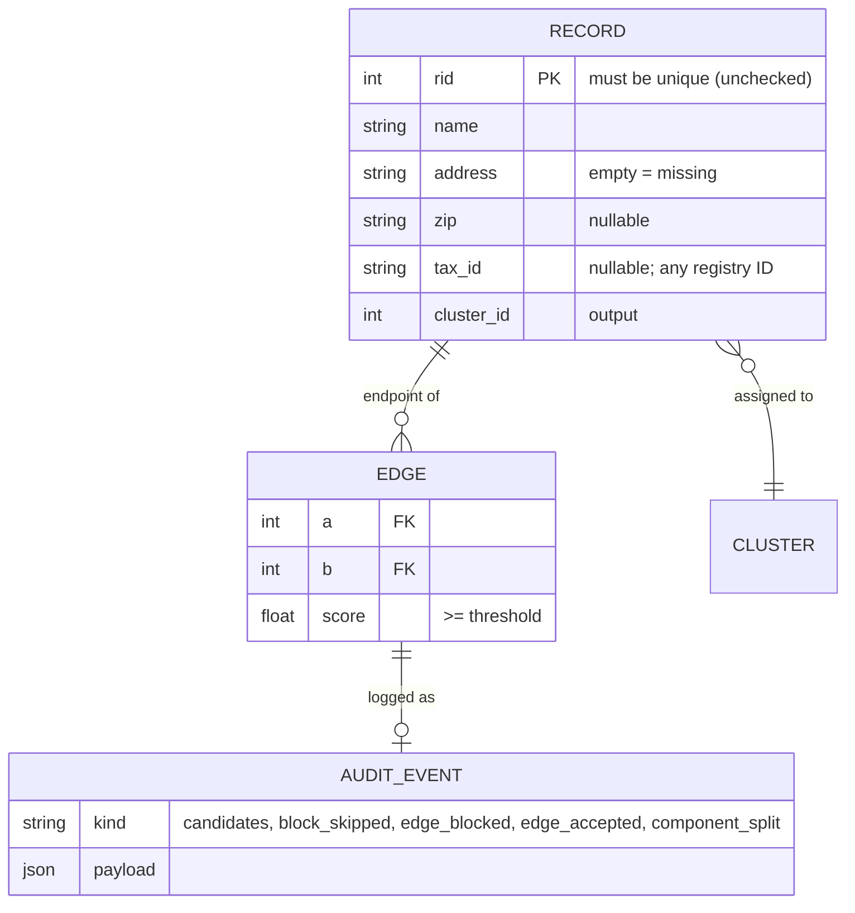
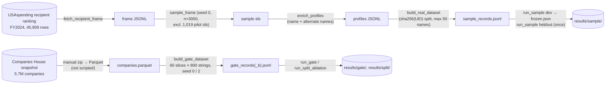
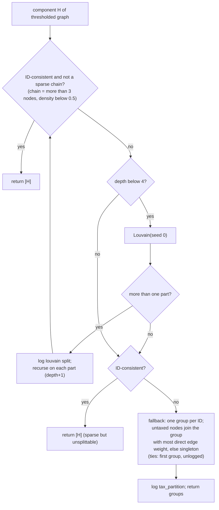
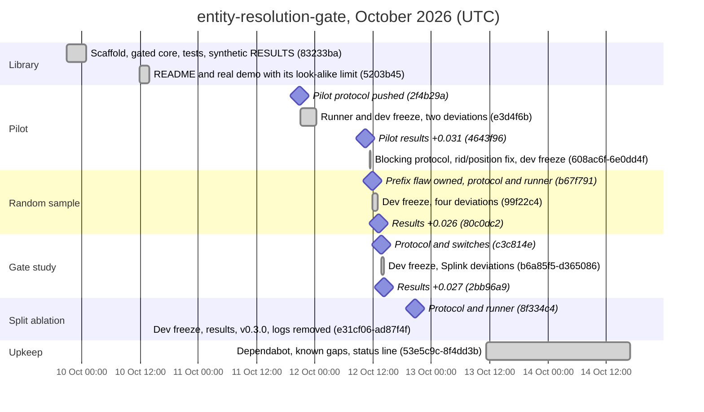

# entity-resolution-gate — Master Explainer

Repo: <https://github.com/PCSchmidt/entity-resolution-gate> · Live demo: none · License: MIT · Last commit: 2026-10-14 (`8f4dd3b`)
Status: prototype / portfolio research study (v0.3.0) · active burst 2026-10-09 → 2026-10-14; "paused or done" is [Unknown]
Explainer generated: 2026-10-18 by Claude Code (Opus 5.5) · Questionnaire v1.1 · Depth: FULL · Review folded in 2026-10-18; author answers pending · Map: `entity-resolution-gate.map.md` (v1.0 draft kept at `entity-resolution-gate.v1.0.md`)

> Tags: **[Verified]** seen in code/commits/CI, **[Measured]** run in this session or by the independent reviewer's read-only probes, **[Documented]** stated in the repo's docs, **[Author]** a confirmed line of `AUTHOR_CONTEXT.md`, **[Inferred]** reasoned, **[Proposed]** not in the repo, **[Unknown]** goes to §26. Claim check levels (L1/L2/L3) are defined in §11. All line numbers refer to commit `8f4dd3b`. Each fact has one home; elsewhere it is referenced by ID (W-…, CL-…, §n).

## TL;DR

**V.1** A small Python library that decides which company records are the same company, using fuzzy name and address similarity as evidence but a hard rule as the boundary: two records with different verified identifiers can never end up in one group. [Verified] `pipeline.py:166` `resolve`, `_split`

**V.2** It is aimed at anyone merging supplier or contractor data from several sources, where a wrong merge (one firm's contracts credited to another) is worse than a missed one. What makes it interesting is less the matcher than the evidence: five pre-registered protocols on public data (three current studies plus a two-part pilot kept as superseded), a tuned plain-fuzzy baseline and Splink comparators, held-out halves scored once, bootstrap intervals, and negative results kept (a flawed pilot, a hypothesis that failed, a component that adds ~0 F1) [Verified] `docs/`, `results/`. On UK company-register data where an identifier is visible on half the records, the full gate beats the same pipeline without the identifier by 2.7 B-cubed F1 points with zero rule-breaking clusters [Verified, L1] `results/gate/heldout_results.json`. The repo's own decomposition shows that gain is almost all same-ID evidence (+0.026), not the veto (+0.0007) [Documented] README status line, `RESULTS_GATE.md` G3. This review adds three things. The default `Config` proposes pairs only through name keys, so same-ID renames are never scored, while the headline used `tax_blocking=True`; how much of the gain the defaults lose is unmeasured (W-SCOPE-1) [Verified]/[Inferred]. Malformed input (a duplicate record ID) silently voids the guarantee, because `resolve` never checks its preconditions (W-CODE-1) [Measured]. And because the visible ID is the answer key itself, ID evidence in the UK study is error-free, so +0.027 is an upper bound for a perfectly reliable identifier (W-EVAL-1) [Verified] `run_gate.py:85-86`.

## Repository fact sheet

The map file holds the Phase 1 working notes; this table is the canonical home for counts, test results and the clean-clone run.

| Field | Value | Tag |
| --- | --- | --- |
| Name · URL · visibility · licence | entity-resolution-gate · github.com/PCSchmidt/entity-resolution-gate · public · MIT | [Verified] `gh api` |
| One-line description (from code) | blocking → weighted string score → must-not-link veto → graph repair, with an audit log | [Verified] `pipeline.py` |
| Category / flags | library + research study · `[MATH]` `[DATA]` `[RESEARCH]` (no `[UI]` `[API]` `[AI]` `[AGENT]` `[DEPLOY]` `[FORK]`) | [Inferred] |
| Size | 64 tracked files; library 414 lines in `src/`; 14 study scripts (2,260 lines); 11 docs (761 lines); 22 result JSON files (116 B to 134 KB) | [Measured] `git ls-files`, `wc -l` |
| History | 27 commits on `main`, 2026-10-09 → 2026-10-14; 18 on 2026-10-12 (commit dates in their own −0400 offset); tag `v0.3.0`; 26/27 commits carry a `Co-Authored-By: Claude Sonnet 5.5` trailer; one branch | [Verified] `git log` |
| Entry points | library API (`resolve`, `generate`, `pairwise_prf`, `Config`, `AuditLog`); `examples/demo.py`; `scripts/benchmark.py`; five `run_*.py` study runners (`dev`/`heldout` stages); fetch/build scripts | [Verified] |
| Clean clone | `uv venv .venv --python 3.12`; `uv pip install -e ".[dev]"` → OK; `examples/demo.py` → `UnicodeEncodeError` when stdout is redirected on Windows (cp1252), fine with `PYTHONIOENCODING=utf-8` (W-UX-2); no env vars or keys | [Measured] |
| Tests | `pytest -q` → **43 passed, 0 failed, 0 skipped** (12/8/11/6/6 per file) in 22.4 s; 43 passed inside Docker; coverage 99% of 267 package statements | [Measured] |
| Lint / types | `ruff check .` clean; `ruff format --check .` 7 files would change; `mypy src tests` clean; `mypy src tests scripts` 1 error with the `study` extra, 8 without | [Measured] |
| CI | one job `test` (Python 3.12): `pip install -e ".[dev]"` → `mypy src tests` → `pytest -q`; last two `main` runs green; Dependabot monthly (2 Actions PRs open) | [Verified] `.github/workflows/ci.yml`; [Measured] `gh run list` |
| Benchmark | `scripts/benchmark.py` reproduces every README quality number exactly | [Measured] |
| Live demo / video | none | [Verified] |
| External services and paid APIs | none at runtime; studies read the public USAspending API and a manually downloaded UK Companies House snapshot; no keys | [Verified] |
| AI coding tools evidenced | Claude (commit trailers); no agent instruction files or config dirs | [Verified] |
| Related repos | one of the evaluator-gated roadmap studies (family grouping is ⚠ in AUTHOR_CONTEXT, so [Inferred]); README links Hard Power Intelligence and Grey-Resolve; no shared code | [Documented]/[Inferred] |
| Headline claims | 34; audited in §11 (CL-01…CL-34) | [Verified] |
| Scripts that write tracked files (not run here) | `run_*.py dev` overwrites `dev_sweep.json`/`frozen.json` unguarded; `heldout` writes once (guarded); `*_posthoc.py` write `posthoc*.json`; fetch/build write ignored `data/` | [Verified] `grep write_text scripts/` |
| Tests needing external resources | none (no network, GPU, Docker or markers; one `parametrize`) | [Verified] |

---

## 1. For everyone: what it does and why it matters (A)

**A.1 ★** It takes a list of company records that may be spelled differently ("Aegis Falcon Defense LLC", "AEGIS FALCON DEFENSE INC") and works out which ones are the same company, while promising never to merge two records whose official ID numbers say they are different companies. [Verified] `resolve`

**A.2 ★** Large organisations keep supplier lists in many systems, and the same supplier appears under slightly different names. To count spend per supplier, or see who is connected to whom, you first have to merge those. People do it with spreadsheets, exact name matches, or "fuzzy matching" tools that score how similar two names look. Fuzzy matching has a nasty failure: two different firms with nearly the same name get fused, so one firm's contracts are credited to another. [Documented] README "What is this?"

**A.3** A realistic user is an analyst reconciling contractor records from two procurement databases. Without the tool: hours of manual checks, or a fuzzy match she can't fully trust. With it: a grouped list, plus a log saying why each pair was joined, refused or split. [Inferred] from README "Who it is for"; no real user is evidenced (A.16).

**A.5 ★ Analogy.** A careful wedding seating planner. Guests who look alike (similar names, same street) are seated together because they are *probably* family. But the planner has one rule she will not break whatever the resemblance: two guests holding different family passports never share a table. If a chain of "probably related" guests would force two passport-holders together, she splits the table, and anyone without a passport sits with the family they seem most connected to. When a passport-less guest looks equally like two families, she still has to pick one, and today her notebook doesn't say it was a coin toss (W-ARCH-1). [Inferred]

**A.6** The surprise is in the evidence: when an ID number is visible on half the records, using it as proof of a match recovers renamed companies ("Borealis Marine" that became "Quartz Holdings") that no name comparison could find. [Documented] `docs/RESULTS_GATE.md` (rename recall 0.258 vs 0.000)

**A.7** The library only processes what you give it; the studies used fixed downloads (2024 US defence contractor names; a UK register snapshot of 2026-10-01). [Documented]

**A.8** Trust the one promise (no two different IDs in a group, given well-formed input) and treat everything else as "probably right". On a standard grouping score it reaches 0.91 out of 1 on US contractor names, against 0.885 for a well-tuned simple matcher; on the UK data even "merge nothing" scores 0.90, so the differences between methods matter more than the level. It cannot tell apart two look-alike firms when the record has no ID, and the README demo shows that on purpose. [Verified] `results/sample/heldout_results.json`; `results/gate/heldout_results.json` `no_merge.b3_f1` 0.9031

**A.9–A.12** There is no AI model in it; the similarity is a hand-written formula. It can't match a fully renamed company unless the records share an ID (about 17% of true US pairs), doesn't model parent companies, other identifiers or non-English legal suffixes, and has been run only to about 40,000 synthetic records. It costs nothing beyond a laptop and sends nothing anywhere. [Verified]/[Documented] README "What it is not", "Limitations"

**A.13–A.14** Built over about five days (9 to 14 October 2026) by Chris Schmidt directing an AI coding assistant; who did what is in §17. [Verified] `git log`

**A.15–A.16** To sell it you would need real identifiers, a larger and faster pipeline, a learned scorer, a review interface and a trial with a procurement team [Inferred]. Today nobody outside the author uses it (0 stars, 0 forks); its value is as a worked, honest example of a "rules before trust" design. [Verified] `gh api`

Improvement records: none specific to Part A.

---

## 2. Purpose, problem, users and use cases (B)

**B.1 ★ Problem.** Record linkage of organisations across sources where (a) names vary, (b) look-alike names belong to different legal entities, and (c) some records carry an identifier that is authoritative when present. False merges corrupt downstream attribution; fuzzy scores alone can't separate identical-looking twins. [Documented] README

**B.2** Motivation: "the entity-resolution step behind the kind of analysis I do on defense and federal-contracting data (the Hard Power Intelligence and Grey-Resolve projects ...)" and "the portfolio's 'probabilistic evidence, deterministic boundary' idea applied to record linkage"; it "began as an item in a longer roadmap". [Documented] README "Motivation", "Known gaps". Who wrote the roadmap and why this item was picked: [Unknown]

**B.3** Prior knowledge: AUTHOR_CONTEXT gives an applied-mathematics background [Author]. Prior record-linkage experience is [Unknown]. What had to be learned is visible in the docs: B-cubed was adopted after pairwise F1 was swamped by one 256-alias entity (`PROTOCOL_SAMPLE.md` Deviation 2); Splink's EM failure mode was diagnosed (`PROTOCOL_GATE.md` Deviation 4). [Documented]

**B.4 Assumptions.** (1) A verified ID is never shared by two entities and never wrong: true by construction in the UK study because the visible ID *is* the answer key (W-EVAL-1); untested for real IDs. (2) Similarity thresholds transfer: did not hold (0.93 synthetic, 0.87 USAspending, 0.99 UK; `results/*/frozen.json`). (3) The graph step improves accuracy: did not hold at tuned thresholds (+0.0001), held at loose ones (`RESULTS_SPLIT.md`). (4) Better blocking would raise F1: did not hold twice. (5) A token-sort-only score would fix prefix chaining: did not hold (−0.018). [Verified]/[Documented]

**B.5** Designed to show: record linkage, constraint enforcement on graphs, evaluation design (pre-registration, baselines, bootstrap), honest reporting. Target roles are now [Author] 2026-10-18: "AI Engineer, Forward Deployed AI Engineer" in that priority order (AUTHOR_CONTEXT ANSWER 2), which confirms the earlier ⚠-derived reading; how well this repo serves either role stays [Inferred].

**B.6–B.7 Requirements (reconstructed).** Essential: group records into clusters (`resolve`); never cluster two different non-null IDs (`_split`, README "Guarantee"); log every blocked, accepted, skipped and split decision (`AuditLog`); deterministic output (`test_deterministic_and_audit_log_is_json`, sorted pairs `:101`). Desirable: ablation switches (`Config:58-71`), a synthetic generator with traps (`synth.py`), metrics (`evaluation.py`). Missing: input validation (W-CODE-1). Non-functional: determinism, offline operation and strict typing for `src`/`tests` are met; explainability is met for edges and splits but not tie-breaks (W-ARCH-1); scale beyond 40k is not met. [Verified]

**B.8–B.10 Constraints and changes.** Public data only (no public US tax IDs, so a UK company number stands in); one laptop; no keys (SEC EDGAR and GLEIF wanted a contact address "which I did not supply"). Not built from the roadmap: BM25/embedding blocking, pgvector, executive and geographic features, Leiden, a 100k+ run, real tax IDs/CAGE codes (README "Known gaps"). Changed: primary metric pairwise → B-cubed (`99f22c4`); missing address from "perfect match" to "no evidence" (`c3c814e`); pilot sampling superseded (`b67f791`). [Verified]/[Documented]

**B.11 ★ Users.** Primary: a data engineer or analyst merging organisation records with a partial identifier column, comfortable in Python/Polars. Secondary: a reviewer auditing merges via the log. Edge: someone evaluating matchers. Poorly served: anyone without an identifier, anyone needing a UI or service. [Documented] README "Who it is for"

**B.12 ★ User stories** (status lives in §3):

1. As an analyst, I want records with different verified IDs never merged, so that no firm is credited with another's contracts.
2. As an analyst, I want a renamed company's records linked when they share an ID, so that name histories don't split one firm.
3. As a reviewer, I want to see why two records were joined or kept apart, so that I can defend the merge.
4. As a matcher developer, I want a seeded benchmark with traps, so that I can compare methods.
5. As a data engineer, I want to process 100k+ records.

**B.13–B.17** Journey: a Polars frame with `rid, name, address, zip, tax_id` → `resolve(df, Config(...))` → `cluster_id` plus an `AuditLog`. Bad input: K.10. Fully automated, with no review queue for uncertain merges. It could deduplicate any named, ID-bearing entity, but people would need privacy controls it lacks. Poorly served: non-English names (`_LEGAL`, `pipeline.py:17`), very large inputs, streaming. [Verified]/[Inferred]

**B.18 ★ Out of scope.** Learned matching, embeddings, executive names, geography, deciding ambiguous untaxed records: "It does not decide which of two ambiguous records is right; it only guarantees it will not break a rule it was told is absolute." [Documented] README "What it is not"

**B.19 ★ Success measures.** Measured: B-cubed F1 (primary), pairwise P/R/F1, rule-breaking clusters, false-merge pairs, rename recall, pair completeness, synthetic wall time. Not measured: anything about users or time saved. [Verified] `results/*/heldout_results.json`

**B.20–B.23** Failure for a user: a false merge of two ID-bearing firms (prevented on valid input) or a confident-looking wrong cluster for an untaxed record (not flagged). Whether the author considers v0.3 done is [Unknown]. It shares the portfolio's "probabilistic evidence, deterministic boundary" thesis [Author], with no shared code. A regulated setting would need real identifiers, canonicalisation, an SBOM, input validation and a tamper-evident persisted log. [Inferred]

Improvement records: W-SCOPE-1 (§20); Low: W-SCOPE-2.

---

## 3. Capabilities inventory (B.12, J.1)

| Capability | State | Evidence |
| --- | --- | --- |
| Name normalisation (lowercase, strip punctuation and English legal words) | implemented | [Verified] `pipeline.py:21-22` |
| Token-pair Metaphone + prefix blocking, 4 modes | implemented, property-tested | [Verified] `block_keys`, `tests/test_blocking.py` |
| Oversize-block skip with log | implemented, **untested** (`pipeline.py:92` uncovered) | [Measured] coverage |
| Optional ID blocking | implemented, **off by default** (B.12 story 2 is therefore partial under defaults) | [Verified] `Config.tax_blocking=False`; W-SCOPE-1 |
| Hard veto on two different IDs (story 1) | implemented, tested; holds only on well-formed input | [Verified] `contradicts`, `test_contradiction_rule`; W-CODE-1 |
| Same-ID positive evidence (score 1.0) | implemented, on by default, but only for pairs blocking proposes | [Verified] `pair_score:105-106` |
| Weighted name/address score | implemented | [Verified] `pair_score` |
| Connected components + Louvain split + guaranteed fallback | implemented, property-tested on synthetic data | [Verified] `_split`, `test_no_cluster_ever_holds_two_tax_ids` |
| Split modes `louvain` / `tax_only` / `none` | implemented, tested | [Verified] `tests/test_split_modes.py` |
| Audit log (story 3) | implemented in memory; edges and splits logged; tie-breaks in the fallback **not** logged | [Verified] `AuditLog`; [Measured] X-u-Y probe |
| Synthetic generator with traps (story 4) | implemented | [Verified] `synth.py` |
| Pairwise, B-cubed, entity and slice bootstrap metrics | implemented, brute-force-checked | [Verified] `tests/test_evaluation.py` |
| Real-data study harnesses (5 runners: 2 pilot, 3 current) | implemented; not re-run (one-shot, need downloads) | [Verified] scripts |
| Input validation; ID canonicalisation | **absent** | [Verified]; [Measured] probes |
| Embedding/BM25 blocking, Leiden, extra features, 100k+ run (story 5), learned scorer | **planned, not built** | [Documented] README "Known gaps"; CL-34 |

---

## 4. Domain perspective (C)

**C.1 ★ Domain concepts.** Entity (a legal organisation), record (one name string with optional address, postcode, identifier), identifier (`tax_id` in the API; UEI as answer key in the US study; Companies House company number as both visible ID and answer key in the UK study), alias/name history, legal-form suffix. Usage matches practice: a UEI identifies a registration, not necessarily a corporate group, and the docs say same-name/different-UEI pairs "may be one organisation registered twice" (`RESULTS_REAL.md`). [Verified]/[Documented]

**C.2–C.5** Standards ignored: EIN format, CAGE, LEI (ISO 17442), ISO 3166, legal-form lists (ISO 20275); B-cubed follows convention. Misleading simplifications: IDs treated as reliable and canonical, so one typo becomes a permanent split (W-DOM-1); "same entity" is flat (no corporate families); address is one string ratio, worth only +0.0012 in the UK study (`RESULTS_GATE.md` G5). Edge cases: renames (17% of US true pairs, ID evidence only), numbered series ("GG 1 2"), aggregate registrants (excluded above 50 names, `PROTOCOL_SAMPLE.md` Deviation 2); mergers and transliteration absent. Missing constraints: parent-subsidiary, temporal validity, jurisdiction, dissolved-name reuse. [Documented]/[Inferred]

**C.6 Data sources** `[DATA]`

| Source | Access | Licence/terms | Coverage | Cost |
| --- | --- | --- | --- | --- |
| USAspending `spending_by_category/recipient` (sampling frame) | REST POST, no key | US government data; exact terms not cited | 45,959 DoD contract recipients FY2024 | free; retries with backoff |
| USAspending `recipient/<id>/` (profiles, alternate names) | REST GET | as above | 3,000 sampled recipients | free |
| USAspending `spending_by_award` (pilot) | REST POST | as above | first 10,000 awards in name order only (the pilot flaw) | free |
| UK Companies House "free company data" snapshot 2026-10-01 | manual zip download, converted to Parquet by hand | README: "I did not find a licence statement ... used for research only" | 5,704,712 live companies | free |
| Synthetic generator | code | n/a | up to 20k entities (4,032 base names) | n/a |

[Documented] `PROTOCOL_*`, README; [Verified] script URLs

**C.7 Authority and bias.** USAspending recipient profiles are noisy (one entity with 256 aliases including credit unions and a county). The sample weights recipients equally, so small firms dominate. Companies House is authoritative for UK company numbers; live companies only, so dissolved lookalikes are absent. [Documented]

**C.8–C.9 Provenance and staleness.** Inside the library each output row keeps its `rid` and the log references `rid`s, so a merge traces to scored edges. In the studies only derived numbers are committed; raw inputs are git-ignored and unhashed (W-DATA-1). Contradictory IDs are blocked and logged; staleness isn't handled. [Verified]

**C.10–C.13 Method and validation.** A rule-based matcher with a must-not-link constraint; a practitioner would ask why the soft part isn't probabilistic, and the repo answers by comparing with Splink. Edge scores are logged, but clusters carry no confidence and tied assignments aren't flagged (W-ARCH-1); study results carry bootstrap and Bonferroni intervals. Validated: metrics (brute-force tests) and the guarantee (proof plus property test). Heuristic: the constants in W-MATH-1. [Verified]

**C.14–C.16** Domain-expert review: none evidenced [Unknown]. A professional would trust the narrow promise once input validation and canonicalisation exist, but not untaxed merges (no per-cluster confidence, no review queue). Industry tools (Splink, Zingg, dedupe.io, Senzing, Quantexa, AWS Entity Resolution) mostly offer deterministic rules alongside learned scoring; the contribution here is a measured demonstration, not a new capability. [Inferred]

**C.17–C.20** Harm: wrong untaxed merges misattribute contracts; zero rule-breaking clusters is not zero wrong merges (`P_full` keeps 246 false-merge pairs, `RESULTS_GATE.md`). Company data, not personal; Companies House licence unconfirmed. To win practitioners: their data, real IDs, injected ID errors, false merges per 1,000 clusters, reviewer time [Proposed]. The skeptic's first question ("your registry ID is the answer key") is W-EVAL-1.

Improvement records: W-DOM-1; Low: W-DOM-2.

---

## 5. Codebase guide (D)

Full Part D answers are in the map file; the essentials:

**D.1 ★** Core: `src/entity_resolution_gate/` (pipeline, evaluation, synth) and `tests/`. Supporting: `scripts/` (study harness), `docs/` (protocols and results), `examples/`. Generated: `results/`. Deletable with low impact: the superseded pilot (`results/real`, `results/blocking`, `run_blocking.py`, `fetch_usaspending.py`), though `run_sample.py` imports from `run_real.py`. [Verified]

**D.2–D.3 ★** Entry points and the clean-clone run: fact sheet.

**D.7 ★ / D.8 ★** Most important: `resolve` (`pipeline.py:166-198`) and `_split` (`:127-163`); walkthrough in §7 F.3.

**D.9** Most non-obvious: the fallback in `_split` (`:147-163`), whose placement of untaxed records breaks ties by group order without logging; and the weighted bootstrap in `boot_f1` (`evaluation.py:69-82`) and `run_gate.metric` (`scripts/run_gate.py:319-335`).

**D.11** Clean functional core: no I/O in `src/`. [Verified]

**D.13 / D.15 / D.16** No input validation (W-CODE-1). Strictly typed, compact, comments explain *why*; `ruff format` would change 7 files. Small smells: duplicated profile-dict code in `enrich_profiles.py`, a `* 0` term in a test assertion and a misnamed defaults test (K.6). [Verified]/[Measured]

**D.17 ★** Docs-vs-code discrepancies: §24.

**Shortcomings pass (W.3).** Dread file: `scripts/run_gate.py` (459 lines, imported and mutated by another script). Domain logic is not tangled with I/O.

Improvement records: W-CODE-1; Low: W-CODE-2, W-UX-2.

---

## 6. Tech stack and rationale (E)

| Layer | Technology + version | What it does here | Why chosen | Alternatives | Trade-off accepted |
| --- | --- | --- | --- | --- | --- |
| Language | Python ≥3.11 (CI 3.12; measured on 3.12.13) | everything | [Unknown] | Rust, Go, Spark | single-thread speed |
| Dataframes | Polars (`>=1.0`; resolved 2.0.0) | input/output tables, dataset building | [Unknown] | pandas, DuckDB only | a second dataframe API next to DuckDB |
| Blocking engine | DuckDB (`>=1.0`) | in-memory self-join on block keys | [Unknown]; README stack table names it | Polars join, Python dict | a SQL engine for one join |
| Graph | NetworkX (`>=3.2`; resolved 3.7) | components, density, Louvain | [Unknown] | igraph, union-find + leidenalg | pure-Python speed |
| String similarity | RapidFuzz (`>=3.6`; 3.14.6) | Jaro-Winkler, token-sort, ratio, `cdist` | [Unknown] | jellyfish, textdistance | none significant |
| Phonetic | jellyfish (`>=1.0`) | Metaphone block keys | [Unknown] | Double Metaphone, Soundex, NYSIIS | English-centric codes |
| Numerics | NumPy (`>=1.26`; 2.5.4) | metrics and bootstrap | declared in `96e70f3` [Verified]; why [Unknown] | — | — |
| Comparator | Splink (`>=4`, `study` extra; resolved 5.0.0) + pandas | Fellegi-Sunter baseline in the studies | [Unknown]; a richer variant was added per `PROTOCOL_REAL.md` Deviation 2 | dedupe, Zingg, recordlinkage | heavy optional dep |
| Testing | pytest (≥8), Hypothesis (≥6.100) | unit + property tests | [Unknown] | — | — |
| Lint/type | ruff (≥0.5), mypy strict | style, types | [Unknown] | pyright | — |
| Packaging | hatchling; uv in README | build, install | README quickstart uses uv [Documented] | poetry, pdm | **no lockfile** |
| Containers | Dockerfile (`python:3.12-slim`) | runs tests | [Unknown] | devcontainer | not used by CI |
| CI | GitHub Actions + Dependabot | see K.4 | [Verified] | — | no ruff or scripts checks |
| AI coding tools | Claude ("Sonnet 5.5" per trailers) | see §17 | [Verified] trailers | — | — |

Frontend, API server, database server, cache, LLM, agents, hosting and observability: none.

**E.1 ★** Python fits: every needed library exists and data sizes are small. In Rust or Go the hot loop (`pair_score`) would be far faster, but the evaluation tooling (Splink, NumPy bootstrap) would be harder. [Inferred]

**E.2** Why each framework, and whether the choice was the author's or the agent's: not documented, [Unknown] (§26).

**E.3 ★ Load-bearing dependencies.** RapidFuzz (all similarity), NetworkX (components, Louvain; the guarantee's fallback is plain Python), DuckDB (blocking join), jellyfish (Metaphone), Polars (I/O). Removable: DuckDB (a Polars self-join or a dict of key → rids does the same in ~10 lines) and PyArrow (only the DuckDB bridge). Heaviest: Splink (optional). [Verified]/[Inferred]

**E.4** Implemented itself: union-find components (`evaluation.components`), B-cubed and the bootstrap (small and tested). Could have used a library: blocking (Splink's, `recordlinkage`). [Verified]

**E.5 Pinning.** Lower bounds only; no lockfile; licences all permissive; Dependabot monthly; `pip-audit` → no known vulnerabilities. [Measured]

**E.5b ★ Environment drift.** A fresh resolve on 2026-10-18 gave **polars 2.0.0**, **splink 5.0.0**, numpy 2.5.4, networkx 3.7, rapidfuzz 3.14.6 [Measured] `uv pip install -e ".[dev,study]"`. No results file records package versions, so which majors produced the published real-data numbers is [Unknown] (§26 Q14); `splink>=4` suggests 4.x but doesn't prove it. Tests pass and the synthetic benchmark reproduces to the digit under the new versions; the real-data runners were not re-run (one-shot, data not downloaded). W-STACK-1.

**E.6–E.10** No managed services or lock-in; venv/uv and a test Docker image; no pre-commit hooks. A defence program would want an SBOM, pinned hashes and an approved base image [Inferred]. Debt: no lockfile; `run_split_ablation.py` imports `run_gate`, which imports Splink at module level, though it never calls Splink. [Verified]

Improvement records: W-STACK-1.

---

## 7. Architecture (F)

**F.1 ★ Style.** An in-process library with a batch pipeline shape (blocking → scoring → graph → constraint repair), plus a separate research harness of batch scripts. It fits: small, offline, one-shot inputs. [Verified]

**F.2 ★ Components.** (1) Normaliser and block-key generator. (2) Candidate generator: DuckDB self-join over keys, cap on block size. (3) Pairwise decision: veto, then score and threshold. (4) Graph gate: components, consistency/density check, Louvain repair, fallback partition. (5) Audit log: append-only event list. (6) Evaluation: metrics and bootstrap. (7) Synthetic generator. (8) Study harness: fetch, build, run, post-hoc. [Verified]

### High-level component diagram



**F.3 ★ One request end to end** (`resolve(df)` on the 7-record demo, [Measured] output; the reviewer's `audit_probe.py` reproduced every value):

1. `examples/demo.py:19-22` builds a Polars frame and calls `resolve(df)`.
2. `resolve` (`pipeline.py:166`): `cfg = Config()` (threshold 0.93, veto on, match on, ID blocking off, `split="louvain"`); validates `split` (`:169-170`); `rec` = rid → row dict (`:172`); `tax` = rid → tax_id (`:173`); graph with 7 nodes (`:174-175`).
3. `candidate_pairs` (`:81`): `block_keys` makes 6 keys per name (for "Aegis Falcon Defense LLC": `m:EJS|FLKN`, `m:EJS|TFNS`, `m:FLKN|TFNS`, `p:aeg|def`, `p:aeg|fal`, `p:fal|def`); a `(rid, key)` frame is registered in a fresh DuckDB connection; keys over 200 are logged as `block_skipped`; a self-join returns distinct pairs, sorted (`:101`).
4. Loop over pairs (`:178-185`): `(0,3)` and `(2,3)` hit `contradicts` (11-… vs 22-…) → `edge_blocked`. `(0,1)`: names normalise to "aegis falcon defense" / "aegis falcon defence", Jaro-Winkler 0.98, token-sort 0.95 → name 0.98; address ratio("120 main st", "120 main street") = 0.846, ZIPs equal → 0.7·0.98 + 0.3·0.846 = **0.9398** ≥ 0.93 → edge. `(0,2)`: same tax ID → 1.0. `(1,2)`, `(1,3)`: 0.9398 each. `(4,5)`: 1.0. Five `edge_accepted` events.
5. Components (`:188`): {0,1,2,3}, {4,5}, {6}. For {0,1,2,3}, `_split`: two tax IDs → inconsistent; depth 0 → Louvain (seed 0) returns {0,2} and {1,3}; logged `component_split … reason tax_conflict`; both parts consistent → returned.
6. Clusters numbered 0..3; `replace_strict` maps rid → cluster (`:197`). Record 1 (truly A, no ID) ends up with B: a tie that Louvain broke one way (§9 H.7).



**F.4–F.7 Boundaries, concurrency, coupling, state.** The library never touches files or network; records are untyped `dict[str, Any]`, so column names are an implicit contract. The library is single-threaded; the runners use `ProcessPoolExecutor(max_workers=12)` (`run_gate.py:244`) and `cdist(workers=-1)` (§24 #10). `run_split_ablation.py` depends on `run_gate.py` internals (`Split`, `slice_stats`, `metric`, `COARSE`). Study state: `data/` (ignored) and `results/` (committed). [Verified]

**F.8 ★ Contracts.** (a) Input frame: `rid` (int, must be unique: unchecked), `name` (str), `address` (str, may be empty), `zip` (str or null), `tax_id` (str or null). (b) Output: input + `cluster_id: Int64`. (c) Audit events: `candidates{n}`, `block_skipped{key,size}`, `edge_blocked{a,b,reason}`, `edge_accepted{a,b,score}`, `component_split{method,depth,size,parts[,reason]}`. (d) Study contract: `frozen.json` written by `dev` (overwritable), read by `heldout`; `heldout_results.json` write-once (`run_gate.py:345-348`). (e) PROTOCOL docs as pre-registration contracts. [Verified]

**F.9–F.10 Patterns and extension.** Pipeline; gate (deterministic veto after soft scoring); strategy via `Config` string modes; generator/evaluator split; "freeze then score once". Adding a hard rule means editing `contradicts`, `_consistent` and the fallback (no rule interface); adding a scorer means editing `pair_score`. [Verified]

**F.11 ★ Invariants** (adversarial probe results: §12 K.10).

| Invariant | Enforced where | If violated |
| --- | --- | --- |
| No output cluster has two distinct non-null IDs | by construction in `_split` (fallback `:147-163`) when `tax_veto=True` and `split != "none"`; property test `test_no_cluster_ever_holds_two_tax_ids` | voided by a duplicate `rid` (W-CODE-1); deliberately off in ablation modes, with no warning |
| Every record gets exactly one cluster | `replace_strict` raises if a rid is unmapped (`:197`) | duplicate rids map both rows to one cluster |
| Same input → same output | sorted candidate pairs (`:101`), Louvain `seed=0` | DuckDB order once caused drift (`6e0dd4f`) |
| Held-out scored once | file-existence guard in each runner | a convention: deleting the file allows a re-run (J.12) |

**F.12–F.18** Skipped (no `[API]`/`[UI]`); see §27. Scripts consume the USAspending REST API (unauthenticated JSON; linear backoff 2 s × attempt; 60-120 s timeouts). The pilot's fetcher trusted `hasNext` and silently got only 10,000 awards (`fetch_usaspending.py:9-11` now warns). [Verified]

**F.19 ★ Scale.** Measured: 9,870 records → 935,873 candidate pairs, 700,581 scored pairs, 241,908 audit events; 39,369 records → 1,233,412 candidates and 336 skipped blocks, 9.7 s. At 10× the first thing to break is **recall**, through the block cap: removing the cap at 20k entities restores recall but costs 11× the runtime (W-MATH-3). Then the Python scoring loop and memory for the candidate list and log; at 100-1000× the `rec` dict, the NetworkX graph and the in-memory log all need replacing. [Measured]/[Inferred]

**F.20–F.23** External failures affect scripts only (retry then raise; `enrich_profiles.py:79-97`); fetchers resume from append-only caches. **F.22 ★** Single point of failure: `_split`'s fallback; for the studies, the one-shot held-out file and uncommitted inputs. Accidental complexity: a DuckDB connection per call for one join; runner-to-runner imports. [Verified]/[Inferred]

**F.24 ★ Decision record.**

| # | Decision | Evidence | Alternatives | Gained / sacrificed | Still right? |
| --- | --- | --- | --- | --- | --- |
| 1 | Hard veto enforced on the graph, not just on edges | `contradicts`, `_split`; `RESULTS_SPLIT.md` S2 | probabilistic penalty | a guarantee (0 vs 6 violations) / recall if IDs are noisy | yes |
| 2 | Guaranteed fallback partition by ID | `pipeline.py:147-163` | flag for review; correlation clustering | unconditional guarantee / arbitrary placement of tied records | yes, but log ties |
| 3 | Louvain for repair and chain-breaking | `:135`; `docs/RESULTS.md` finding 1 | min-cut between anchors, Leiden | +0.20 F1 at 0.80, most loose-threshold repairs / silent tie-breaks | yes; log them (W-ARCH-1) |
| 4 | Token-pair Metaphone + prefix blocking, cap 200 | `block_keys`; single-token keys gave recall 0.005 | sorted neighbourhood, embeddings | cheap, bounded / recall loss in big blocks | yes at this scale |
| 5 | Hand-weighted `max(JW, TSR)`, 0.7/0.3 | `pair_score` | learned weights, Fellegi-Sunter | explainable / uncalibrated | acceptable |
| 6 | Missing address = no evidence | `c3c814e`, `:110-111` | impute; penalise | removed a false-positive source / asymmetry (H.10) | yes, document |
| 7 | ID blocking opt-in | `Config:68` ("needed for renames") | on by default | backward compatibility / defaults miss renames | **no** (W-SCOPE-1) |
| 8 | Sorted candidate pairs | `6e0dd4f`, `:101` | stable hashing | reproducibility / a sort | yes |
| 9 | Pre-registered, one-shot held-out | `docs/PROTOCOL_*`, runners | ad-hoc tuning | credible numbers / speed | yes |
| 10 | B-cubed F1 as primary metric | `PROTOCOL_SAMPLE.md` Deviation 2 | pairwise only | robust to huge entities / pilot comparability | yes |

All ten have a stated reason in code or docs; who decided is [Unknown] (§26).

**F.25–F.26** Most leverage: decisions 1 and 9; would reverse: 7. Redesign today: a validated `Record` schema, pluggable `Scorer`/`HardRule` protocols, ID blocking on, canonical IDs, tie logging, vectorised per-block scoring, a JSONL log with a run header. [Inferred]/[Proposed]

Improvement records: W-ARCH-1, W-CODE-1 (includes the missing post-check).

---

## 8. Data architecture (G)

**G.1 ★ In, stored, transient, out.**

| Data | Format | Volume | Example | Lifetime |
| --- | --- | --- | --- | --- |
| Library input | Polars frame | tested to 39,369 rows | `(0, "Aegis Falcon Defense LLC", "120 Main St", "20001", "11-1111111")` | caller's |
| Block keys, candidate pairs, graph, audit log | in-memory | 9,870 rows → 935,873 pairs, 241,908 events [Measured] | `{"kind": "edge_blocked", "a": 0, "b": 3, "reason": "tax_id_contradiction"}` | one call |
| Library output | frame + `cluster_id` | = input | `cluster_id = 1` | caller's |
| Study raw inputs | JSONL in git-ignored `data/` | US sample 8,872 records (dev 4,330 + held-out 4,542); UK 60 slices ≈ 56k records | `{"rid": …, "name": …, "entity_id": <company number>, "slice": 17, "split": "heldout", "kind": "previous", "address": "", "zip": ""}` (`build_gate_dataset.py:137-150`) | local only |
| Study outputs | JSON in `results/` (committed) | 22 files, 116 B to 134 KB | `results/gate/heldout_results.json` | permanent |

[Verified]/[Measured]

**G.2 Storage.** JSONL in, JSON out, in-memory DuckDB for one join; fits the batch, offline shape. [Verified]

**G.3 ★ Data model.** One record type with an implied *cluster* and a hidden *entity*:

```json
// primary input (one row)
{"rid": 0, "name": "Aegis Falcon Defense LLC", "address": "120 Main St", "zip": "20001", "tax_id": "11-1111111"}
// intermediate: scored edge
{"a": 0, "b": 1, "score": 0.9398}
// output (one row) = input + cluster_id; plus audit events
{"rid": 0, "...": "...", "cluster_id": 0}
{"kind": "component_split", "method": "louvain", "depth": 0, "size": 4, "parts": 2, "reason": "tax_conflict"}
```



**G.4 Flow.** On-demand batch ETL in the studies: fetch → enrich → sample → build records (one per distinct name string, split by hash) → run. Identical name strings per entity are deduplicated at build time (`build_gate_dataset.py:116`). [Verified]



**G.5–G.6 Validation and missing values.** None in the library. Scripts check a few things: duplicate recipient ids raise (`fetch_recipient_frame.py:86`); empty normalised names are dropped (`build_gate_dataset.py:47`). Missing address → name-only score; missing ZIP → no halving; missing ID → neither veto nor match; conflicting IDs → veto. Unchecked: unique `rid`, string-typed columns, canonical IDs, non-null names. [Verified]

**G.7–G.13** Study inputs carry no hashes (W-DATA-1); caches are append-only fetch JSONL and per-split `cdist` matrices (`run_gate.py:135-139`), and a half-written cache line would break resume [Inferred]. Raw data recovery depends on a live API ("a later download may differ") and a dated snapshot. Data-quality risks: alias noise (partly excluded), simulated visibility and error-free IDs, the superseded prefix bias. A DuckDB file with input hashes would give lineage if the studies grow [Proposed]. [Documented]

Improvement records: W-DATA-1.

---

## 9. Algorithms and mathematics (H)

**What the machinery is for.** Everything in this library exists to settle one question about messy administrative records: *do these two rows describe the same real-world entity?* Names are misspelled, addresses reformatted, suffixes come and go, and identifiers are often missing, so no single comparison can decide it. The everyday picture is a clerk with a shoebox of index cards: holding every card against every other is hopeless into the thousands, so the clerk piles cards that share a couple of distinctive letters, compares only cards within a pile, stamps cards with different official IDs "never together", and untangles any pile where the connections form a loose chain instead of a tight knot. The pipeline is that story in four steps: **blocking** (which pairs are worth comparing), the **pair score** (how alike is each pair), the **must-not-link veto and graph gate** (hard constraints and repair), and the **metrics with their intervals** (how good, and how sure). Each step comes first in plain words, then symbols, then checkable numbers; assumptions and limits follow the intuition. [Verified] `pipeline.py`, `evaluation.py`

### Step 1 — blocking: which pairs are worth comparing at all (H.1)

**Plain.** Comparing every record with every other grows as the square of the count: 10,000 records already mean 50,000,000 pairs (illustrative round numbers). Blocking avoids this. Each name is reduced to its words, and each *pair* of words yields two labels — one based on how the words sound, one on how they start. Only records sharing a label are compared. Because labels come from word pairs, a typo in one word leaves the others intact — a misspelling usually costs nothing.

**Engineer.** `normalise` (`pipeline.py:21-22`) lower-cases, keeps `[a-z0-9]` tokens and drops legal filler ("ltd", "inc", …). `block_keys` (`pipeline.py:29-55`) builds the keys; `candidate_pairs` (`pipeline.py:81-101`) joins records on shared keys in DuckDB, keeps only keys whose block holds at most `max_block_size = 200` records, and logs skipped keys. Pair order is fixed: Louvain depends on it (`pipeline.py:101`).

**Expert.** For the normalised name's tokens $u_1,\dots,u_k$ (at most $k\le4$; 6 in `squash_first_wide`), the key set is
$\mathcal{K}=\{\texttt{m:}\phi(u_i)|\phi(u_j),\ \texttt{p:}u_i[{:}3]|u_j[{:}3] : i<j\}$,
with $\phi$ the Metaphone sound code and $u_i[{:}3]$ the token's first three characters; single-token names get unary keys instead. A pair is a candidate only when it shares a key whose block holds at most 200 records, bounding work per key at $\binom{200}{2}=19{,}900$ comparisons. [Verified] `block_keys`, `candidate_pairs`

**Worked example (illustrative numbers).** "Ann Lee Smith" and "Ann Lee Smyth" share the token pair ("ann", "lee"), so both carry `m:φ(ann)|φ(lee)` and `p:ann|lee` and become candidates despite the misspelled surname. Three tokens give $\binom{3}{2}=3$ token pairs and 6 keys; four tokens give 6 pairs and 12 keys.

**Assumptions and limits.** Assumptions: the informative part of a name lives in its word pairs, and Metaphone merges the spelling variants that matter. At scale the cap trades recall for time: blocks over 200 are dropped whole and only the log records it; the repo's measurements of that trade are W-MATH-3. [Verified] `pipeline.py:88-100`

### Step 2 — the pair score: how alike is a pair (H.10, three registers)

**Plain.** Two names are compared by how many letters they share in roughly the same places (with extra credit for a matching start), and by how alike they are once their words are put in alphabetical order; the better of the two counts is kept. If both records have an address, address similarity adds a smaller share, halved when the postcodes differ. If both have the same ID, that is taken as proof. So "Acme Tooling" and "Acme Tooling Ltd" look identical after clean-up, while "Acme Tooling" and "Tooling Services" do not.

**Engineer.** `pair_score` (`pipeline.py:104-115`) normalises both names on every call, computes `JaroWinkler.similarity` and `fuzz.token_sort_ratio/100`, takes the max (or token-sort only when `name_score="token_sort"`), returns the name score alone if either address is empty, else `0.7·name + 0.3·addr` with `addr = fuzz.ratio(lower)/100`, halved on a ZIP mismatch; a shared non-empty `tax_id` short-circuits to 1.0 (`tax_match`). Edge kept if score $\ge$ threshold. Trade-off: max-of-two rewards long shared prefixes, which the pilot suspected of chaining "Advanced …" names; the pre-registered token-sort-only ablation was **worse** (−0.018 B-cubed F1, CL-13), so JW earns its place.

**Expert.** Let $n(\cdot)$ be the normaliser, $\mathrm{JW}$ Jaro-Winkler and $\mathrm{TSR}$ the token-sort ratio in $[0,1]$. For records $a,b$ with names $s$, addresses $d$, postcodes $z$ and identifiers $t$ (each possibly missing, $\varnothing$):

$$
N(a,b) = \max\{\mathrm{JW}(n(s_a),n(s_b)),\ \mathrm{TSR}(n(s_a),n(s_b))\}
$$

$$
A(a,b) = \rho(d_a,d_b)\cdot\big(1 - \tfrac12\,\mathbb{1}[z_a\neq\varnothing \wedge z_b\neq\varnothing \wedge z_a\neq z_b]\big)
$$

$$
s(a,b)=\begin{cases}
1 & t_a = t_b \neq \varnothing \ \ (\texttt{tax\_match})\\
N(a,b) & d_a=\varnothing \ \vee\ d_b=\varnothing\\
w_n N(a,b) + w_a A(a,b) & \text{otherwise}
\end{cases}
$$

with $w_n=0.7$, $w_a=0.3$, and $\rho(x,y)=1-\frac{\mathrm{Indel}(x,y)}{|x|+|y|}$ the RapidFuzz Indel ratio. Jaro is $\mathrm{J}=\frac13\left(\frac{m}{|x|}+\frac{m}{|y|}+\frac{m-\tau}{m}\right)$ with $m$ matching characters within a window and $\tau$ half the transpositions; $\mathrm{JW}=\mathrm{J}+\ell p(1-\mathrm{J})$ with common-prefix length $\ell\le4$, $p=0.1$ (Winkler 1990). $\mathrm{TSR}(x,y)=\rho(\mathrm{sort}(x),\mathrm{sort}(y))$ over whitespace tokens.

*Worked example* [Measured]: demo records 0 and 1 give $\mathrm{JW}=0.98$, $\mathrm{TSR}=0.95$, $N=0.98$; $\rho(\text{"120 main st"},\text{"120 main street"})=0.846$, ZIPs equal; $s = 0.7(0.98)+0.3(0.846)=0.9398\ \ge\ 0.93$.

*Assumptions, complexity and limits.* Name similarity is assumed monotone in match probability; the same weights fit every source; address strings are comparable as raw text. Complexity: $O(|x|\,|y|)$ worst case per comparison, effectively linear for short strings (bit-parallel). $s$ is not a probability: thresholds run 0.87–0.99 across the repo's studies. The missing-address branch makes a pair with no addresses easier to link than one with two differing addresses: for identical names, 1.0 against 0.7 to just under 1.0 depending on address similarity (0.80 for "1 Main St" vs "99 Oak Rd", same ZIP) [Measured] `audit_probe.py`.

### Step 3 — the must-not-link veto and the graph gate (H.7, three registers)

**Plain.** One rule is absolute: two records with different official IDs are never grouped. The remaining pairs that score high enough are joined by a string; bunches of strings form groups. If a group holds two different IDs anyway, or looks like a long thin chain rather than a tight knot, it is cut into tighter sub-groups; if two IDs still remain together, it is split by ID and each un-IDed record joins the ID it has the strongest strings to. When a record is pulled equally both ways, something still has to choose, and the log doesn't say a choice was made.

**Engineer.** `contradicts` (`pipeline.py:118-120`) is the veto. `_split` (`pipeline.py:127-163`): `chained = |V| > 3 and density < 0.5` (`:131`); return if ID-consistent and not chained; else, up to depth 4, Louvain (seed 0) on weights and recurse; if no split happened and the component is still inconsistent, partition by ID with untaxed nodes attached by direct edge weight (ties go to the first group, unlogged) (`:147-163`). `split="tax_only"` sets `min_density = 0`; `split="none"` skips `_split`.

**Expert.** Graph $G=(V,E,w)$ with $E=\{(a,b)\in C : \neg\mathrm{contra}(a,b),\ s(a,b)\ge\theta\}$ over candidates $C$, $\mathrm{contra}(a,b)=[t_a\neq\varnothing\wedge t_b\neq\varnothing\wedge t_a\neq t_b]$. Density $\delta(H)=\frac{2|E_H|}{|V_H|(|V_H|-1)}$. Louvain maximises modularity

$$
Q=\frac{1}{2W}\sum_{i,j}\Big[w_{ij}-\frac{k_ik_j}{2W}\Big]\mathbb{1}[c_i=c_j],
$$

with $W$ total edge weight, $k_i$ weighted degree, $c_i$ community. **Guarantee.** For every output cluster $P$: $|\{t_r : r\in P,\ t_r\neq\varnothing\}|\le1$. *Proof sketch:* `_split` returns (i) a component already consistent, (ii) the union of recursive results on Louvain parts, or (iii) fallback groups each holding one ID or none by construction; depth is bounded by 4, so by induction every returned set is consistent. The proof needs `tax_veto=True` (else `tax` is all `None`), `split≠"none"`, and **unique rids** (a duplicate rid shares one node; W-CODE-1).

*Worked example: demo record 1 is a genuine tie* [Measured] (`audit_probe.py`). Records 0 and 2 are company A (ID X), record 3 is company B (ID Y), and record 3 has the same name, address and ZIP as record 0. Record 1 (truly A, no ID) scores exactly 0.9398 against 0, 2 *and* 3, equally similar to each look-alike record; component $\{0,1,2,3\}$ has $w_{01}=w_{12}=w_{13}=0.9398$, $w_{02}=1$. Louvain returns $\{0,2\},\{1,3\}$ ($Q=0.0078$) rather than $\{0,1,2\},\{3\}$ ($Q=-0.0303$), for seeds 0-9: modularity prefers the balanced split. A weight-sum rule (the fallback's) would put record 1 with A, which holds two near-duplicate records (summed weight 1.88 vs 0.94) — but that total is a group-size prior, not evidence; reverse the truth and weight-sum is wrong while Louvain is right. The README's "matches both look-alike companies equally well" is literally correct, as is its point that nothing in the data separates the twins. What the example does show: the tie is broken silently. The same holds in the fallback: on a path X–u–Y with equal weights, Louvain returns one community, the fallback runs, u joins X by group order, and nothing in the log marks it as a tie [Measured].

*Complexity.* Components $O(|V|+|E|)$; Louvain roughly $O(|E|\log|V|)$ in practice; fallback $O(|V_{\text{untaxed}}|\cdot|V|)$ per component. *Measured activity* (`results/split/heldout_results.json` `split_activity`, `P_full`): at the tuned threshold (0.99) the step touched 6 components and 22 of 26,596 records, and 5 of 6 conflict repairs went to the fallback. At looser thresholds Louvain does most of them: 72 Louvain conflict splits vs 30 fallback partitions at 0.80, and 168 vs 110 at 0.90. [Verified, L1]



### Step 4 — measuring it honestly: metrics and intervals (H.6, three registers)

**Plain.** For each record: of the records grouped with it, what share truly belong (precision), and of those that truly belong, what share were grouped with it (recall)? Average over records; intervals come from rescoring resampled data.

**Engineer.** `bcubed_per_record`/`bcubed_f1` (`evaluation.py:95-124`) vectorise per-record shares via joint label codes. UK runners resample *slices* (`run_gate.py:319-335, 352-356`), the US runner *entities* (`boot_f1`, `evaluation.py:69-82`), 2,000 paired draws.

**Expert.** For record $r$ with predicted cluster $\hat C(r)$ and true entity $E(r)$:

$$
P_r=\frac{|\hat C(r)\cap E(r)|}{|\hat C(r)|},\quad R_r=\frac{|\hat C(r)\cap E(r)|}{|E(r)|},\quad P=\tfrac1n\textstyle\sum_r P_r,\ R=\tfrac1n\sum_r R_r,\ F=\frac{2PR}{P+R}.
$$

Pairwise: $TP=\sum_{c,e}\binom{n_{ce}}{2}$, $\widehat{P}=TP/\sum_c\binom{n_c}{2}$, $\widehat{R}=TP/\sum_e\binom{n_e}{2}$. *Worked example* (`test_bcubed_extremes_and_entity_weights`): entities $\{0,0,0,0,1\}$, all singletons predicted: $P=1$, $R=(4\cdot\frac14+1)/5=0.4$. *Baseline caution:* on mostly-singleton data, linking nothing already scores high on B-cubed (0.903 on the UK slices), so differences, not levels, carry the information.

Slice bootstrap: draw $w\sim\mathrm{Multinomial}(30,\frac1{30}\mathbf 1)$ over held-out slices; recompute each metric from weighted per-slice sufficient statistics ($\sum P_r$, $\sum R_r$, $n$, TP, pred, true); paired contrasts use the same draws for both matchers; report 2.5/97.5 (or 1.25/98.75) percentiles. Resampling slices respects within-slice dependence — the right unit. The entity bootstrap in `boot_f1` weights cross-entity pairs by $w_aw_b$: a standard weighted approximation that avoids re-running the matcher per draw (pairs between two copies of one drawn entity aren't counted, and duplicated records' cluster membership isn't defined), not an exact resampling. [Verified]

Rename recall stays close to $q^2$ (0.066, 0.258, 1.000 at $q=0.25, 0.5, 1$, against 0.0625, 0.25, 1): a rename pair is recovered directly only if both records show the ID, each with probability $q$; it runs slightly above $q^2$ because renames can also link through a third record. [Verified, L1] `results/gate/heldout_results.json`

### The rest of the pipeline's mathematics

**H.1 ★ Inventory.** Everything else is standard machinery, a library call or a small adaptation; each row gives one plain-language clause.

| Method | Location | Origin | What it does, in plain words |
| --- | --- | --- | --- |
| Normalisation; Metaphone keys; Jaro-Winkler, token-sort, Indel ratios | `normalise`, `block_keys`, `rapidfuzz` | standard | cleans names and supplies the string similarities |
| Token-pair + prefix blocking with size cap | `block_keys`, `candidate_pairs` | adapted | decides which pairs are compared (Step 1) |
| Weighted max-of-two score with ZIP penalty | `pair_score` | original heuristic | turns a pair into one score (Step 2) |
| Must-not-link veto; connected components | `contradicts`; NetworkX, `evaluation.components` | standard | blocks clashing IDs; groups linked records |
| Density chain test; ID-anchored fallback | `_split:131`, `:147-163` | original | cuts chains; repairs ID conflicts (Step 3) |
| Louvain communities | `nx.community.louvain_communities` | standard (Blondel et al. 2008) | finds the tight knots inside a group |
| Pairwise and B-cubed P/R/F1; entity and slice bootstrap; Bonferroni | `evaluation.py`, `run_gate.metric` | standard, efficiently adapted | scores the grouping; gives intervals (Step 4) |
| Fellegi-Sunter via Splink | `run_real.py`, `run_gate.py` | library | the statistical baseline for comparison |

**H.2 From scratch versus library.** Written here: normaliser, keys, score, veto, density test, fallback, metrics, bootstrap, union-find. Library: RapidFuzz (C++), Metaphone, Louvain (local moves to raise modularity, then aggregation), Splink (m/u estimation, summed log Bayes factors). [Verified]

**H.4–H.5, H.8–H.9, H.11–H.14, H.16** Skipped: no geospatial, time-series, embeddings, training, RL, generative or LLM math (§27).

### Rigour: constants, assumptions, complexity and checks (H.15, H.17–H.26)

**H.15 Weights.** All constants are hand-set; only the threshold is tuned; the density rule and 0.93 were "chosen on seed 1" (`docs/RESULTS.md`). W-MATH-1. [Documented]

**H.17 ★ Assumptions versus the data.** Four assumptions carry the chain. (1) IDs are perfectly reliable — true by construction in the UK study only. (2) Louvain communities match entities — often false for small conflict components, so the fallback does most repairs at the tuned threshold and Louvain at loose ones (H.7). (3) A missing address is uninformative — plausible. (4) Slices are contiguous in name order, concentrating lookalikes by design. [Inferred]/[Measured]

**H.18 Hot path.** cProfile on 9,870 records: `pair_score` dominates (≈7 s over 700,581 calls), with `normalise` called 1,406,716 times (once per pair side); DuckDB join ≈1.75 s; `sorted` ≈1.3 s. Unprofiled, memoising `normalise` cuts 6.4 s to 4.6 s (−28%) [Measured] `audit_prof.py`. W-PERF-1.

**H.19–H.21 Numerical error and verification.** Joint-label codes (`evaluation.py:30, 108`) overflow int64 only beyond ~3×10⁹ records. Deliberate approximations: the block cap, Louvain instead of an exact constrained partition, hand weights. Correctness checks use independent oracles (`test_prf_counts_matches_brute_force`, `test_bcubed_matches_the_definition`, `test_unit_weight_bootstrap_equals_pairwise_f1`, `test_components_match_networkx`). [Verified]

**H.22–H.25 Literature, alternatives, objections.** Literature: Fellegi & Sunter (1969), Winkler (1990), Bagga & Baldwin (1998), Blondel et al. (2008), Christen (2012), Wagstaff et al. (2001) for must-not-link; the repo cites none. More rigorous options — correlation clustering with must-not-link, min-cut between ID anchors, a learned scorer, Leiden [Proposed]; expert objections map to W-EVAL-1, W-ARCH-1 and W-MATH-1. Origin of the math: [Unknown].

**H.26 What could go.** The density chain test adds nothing at the tuned thresholds (0.0000) and +0.0013 at 0.80, but it rescues the no-ID pipeline at loose thresholds (+0.07). [Documented] `RESULTS_SPLIT.md`

*Shortcomings for the W-MATH record:* the entity bootstrap is a weighted approximation, not exact resampling (H.6), so its intervals rest on an unvalidated shortcut [Inferred]; fallback ties resolve by `max` over a dict built from unordered set iteration (`pipeline.py:148-157`), so which group a tied record joins is arbitrary and implementation-dependent, not just unlogged [Inferred] (audit gap: W-ARCH-1).

Improvement records: W-ARCH-1, W-MATH-1, W-MATH-3; Low: W-PERF-1.

---

## 10. AI/ML and agent architecture (I)

**I.1–I.2 ★** Fully deterministic: no model is trained or called by the library. The only statistical models are the Splink comparators in the study scripts (`scripts/run_real.py` `Matchers`, `scripts/run_gate.py` `SplinkID`; Fellegi-Sunter on DuckDB, local, no tokens or cost), used as baselines. [Verified]

**I.3–I.8, I.10–I.17, I.20–I.21** Skipped: no `[AI]`/`[AGENT]` (§27).

**I.9 ★ Deterministic gates.** The repo is itself a gate around a soft score:

| Gate | Checks | On failure |
| --- | --- | --- |
| Edge veto `contradicts` | two different non-null IDs | edge dropped, `edge_blocked` logged |
| Component consistency `_consistent` | at most one ID per component | Louvain split, then fallback partition |
| Chain test | density < 0.5 with >3 nodes | Louvain split |
| Mode validation | unknown blocking/split mode | `ValueError` |
| Held-out one-shot guard | results file exists | `sys.exit` |

**I.18 ★** Essential AI features: none, by design. On the US sample the hand score beat Splink by 0.018 B-cubed F1 (post-hoc); on UK data a supervised Splink came within 0.005 with 29 rule-breaking clusters. [Documented] CL-11, CL-23

**I.19 Where AI could add leverage.** (a) A learned scorer behind the unchanged gate, which would test CL-34 (W-AI-1); (b) multilingual legal-form normalisation; (c) an LLM only as a reviewer for low-margin untaxed assignments, gated by the same veto. Renames share no text, so embeddings are unlikely to help there; ID evidence does. [Proposed]

Improvement records: W-AI-1.

---

## 11. Evaluation, results and claims audit (J)

**J.1 ★ Claims audit.** Check levels: **L1** doc matches the committed results artifact; **L2** artifact reproduced by re-running the script in this session; **L3** independently recomputed (own script or another method); **NR** not re-runnable here (one-shot held-out, data not downloaded), so L1 is the ceiling. Numbers were checked against the named JSON to the rounding shown; the independent reviewer re-checked every number in this table and found none wrong.

| ID | Claim | Where | Evidence | Level | Verdict |
| --- | --- | --- | --- | --- | --- |
| CL-01 | No cluster contains two different non-null tax IDs (property-tested over seeds, trap rates, thresholds) | README at-a-glance, Approach | `_split` construction; `test_no_cluster_ever_holds_two_tax_ids` (15 examples, threshold 0.6); 43 passed | L2 + L3 (probes) | **Partially supported**: holds for well-formed input with the guarantee-bearing switches; voided by a duplicate `rid` (W-CODE-1); property test covers only `split="louvain"` and generator inputs |
| CL-02 | Synthetic: P/R/F1 0.858/0.973/0.912 (seed 2), 0.856/0.972/0.910 (seed 3), 0.816/0.977/0.889 (5k), 0.770/0.842/0.804 (20k); 0 violations | README, `docs/RESULTS.md` | `python scripts/benchmark.py` | L2 | **Supported**, exact |
| CL-03 | "39,369 records in 6.7 s" | README | 9.7 s on this laptop | L2 | **Supported** in order of magnitude (machine-dependent) |
| CL-04 | "Precision is capped near 0.86 at small scale by the trap twins' records that carry no tax ID" | README, RESULTS.md | at 1,000 entities (seed 2), 179 of 187 false-merge pairs involve a trap entity | L3 | **Supported** |
| CL-05 | 20k-entity drop is "partly the generator and partly a real scaling cost ... not separated" | README, RESULTS.md | without the block cap, recall returns to 0.974 but precision falls to 0.741 (14.9M candidates, 116 s vs 9 s) | L3 `audit_cap.py` | **Supported; mechanism now separated**: recall loss = block cap (a method scaling cost), precision loss = generator name collisions. README Limitations "unrelated to the algorithm" is the wrong line (§24) |
| CL-06 | Threshold 0.82 gave precision 0.61; single-token keys gave recall 0.005 at 5k | RESULTS.md "Development findings" | code that produced them no longer exists (before density splitting and the token-set → token-sort swap) | — | **Not checkable** (historical dev finding) |
| CL-07 | USAspending: frame 45,959; sample 3,000; held-out 1,527 entities / 4,542 records | README, RESULTS_SAMPLE | `results/sample/heldout_results.json` `n_entities`, `n_records`; frame size only in docs | L1, NR | **Supported** (frame size [Documented]) |
| CL-08 | Pipeline 0.911 [0.898, 0.922] vs tuned fuzzy 0.885 [0.870, 0.898]; Splink 0.893; exact 0.840 | README, RESULTS_SAMPLE | JSON 0.9109 [0.8984, 0.9223], 0.8849 [0.8703, 0.8980], 0.8930, 0.8400 | L1, NR | **Supported** |
| CL-09 | P1: +0.026 [+0.019, +0.034] (status line "+1.9 to +3.3") | README, RESULTS_SAMPLE | `P1_pipeline_base_minus_fuzzy` 0.02600 [0.01921, 0.03348] | L1, NR | **Supported** (third-decimal rounding mismatch, §24) |
| CL-10 | Pairwise gap +0.070 | README, RESULTS_SAMPLE | 0.06995 [0.0337, 0.1052] | L1, NR | **Supported** |
| CL-11 | Pipeline beats Splink by 0.018 [+0.012, +0.025] (post-hoc) | README, RESULTS_SAMPLE | `results/sample/posthoc.json` 0.01786 [0.01158, 0.02484] | L1, NR | **Supported** (correctly labelled post-hoc) |
| CL-12 | Blocking variants: completeness +4 to 8 points at up to 1.7× candidates; F1 moves ≤0.004, indistinguishable from zero | README, RESULTS_SAMPLE | completeness +0.044/+0.055/+0.076; ratios 1.25/1.35/1.69; F1 +0.002/+0.003/+0.004, Bonferroni intervals include 0 | L1, NR | **Supported** |
| CL-13 | Token-sort-only score worse, −0.018 | README, RESULTS_SAMPLE | −0.01799 [−0.0254, −0.0113] (98.75%) | L1, NR | **Supported** |
| CL-14 | 17% of true pairs are renames; no matcher recovers any | README, RESULTS_SAMPLE | posthoc `share_not_findable` 0.1707 (1,450 of 8,493); recovery 0 only in pilot JSON | L1, NR | **Supported** |
| CL-15 | "the key result holds under pairwise F1 and with the largest entities removed" | README | posthoc sensitivity +0.0227 [0.0169, 0.0284] | L1, NR | **Supported** |
| CL-16 | UK: 30 held-out slices, 28,278 records, 23,280 companies | RESULTS_GATE | `n_records` 28,278, `n_slices` 30 (company count [Documented]) | L1, NR | **Supported** |
| CL-17 | Full gate 0.928 [0.923, 0.932] vs no-ID pipeline 0.901 [0.895, 0.907]; +0.027 [+0.025, +0.029] | README, RESULTS_GATE | 0.9277, 0.9010; G1 0.0267 [0.0248, 0.0288] | L1, NR | **Supported**; an upper bound for an error-free ID (W-EVAL-1) |
| CL-18 | Improves all 30 held-out slices (+0.016 to +0.037, median +0.026) | README, RESULTS_GATE | per-slice arrays: 30/30, min 0.0163, max 0.0369, median 0.0261 | L3 (recomputed from arrays) | **Supported** |
| CL-19 | Veto alone +0.0007; same-ID evidence +0.026 | README, RESULTS_GATE | G3a 0.0007 [0.0005, 0.0010]; G3b 0.0261 | L1, NR | **Supported** |
| CL-20 | "zero clusters contain two different visible IDs, against 49 to 77 without the veto" | README gate section | at q=0.5: P_match 48, P_addr 49, exact 60, fuzzy 67, P_name 77 | L1, NR | **Partially supported**: range is 48-77 (RESULTS_GATE G2 says so) |
| CL-21 | Veto prevents 66 to 93 wrongly merged pairs | README, RESULTS_GATE | 246→180 and 339→246 | L1, NR | **Supported** |
| CL-22 | Name similarity alone doesn't beat no-merge (fuzzy 0.003 below) | README, RESULTS_GATE | `ref_fuzzy_minus_no_merge` −0.0032 [−0.0038, −0.0026] | L1, NR | **Supported** |
| CL-23 | Supervised Splink within 0.5 points; 1,349 wrong pairs; 29 rule-breaking clusters; unsupervised linked nothing | README, RESULTS_GATE | G4b 0.0050 [0.0034, 0.0068]; 1,349 / 29; unsupervised F1 = no-merge 0.9032 | L1, NR | **Supported** |
| CL-24 | Effect +0.007 at 25%, +0.027 at 50%, ceiling at 100% | README, RESULTS_GATE | G1 0.0074, 0.0267, 0.0990 | L1, NR | **Supported** |
| CL-25 | Graph step: +0.0001 F1 at tuned threshold; 6 rule-breaking clusters without it; +0.20 F1 at threshold 0.80 | README, RESULTS_SPLIT | S1 0.00013 [0.00002, 0.00029]; none@0.5 6 violations; fixed 0.80 +0.2013 [0.182, 0.222] | L1, NR | **Supported** |
| CL-26 | Step touched 6 components, 22 of 26,596 records; 5 of 6 needed fallback | RESULTS_SPLIT | `split_activity` `{tax_partition: 5, tax_conflict: 1}` | L1, NR | **Supported** (at the tuned threshold; H.7 for loose ones) |
| CL-27 | Pilot: tuned pipeline +0.031 [+0.004, +0.059] over fuzzy; corrected blocking attribution 214/73 | RESULTS_REAL | `results/real/test_results.json` | L1, NR | **Supported** (invalid value kept, labelled) |
| CL-28 | "Tests: 43, including property-based; mypy --strict; ruff" | README | fact sheet | L2 | **Supported** |
| CL-29 | "`mypy src tests scripts` strict, clean" | README "Verify the claims" | 8 errors without the `study` extra, 1 with | L2 | **Contradicted**: true when written in `83233ba` (scripts held only `benchmark.py`); the remaining error arrived with `8f334c4`, and CI never ran this command (K.4) |
| CL-30 | Protocols "pushed before any matcher was run" | docs, README | push events (J.12) | L1 (GitHub events) | **Supported as ordering**; whether any run preceded the push can't be verified |
| CL-31 | "The held-out stage refuses to run twice" | README, docs | file-existence guards in all five runners | L1 (code read) | **Supported**, as a convention (J.12) |
| CL-32 | Demo output "Real output of examples/demo.py, table lightly reformatted" | README | identical except audit-line order | L2 | **Supported** |
| CL-33 | Record 1 "matches both look-alike companies equally well" | README demo note | 0.9398 to each of records 0, 2 and 3; records 0 and 3 identical in name, address, ZIP | L3 `audit_probe.py` | **Supported**: a genuine tie; the weight-sum difference toward A reflects A's group size, not evidence (H.7) |
| CL-34 | "a later learned or embedding-based scorer could replace the score without touching the gate" | README | `pair_score` is the only soft step, but no scorer interface and no experiment | L1 (code read) | **Unsupported** (plausible design claim, untested; W-AI-1) |

**J.2–J.3 ★ Harness and numbers.** Five runners (two pilot) with dev/held-out stages plus the synthetic benchmark; metrics as B.19. Test sets: US 1,527 entities / 4,542 records; UK 30 slices / 28,278 records (gate) and 30 / 26,596 (split). Numbers: CL-02, CL-08 to CL-26, with 2,000-draw entity (US) or slice (UK) bootstraps and Bonferroni for secondary families; synthetic rows have one seed and no intervals. Reproduce: `scripts/benchmark.py` (re-run here) and the one-shot `heldout` stages (need downloads). [Verified]

**J.4 ★ Baselines.** Exact name, tuned plain fuzzy, Splink (unsupervised; supervised in the UK study) and a no-merge reference, all tuned once on the same dev data: fair on effort. Acknowledged asymmetries: the fuzzy baseline lacks the graph step and uses token-sort only, so P1 conflates score and graph step; the hand-configured Splink is weak. [Verified]/[Documented]

**J.5–J.7** Ablations: veto vs match (G3), address (G5), blocking modes, token-sort score, split modes, ID visibility (q); not ablated: weights, density, cap, repair rule. Negative results are prominent (J.6: prefix pilot, `_INVALID_` attribution key, failed token-sort hypothesis, blocking not helping, name-only below no-merge, graph step ~0, unsupervised Splink failing). Sensitivity: tuned thresholds differ (0.87, 0.99) and sit at the grid ceiling in both UK studies; +0.20 F1 gap at 0.80; demo identical over Louvain seeds 0-9; pilot vs random sample flipped the fuzzy comparison. [Verified]/[Measured]

**J.8–J.11** Reproduction: synthetic exactly; real data needs a live USAspending download that "may differ", the pilot's profile files and the 2026-10-01 snapshot with an unscripted conversion, without hashes or pinned versions (partial). Regression detection: only a loose CI guard (`test_quality_on_easy_synthetic_data`, P > 0.75, R > 0.9). A rigorous plan adds real IDs with measured error rates, ID-noise injection, several registers, 100k-1M records, pinned inputs and external timestamping. [Verified]/[Proposed]

**J.12 ★ Pre-registration integrity.** [Verified] `gh api repos/PCSchmidt/entity-resolution-gate/events`, `git show --stat`

- *Order and push.* Every protocol was pushed before its dev and results commits. Gate: protocol `c3c814e` 13:38:01Z, dev `b6a85f5` 14:03:07Z, results `2bb96a9` 14:18:02Z. Split: `8f334c4` 20:33:41Z, `e31cf06` 20:36:21Z, `c651f50` 20:37:56Z (dev 2 min 40 s after the protocol). Pushes prove order only (§26 Q12).
- *Protocol and runner in one commit?* Yes for sample (`b67f791`) and split (`8f334c4`); pilot, blocking and gate runners arrived with the dev freeze (`e3d4f6b`, `6e0dd4f`, `b6a85f5`).
- *One-shot guard.* `heldout` exits if `heldout_results.json` exists; attempts aren't logged, and `dev` overwrites `dev_sweep.json`/`frozen.json` unguarded. Run count [Unknown] (§26 Q11).
- *Deleted logs.* `ad87f4f` removed the split dev and held-out logs a minute after the results; recoverable from history.
- *Deviations.* Numbered in every protocol, each before held-out scoring.

Verdict: stronger than most portfolio studies on candour, ordering-only on proof. W-EVAL-2 (Low table).

**J.13 Upper bounds and leakage.** Yes. In the UK studies the ID shown to the matcher is the answer key itself (`run_gate.py:85-86`; the repo says the company number is the answer key and is shown on a random fraction of records). ID evidence is therefore never wrong, and every number that uses it (CL-17 to CL-24) is an upper bound for a perfectly reliable identifier with simulated visibility. W-EVAL-1.

Improvement records: W-EVAL-1; Low: W-EVAL-2.

---

## 12. Testing and code quality (K)

**K.1–K.2 ★ Tests** (counts and results: fact sheet). Unit and Hypothesis property tests over blocking modes, the veto and guarantee, determinism, metrics vs brute force, switches and split modes; no integration test of the study scripts. [Verified]

**K.3 Coverage.** 99% (267 statements, 4 missed): `pipeline.py:92` (the `block_skipped` log), `:146` (sparse unsplittable component kept), `:161` (fallback singleton), `evaluation.py:124`. Scripts: 0%. The block-cap path, the one with measured recall impact at scale, is untested. [Measured]

**K.4 ★ What CI checks vs what the docs claim.** CI has one job, `test` (Python 3.12 only): `pip install -e ".[dev]"`, `mypy src tests`, `pytest -q`. [Verified] `.github/workflows/ci.yml`

| Enforcement claim | Where | CI checks it? | Run here |
| --- | --- | --- | --- |
| "mypy --strict" | README tests line | yes, for `src tests` | clean [Measured] |
| "`mypy src tests scripts` strict, clean" | README "Verify the claims" | **no** (scripts never type-checked in CI; `study` extra not installed) | 1 error with `study`, 8 without (CL-29) |
| "ruff" | README tests line | **no** | `ruff check` clean; `ruff format --check` 7 files would change |
| "43 tests, including property-based" | README | yes | 43 passed |
| `requires-python >=3.11` | `pyproject.toml` | **no** (3.12 only) | not tested on 3.11 |
| Docker image runs the tests | `Dockerfile` | **no** | 43 passed in container |

**K.5 Fixtures.** Built in code: `generate(...)`, small hand frames. No external APIs to mock. [Verified]

**K.6 ★ AI-written tests? Spot-check.** Every commit that added tests carries a Claude co-author trailer; how they were reviewed is [Unknown]. Three spot-checks:

1. `test_no_cluster_ever_holds_two_tax_ids` (`tests/test_er.py:48-52`): Hypothesis draws a seed and trap rate, resolves 60 synthetic entities at threshold 0.6 (forcing merges), and asserts every cluster has ≤1 distinct ID and every row a unique, non-null cluster. A real behavioural property. Weakness: default split mode only; generator inputs only (unique rids by construction), so it cannot find W-CODE-1.
2. `test_bcubed_matches_the_definition` (`tests/test_evaluation.py:110-118`): vectorised B-cubed vs a nested-loop textbook implementation on random labelings. Strong: independent oracle.
3. `test_missing_address_is_not_evidence` (`tests/test_gate_flags.py:63-73`): the first assertion is real. The second is `pair_score(match) > pair_score(a, c, cfg) * 0 + 0.7 * name_only`; the first term is multiplied by zero, so it only checks the score exceeds 0.7 × name, which any non-zero address similarity satisfies. Weak; looks like an editing artefact.

Also `test_defaults_enable_everything` asserts only `tax_veto` and `tax_match`; `tax_blocking` is off by default, contrary to the name. [Verified]

**K.7–K.9** Types and lint: fact sheet and K.4; `ruff check` uses the default rule set; `ruff format` would change `examples/demo.py`, `scripts/build_gate_dataset.py`, `scripts/enrich_profiles.py`, `scripts/run_split_ablation.py`, `pipeline.py`, `synth.py` and a README block. No failure-injection tests (none needed beyond validation); metrics have independent oracles (H.21). [Measured]/[Verified]

**K.10 ★ Adversarial invariant probes (F.11) and missing edge cases.** Probes written outside the repo (`probe_split.py` by the drafter, `audit_probe.py` by the reviewer, re-run in this fold-in pass) [Measured]:

| Probe | Input | Result | Invariant hit |
| --- | --- | --- | --- |
| Duplicate `rid` | two rows `rid=0` with IDs A and B (with and without a third record; with no candidate pairs at all) | both rows get cluster 0, no error | ≤1 ID per cluster (W-CODE-1) |
| ID formatting | "11-1111111" vs "111111111", same name | `edge_blocked`, split into two clusters | canonical IDs assumed (W-DOM-1) |
| Missing column | no `tax_id` column | raw `KeyError: 'tax_id'` | input contract unchecked |
| Null name | `name=None` | `AttributeError` in `normalise` | input contract unchecked |
| Tie in the fallback | path X–u–Y, equal weights | one Louvain community → `tax_partition`; u joins X by order; no tie event | audit log completeness (W-ARCH-1) |
| Demo seeds | Louvain seeds 0-9 on the demo | always {0,2},{1,3} | determinism holds |
| Missing vs differing address | identical names | 1.0 vs 0.80 ("1 Main St" vs "99 Oak Rd", same ZIP) | asymmetry (H.10) |

Missing tests: duplicate rids, null names, ID formats, oversize blocks, split modes in the property test, fallback ties. **One invented test that fails today:**

```python
def test_duplicate_rids_are_rejected_or_kept_apart() -> None:
    df = pl.DataFrame({"rid": [0, 0, 1], "name": ["Acme Tooling", "Zeta Marine", "Acme Tooling"],
                       "address": ["", "", ""], "zip": [None] * 3, "tax_id": ["A", "B", None]},
                      schema_overrides={"zip": pl.Utf8, "tax_id": pl.Utf8})
    with pytest.raises(ValueError):
        resolve(df)   # today: no error; rows with IDs A and B share cluster 0
```

**K.11 Greatest validation risk.** That the guarantee is trusted on inputs that violate unstated preconditions (unique rid, canonical IDs). [Inferred]

Improvement records: W-TEST-2, W-CODE-1; Low: W-TEST-1, W-TEST-3.

---

## 13. Security, privacy and compliance (L)

**L.1–L.2 ★ Assets, threats, surfaces.** Assets: merge correctness (integrity) and the studies' credibility. Threats: malformed input producing a silently wrong merge; supply-chain drift. No threat model written; low exposure (no service, no secrets, no personal data). Surfaces: the input frame; for scripts, JSON from USAspending, the Companies House Parquet, CLI path arguments. [Inferred]/[Verified]

**L.3 Injection.** DuckDB queries are parameterised (`?`, `pipeline.py:89, 99`); keys are registered as an Arrow table, never interpolated. `enrich_profiles.get` concatenates an API-supplied `recipient_id` into a URL unquoted: low risk (same host). No untrusted pickles. [Verified]

**L.5 ★ Secrets.** None used. No `.env` ever committed (`git log --all -- '*.env'` empty); a regex scan of `git log -p --all` for key/secret/token/password assignments found nothing beyond a regex constant. [Measured]

**L.6–L.12** No persisted audit trail. Supply chain: E.5 and W-STACK-1; no SBOM. Companies House licence unconfirmed; SEC/GLEIF rules respected. Air-gap ready (pure Python, no runtime network). Government use would need an SBOM, hash-pinned deps, a digest-pinned base image (Docker uses `python:3.12-slim` by tag), integrity-protected logs (NIST 800-53 AU) and input validation (SI-10). [Verified]/[Proposed]

**L.13 ★ First look for a security review.** Input validation at `resolve` (integrity, not confidentiality) and dependency pinning. Nothing must be fixed immediately. [Inferred]

**Shortcomings pass (W.11).** Most damaging malicious input: duplicate rids or reformatted IDs that make the gate merge or split wrongly while reporting success (W-CODE-1, W-DOM-1).

Improvement records: Low: W-SEC-1.

---

## 14. Performance, reliability, deployment, operations, cost (M)

**M.1 ★ Hot spots** [Measured]. Benchmark wall times: 0.9 s (2,021 records), 0.3 s (1,964), 8.0 s (9,870), 9.7 s (39,369); profile in H.18; memory unmeasured (candidate list and log dominate). The 39k run is fast *because* of the block cap: without it, 116 s instead of 9 s (W-MATH-3).

**M.2–M.4** Optimised: capped blocking, parallel study slices, cached fuzzy matrices. Unoptimised: per-pair Python scoring, re-normalisation, log growth. Premature: Spark or a multi-threaded library at these sizes. [Verified]/[Inferred]

**M.5 Benchmark plan.** Extend `benchmark.py` to 100k and 1M records with a larger name space; record time, peak RSS, candidates, skipped blocks and F1 per size; plot F1 vs latency. [Proposed]

**M.6–M.8** Library: no external failure modes. Scripts: retries then `RuntimeError`; resumable caches. The audit log is the only trace (no run ID, config or version; W-ARCH-1). Reliability target for a batch library: deterministic, exact reproducibility; met. [Verified]/[Inferred]

**M.9–M.15** Skipped: no `[DEPLOY]` (§27). It runs locally and in Docker; CI is described in K.4.

**M.16–M.17 Cost.** $0: no paid services, CI on free public-repo minutes. Not analysed further (§27).

Improvement records: W-MATH-3; Low: W-PERF-1, W-PERF-2, W-OPS-1.

---

## 15. Alternatives and trade-offs (N)

**N.1 ★ Fundamentally different builds.**

| Approach | How | Better when | Why the current one (or not) |
| --- | --- | --- | --- |
| SQL rules only | exact normalised name + ID join in DuckDB | precision is all that matters | exact matching scores 0.840 vs 0.911 B-cubed F1 on the US sample |
| Splink with an ID comparison | Fellegi-Sunter, supervised from labels | large data, many fields | supervised Splink got within 0.005 F1 but broke the ID rule in 29 clusters; a post-hoc must-not-link step on its output is untested (W-AI-1) |
| Learned pairwise classifier + constrained clustering | logistic regression/GBM, then correlation clustering with must-not-link | labels exist (they do: dev pairs) | likely more accurate; more complexity; not tried |
| Commercial ER (Senzing, Quantexa, AWS Entity Resolution) | managed | enterprise scale | cost, lock-in; not a learning artefact |
| LLM adjudication | ask a model whether two records match | small, messy, high-value sets | cost, nondeterminism; would itself need this gate |

The current approach wins on transparency and the guarantee, and is a good vehicle for the evaluation work, which is the real product here. [Inferred]

**N.2 ★ Simplest 80% version.** Exact normalised-name grouping + same-ID union + different-ID must-not-link repair. On UK data the identifier does almost all the work (CL-19, CL-22); on US names the fuzzy layer adds +0.07 over exact. The current build is about two steps beyond the 80% version, and both are justified by measurement for name-only data. [Documented]/[Inferred]

**N.3–N.4** Built: blocking, scoring, gate, metrics; Splink could supply blocking and scoring, and B-cubed exists in several packages; the gate itself is small and worth owning. Without NetworkX: union-find (already in `evaluation.components`) plus a hand-written repair, losing Louvain's chain-breaking and its conflict repairs at loose thresholds. Without DuckDB: a Polars self-join, nothing lost. [Inferred]

**N.5 Trade-offs.** The F.24 table, plus: pure-Python per-pair loop (simplicity over speed) and no lockfile (low upkeep over exact reproducibility).

**N.6 Tried and abandoned.** Single-token blocking (recall 0.005), threshold 0.82 (precision 0.61), token-set ratio (swapped for token-sort) (`docs/RESULTS.md`); alphabetical-prefix sampling; pairwise F1 as primary metric; token-sort-only score; extra blocking keys (kept as modes, not default). [Documented]

**N.7–N.11** Minimum-cost: what exists. Enterprise: a service with schema validation, persisted audit store, review queue, learned scorer. Weekend rebuild: keep `contradicts`, `_split`, B-cubed and the slice bootstrap; drop DuckDB. Strongest competitor: Splink, better on scale, calibration and community; this repo is better on the hard guarantee and on F1 for these two datasets and configurations. Newer techniques: LLM-assisted labelling with human checks, multilingual embedding blocking, Leiden. [Inferred]/[Proposed]

**N.12 ★ Biggest mistake in the current design.** Shipping defaults (`tax_blocking=False`) that don't match the configuration the headline result was measured with, so a quickstart user never scores the same-ID renames that the study credits with nearly all of the gain (W-SCOPE-1). Runner-up: `resolve` trusts its input, so a malformed primary key voids the one guarantee without an error (W-CODE-1). Louvain's handling of demo record 1 is *not* on this list: it is a genuine tie (H.7), and the remedy is to log it.

**N.13 Experiments.** (a) Log low-margin and tied assignments, then compare an anchor/weight-sum repair with Louvain on fresh slices at thresholds 0.80/0.90/0.99, as a hypothesis test; (b) ID-noise injection at 0.5%, 1%, 5%; (c) supervised Splink + post-hoc must-not-link repair vs the full gate; (d) the headline study under default `Config` to measure what the defaults lose. [Proposed]

Improvement records: see W-SCOPE-1, W-CODE-1, W-ARCH-1.

---

## 16. Development history and timeline (O)

**O.1 ★ Timeline.** Times are GitHub push events in UTC where available (12-14 Oct), otherwise commit dates [Verified] `git log`, `gh api …/events`.



**O.2** Gated core and synthetic benchmark on day 1; the switches were added later as ablation hooks, each tested and defaulting to the original behaviour; the core architecture didn't change. [Verified]

**O.3 What the history reveals.** Commits range from 2 to 7,381 changed lines, with long, specific messages. Three bulk commits exceed 1,000 lines, mostly generated JSON: `99f22c4` (7,381; 7,150 lines of `dev_sweep.json`), `e3d4f6b` (2,156; 1,707 lines of sweep JSON plus the 264-line runner) and `6e0dd4f` (1,241; 770 lines of sweep JSON, a 265-line runner, 126 lines of tests); their code can't be split into steps. The research cycle is visible commit by commit. Trailers: 26 of 27 Claude Sonnet 5.5; no other tool. No reverts or visible squashes. [Verified] `git log --shortstat`

**O.4 Recurring defects.** Evaluation-plumbing bugs: record-id vs row-position mismatch (`b0584d9`), DuckDB non-deterministic order (`6e0dd4f`), the API page cap mistaken for the end of data (`b67f791`), empty addresses scored as a match (`c3c814e`). Each was corrected in public: three with regression tests (`tests/test_evaluation.py:90`, `tests/test_blocking.py:117`, `tests/test_gate_flags.py:63`) and the page-cap flaw with a warning docstring, a new fetcher and correction notices. Debt introduced: runner-to-runner imports, no lockfile. [Verified]

**O.5 Process artefacts.** Five PROTOCOL docs, each with "My expectation, written down so it can be wrong" (four of five) or a "What I knew before writing this" section (GATE, SAMPLE, SPLIT), plus numbered deviations; RESULTS docs with criteria tables and "what this does and does not show". No issues or PRs except two Dependabot PRs; no agent instruction files. [Verified] `grep -n "What I knew\|My expectation" docs/PROTOCOL_*.md`

**O.6 Honesty of history.** Linear and unsquashed; protocols pushed before results (J.12); run logs committed then removed (`ad87f4f`, recoverable). Irrecoverable: agent sessions and prompts. [Verified]

**O.8 Process evolution.** Pre-registration tightened across the studies: the pilot protocol (`2f4b29a`) has one expectations paragraph; later protocols add "what I knew", explicit Bonferroni families, a no-merge reference, and fresh disjoint slices (`--exclude-from`) for the split study. [Verified]

Improvement records: W-PROC-1.

---

## 17. How it was built: human + AI collaboration (P)

Framing: per the author, AI coding agents wrote most of the code under his direction [Author] AUTHOR_CONTEXT "How the projects are built". The repo is consistent with that: 26 of 27 commits are authored by Chris Schmidt with a `Co-Authored-By: Claude Sonnet 5.5` trailer [Verified]. Trailers show co-authorship, not shares, and give no per-line signal.

**P.1 ★ Tools.** The repo evidences Claude only: no agent config, and 26/27 commits carry just the `Co-Authored-By: Claude Sonnet 5.5` trailer [Verified]. **Conflict flagged, not reconciled:** the author states [Author] 2026-10-18 that development used "mostly Claude Code but also Github Copilot, Codex, Prime-Agent with a variety of LLMs", usually one main tool per project "with limited exceptions" (AUTHOR_CONTEXT ANSWER 3-4); the 27-commit history can neither corroborate nor exclude those tools here.

**P.2 ★ Share.** [Author] 2026-10-18: "Very little code written by Author (Chris Schmidt)"; he framed the questions, preferences and feedback behind each project's scope, plan, approach, goals, purpose and architecture, but "all development work done by LLMs and agents" (AUTHOR_CONTEXT ANSWER 3), confirming the framing line above. Commit authorship (26/27 by Chris Schmidt) is not hand-writing evidence and does not contradict this. How much of the docs was drafted or edited by hand is [Unknown] (§26 Q18; code half closed). First-person docs ("which I did not supply", `README.md:200,246,256`) show whose name they are published under, not who typed them. [Verified]

**P.3 ★ What the author decided.** [Author] 2026-10-18: he "asked all the initial questions and provided my preferences and feedback" for each project's scope, plan, approach, goals, purpose and "architectural preferences" (AUTHOR_CONTEXT ANSWER 3); generally also direction, topics, trade-offs and publication [Author], confirming the earlier ⚠-derived reading. Repo-specific decisions (the studies, the pre-registration discipline, each deviation, publishing the prefix flaw, not working around SEC/GLEIF) are plausibly his but not attributable from evidence. [Unknown] (§26 Q19)

**P.4–P.11** Agent-originated choices, hand rewrites, cross-model review and session cost: [Unknown]. Visible workflow: protocol → runner (sometimes the same commit, J.12) → dev freeze with deviations → held-out results → README; a real spec is `docs/PROTOCOL_GATE.md` (hypotheses G1-G5, criteria, expectations); prompts aren't in the repo. **P.7 ★** No instruction files. Most commits are one study stage (sizes in O.3). The PROTOCOL/RESULTS docs and long commit messages act as cross-session memory [Inferred]. [Verified]

**P.12 ★ Verification of AI-assisted code.** In-repo evidence: strict mypy on `src`/`tests` in CI, property tests against independent oracles, regression tests with three of four evaluation-bug fixes (O.4), benchmark "unchanged to the digit" checks in commit messages, pre-registered criteria. Whether diffs were read line by line: [Unknown].

**P.13 ★ Mistakes found and corrected in the history (author or agent; attribution [Unknown]).** Every commit here carries both the author and an agent trailer, so the history can't say who introduced or who caught each mistake (attribution rule, Part P). Defects found in this review (W-CODE-1 and others) are listed in §20, not here.

1. A record-id vs row-position mismatch inflated the "blocking is the bottleneck" share from 75% to 86% (`b0584d9`, `PROTOCOL_REAL.md` Deviation 3).
2. The USAspending fetch trusted `hasNext` and silently sampled an alphabetical prefix that the docs then called a "census" (`b67f791`).
3. Empty addresses scored as a perfect match (`c3c814e`).
4. DuckDB's arbitrary pair order made Louvain results non-deterministic (`6e0dd4f`).
5. A Splink prior made every probability ≤0.229 against a grid starting at 0.50 (`PROTOCOL_REAL.md` Deviation 1).
6. The README's `mypy src tests scripts` claim drifted from true to false when the split runner landed (CL-29).
7. A test assertion with a `* 0` term (`test_gate_flags.py:70-73`).

**P.14 Catch mechanism.** Mostly implausible study numbers (dev F1 0.21-0.31 led to the 256-alias entity; Splink 0.000 to the prior bug), then a correction notice and usually a regression test. Who noticed each: [Unknown]. [Documented]

**P.15–P.18** Overrides, time saved, prompting patterns: [Unknown]. Accepted without enough evaluation: the pilot's "census" wording and first blocking attribution, corrected within a day. [Verified]

**P.19–P.25 ★** A reviewer would expect the author to explain unaided the veto and guarantee, B-cubed vs pairwise, and one-shot held-out scoring; likely re-study: the fallback's tie behaviour, `boot_f1`'s weighting, the slice-bootstrap statistics, Splink's EM failure. Hard live edits: tie logging in `_split` with the proof intact, vectorised scoring. Hard to maintain without an agent: `run_gate.py`. Self-assessment and reflections: §26. [Inferred]

**P.26–P.28** Skipped: the repo has no gates, approval records or Evaluator/reviewer verdicts (§27).

Improvement records: W-PROC-1.

---

## 18. Product and research potential (Q)

**Q.1–Q.3** Value: prevents a class of false merges with a guarantee, quantifiable as false-merge pairs avoided (66-93 per 28k records, CL-21). Competition: Splink, Zingg, dedupe, recordlinkage, Senzing, commercial MDM; differentiation is a small, auditable gate plus published, pre-registered evaluation, and the evaluation is the harder part to copy. Not a realistic standalone product. [Documented]/[Inferred]

**Q.4–Q.5** MIT; dependencies permissive; Companies House terms unconfirmed. Public repo; no PyPI release. [Verified]/[Documented]

**Q.6 ★** `[RESEARCH]` Engineering study, not novel research. Established parts: blocking, string similarity, must-not-link constraints, Louvain, B-cubed. Distinctive combination: a measured decomposition of veto vs positive evidence vs graph repair, with a dose-response over ID visibility. No novelty claim is made, and none is warranted. [Inferred]

**Q.7–Q.8** To publish (workshop/blog grade): real IDs with error injection, Splink + post-hoc constraint repair as a comparator, a second register, released derived datasets if the licence allows [Proposed]. Strong as a blog post or talk ("the veto is worth 0.07 points, the ID as evidence 2.6, the graph step is a safety net"); plans [Unknown].

---

## 19. Limitations, technical debt and roadmap (R)

**R.1 ★ Limits.** Documented by the repo: synthetic-only scale; name-only US data; company number not tax ID; simulated visibility; one hard rule; thresholds not portable; small synthetic name space; no embeddings or extra features; untaxed ambiguity not resolved. Added by this review: IDs assumed error-free and canonical; English-only normaliser. [Documented]/[Verified]

**R.2 ★ Incomplete / defects.** Defects: W-CODE-1 (malformed input voids the guarantee), CL-29 (README mypy claim), W-UX-2 (demo crash under redirected output on Windows), W-ARCH-1 (silent tie-breaks). Incomplete: 100k+ run, real IDs, learned scorer. [Measured]/[Documented]

**R.3–R.8** Top debts: W-CODE-1, W-SCOPE-1, W-STACK-1, W-ARCH-1, then runner-to-runner imports with 0% script coverage. Best refactor and best value/effort: W.16. Missing docs: "how this was built", a CHANGELOG, versions per result file. v2: pluggable hard rules (ID, CAGE, jurisdiction) and scorers, per-cluster confidence, a review queue, streaming candidates. Blockers: no public real tax IDs or CAGE codes; Companies House licence. [Proposed]/[Documented]

**R.9 ★ Next three phases.** [Proposed]

| Phase | Goal | Deliverables | Exit criterion |
| --- | --- | --- | --- |
| 1. Harden (1-2 days) | make the guarantee unconditional on valid input and the defaults honest | input validation and post-check; ID canonicalisation hook; `Config.full_gate()` preset; tie/low-margin events and a run header in the log; lockfile; README fixes; ruff + scripts mypy in CI | K.10 invented test passes; demo logs record 1 as a tie; `mypy src tests scripts` clean in CI; benchmark unchanged to the digit |
| 2. Robustness (1 week) | measure what the defaults and noisy IDs cost; test repair rules | headline study under default `Config` on fresh slices; ID-noise injection; anchor/weight-sum repair as a pre-registered comparison with Louvain | held-out F1 and violations at 0%, 1%, 5% ID error; repair comparison with intervals, either outcome published |
| 3. Scale and learned scorer (2-3 weeks) | show the gate is scorer-agnostic and scales | vectorised scoring; 100k and 1M synthetic runs with a larger name space; Splink or a learned scorer behind the gate; F1-vs-latency curve | 1M records under 10 minutes; scorer + gate ≥ scorer alone on held-out F1 with 0 violations |

**R.10** Two weeks: phases 1-2. Two months: all three plus a second real register and a write-up.

---

## 20. Shortcomings and Improvement Register (W, 0.7)

Classes: **defect** (wrong), **gap** (missing), **limit** (deliberate boundary). Effort S < 1 day, M 1-5 days, L > 1 week. Full records for Medium severity and above (12, after merging related findings); Low findings in the table that follows. Retired IDs: W-ARCH-2 → W-CODE-1, W-ARCH-3 → W-ARCH-1, W-MATH-2 → W-MATH-1, W-EVAL-3 → W-MATH-3.

### Full records

**W-SCOPE-1 — The default configuration is not the configuration behind the headline gate result.**
- Shortcoming: `Config()` has `tax_blocking=False`, so `resolve(df)` proposes pairs only through name keys and never scores same-ID renames; the +0.027 used `tax_blocking=True` (`run_gate.py:59-61`). Class: defect (defaults/docs).
- Evidence: `pipeline.py:67-68` ("needed for renames"); `test_equal_ids_are_not_even_proposed_without_tax_blocking` (`tests/test_gate_flags.py:81-89`); README at-a-glance silent [Verified]. `tax_match=True` by default, so proposed same-ID pairs still score 1.0 (`pipeline.py:105`). Synthetic F1 moves only 0.912 → 0.913 [Measured] `audit_taxblock.py`.
- Impact: UK true pairs are mostly renames, so the loss under defaults there is [Inferred] large but unmeasured (the UK slices were never run with defaults). Severity: **Medium**.
- Options: (a) Flip the default to `tax_blocking=True`: defaults match evidence, but the synthetic benchmark changes (re-run), candidates grow where IDs are common, and the "base reproduces original" convention breaks; reversible. (b) A `Config.full_gate()` preset named in the README at-a-glance table: no behaviour change, the tested configuration is one call; users must opt in. (c) Document only.
- Recommendation: (b) now, (a) at the next minor version with a re-run; and measure the defaults' loss on fresh slices (N.13 d).
- Effort · Value: S · High
- Verify by: a test that the preset equals `run_gate.cfg_for("P_full", t)` apart from the threshold; the README quickstart links two same-ID records with dissimilar names.

**W-DOM-1 — Identifiers are assumed canonical and error-free.**
- Shortcoming: no canonicalisation or validation before the veto; "11-1111111" and "111111111" are treated as different IDs and split; one mistyped ID becomes a permanent must-not-link. Class: gap.
- Evidence: `contradicts` (`pipeline.py:118-120`) compares raw strings; K.10 probe [Measured].
- Impact: on real data the gate would split true matches whenever IDs are formatted or keyed inconsistently, and its guarantee would report that as success. Severity: **Medium**.
- Options: (a) A `canonical_id` hook in `Config` (default: strip non-alphanumerics, uppercase) before veto and match: fixes formatting splits at small cost; must suit each ID type (low over-merge risk for EIN/UEI). (b) ID confidence levels (verified IDs veto, reported IDs only add evidence): models reality, at the cost of a schema change. (c) Document "IDs must be canonical".
- Recommendation: (a) plus a README note; (b) only if a source with mixed-quality IDs is added.
- Effort · Value: S · Medium
- Verify by: a test where two formats of one EIN cluster together and two different EINs never do.

**W-CODE-1 — `resolve` checks neither its preconditions nor its postcondition, so malformed input or ablation switches void the guarantee silently.**
- Shortcoming: no checks for columns, types, null names or unique rids; no end-of-run check that clusters hold ≤1 ID; `tax_veto=False` or `split="none"` silently disable the guarantee. Class: defect (undocumented precondition) + gap.
- Evidence: `pipeline.py:172` (`rec = {int(r["rid"]): r ...}` collapses duplicates), `:197`; K.10 probes [Measured]; `pipeline.py:173, 189`, `RESULTS_SPLIT.md` (6 violations with `split="none"`) [Verified].
- Impact: the project's one promise is voided by a malformed primary key, with no error. Severity: **High** (headline guarantee, trivial trigger, malformed input only).
- Options: (a) Validate at the top of `resolve` (required columns, unique integer `rid`, non-null string `name`, string-or-null `tax_id`; raise `ValueError`) and add an O(n) post-check that logs `guarantee_violations` and raises when the guarantee-bearing configuration is active: closes the input-side hole and makes each run self-certifying, ~25 lines, may reject frames that worked by accident; reversible. (b) A Pandera/Pydantic schema: declarative, but a dependency and per-row overhead. (c) Make ablation switches private and document preconditions only.
- Recommendation: (a); cheap and in line with the project's "fail rather than pretend" thesis.
- Effort · Value: S · High
- Verify by: the K.10 invented test passes; `split="none"` on `_bridge()` logs a violation count of 1; default config logs 0.

**W-STACK-1 — No lockfile, and results don't record the environment that produced them.**
- Shortcoming: lower bounds only; a fresh install resolved polars 2.0.0 and splink 5.0.0 (E.5b). Class: gap.
- Evidence: `pyproject.toml:11-17`; install output [Measured]; results JSON carry no versions [Verified].
- Impact: real-data numbers may not reproduce under new majors, and which Splink version produced them is itself unknown; a reviewer can't rebuild the environment. Severity: **Medium**.
- Options: (a) Commit `uv.lock` (with the versions used, if known), keeping loose bounds for library users: exact study environment, some upkeep. (b) Write `importlib.metadata` versions into every results JSON: per-number provenance, future runs only. (c) Upper bounds (`polars<2`, `splink<5`): protects users, blocks upgrades.
- Recommendation: (a) + (b); (c) only for the `study` extra.
- Effort · Value: S · Medium
- Verify by: `uv sync --frozen` on a clean machine reproduces the benchmark; new results files include a `versions` block.

**W-ARCH-1 — The audit log omits decisions it makes arbitrarily and the context needed to audit a run.**
- Shortcoming: an untaxed record tied between ID groups is placed silently, by Louvain's modularity (balanced split) or the fallback's group order; the log also has no run header, is unbounded (241,908 events for 9,870 records) and is in memory only. Class: gap.
- Evidence: demo record 1 tie (H.7, seeds 0-9) and X–u–Y probe (K.10) [Measured]; `pipeline.py:135, 147-163`; `AuditLog` (`:73-78`).
- Impact: the explainability promise doesn't cover the decisions most likely to be wrong, and a log can't be tied to its run. Repair runs hundreds of times per study at loose thresholds (H.7); the tie rate on real data is unknown. Severity: **Medium**.
- Options: (a) Log a `low_margin_assignment` event (record, candidate groups, weights, method) whenever the chosen side isn't strictly stronger, plus a header event (`asdict(cfg)`, version, row count, input hash), log levels and an optional JSONL sink: the log tells the truth, results unchanged. (b) Also leave tied untaxed records as singletons: fewer coin-toss merges, lower recall on ties. (c) A weight-sum or anchor repair instead of Louvain for ID conflicts: it breaks ties toward the larger group, which is a prior, not evidence, and Louvain does most conflict repairs at loose thresholds; a hypothesis to test, not a fix.
- Recommendation: (a) now; (b) and (c) only as pre-registered comparisons on fresh slices.
- Effort · Value: S · High
- Verify by: the demo log marks record 1 as a tie; the first event is a header; a fresh-slice count of tie events per study; a 39k-record run at level "decisions" emits < 5% of today's events.

**W-DATA-1 — Real-data inputs can't be pinned or rebuilt exactly.**
- Shortcoming: no hashes of downloaded inputs; the Companies House zip → Parquet step isn't scripted; USAspending is live. Class: gap.
- Evidence: `RESULTS_GATE.md` Reproduce; `RESULTS_SAMPLE.md` "a later download may differ". [Documented]
- Impact: third parties can't confirm they score the same records. Severity: **Medium**.
- Options: (a) Script the conversion and record SHA-256 of the zip, Parquet and each records JSONL in `results/*/inputs.json`: verifiable inputs, small cost. (b) Publish the derived record files if the licence allows: full reproducibility, licence and hosting work. (c) Accept.
- Recommendation: (a) now; (b) after confirming the licence.
- Effort · Value: S · Medium
- Verify by: a fresh download with the scripted conversion reproduces the recorded hashes.

**W-MATH-1 — Most constants are hand-set and untested for sensitivity; the score isn't a probability; tuned thresholds hit the grid ceiling.**
- Shortcoming: 0.7/0.3 weights, ZIP halving, density 0.5, >3 nodes, depth 4, cap 200, 4 tokens are fixed; tuned thresholds are 0.93/0.87/0.99 across datasets, and both UK studies tuned to 0.99, the top of the grid; scores in the log can't be read as confidence. Class: gap / limit.
- Evidence: `Config`, `_split`; `results/*/frozen.json`; `PROTOCOL_GATE.md` Deviation 2; README "Thresholds are not portable". [Verified]/[Documented]
- Impact: unknown headroom; "why 0.5?" is hard to defend; every dataset needs labels to tune. Severity: **Medium**.
- Options: (a) A dev-only one-at-a-time sensitivity sweep and a grid past 0.99: defensible constants; compute and a temptation to retune. (b) Learned, calibrated weights (logistic regression on JW, TSR, address ratio, ZIP equality; isotonic or Platt), thresholded on probability: interpretable and more portable; needs labels per dataset; overlaps W-AI-1. (c) Document as heuristics.
- Recommendation: (a) for the density rule and the cap, then (b) as part of W-AI-1.
- Effort · Value: M · Medium
- Verify by: a sensitivity table in `docs/` with dev F1 ranges per constant; a reliability diagram if (b).

**W-MATH-3 — The block cap trades recall for time at scale, and the synthetic scale numbers don't separate method from generator.**
- Shortcoming: blocks over 200 are skipped whole and only a log event records it; the synthetic benchmark runs one seed per size with no intervals over a 4,032-name space that saturates near 20k entities. Class: limit (method scaling cost) + gap (reporting).
- Evidence: at 20k entities (39,369 records) 336 blocks are skipped; with the cap P/R/F1 0.770/0.842/0.804 in 9 s, without it 0.741/0.974/0.842 in 116 s and 14.9M candidates [Measured] `audit_cap.py`: recall loss = cap, precision loss = generator collisions (CL-05). `pipeline.py:88-100`; `synth.py:9-15`.
- Impact: the layer that breaks first at 10×; misdescribed in README Limitations (§24 #4). Severity: **Medium**.
- Options: (a) Sub-block oversize blocks with an extra key (third token or 5-character prefix): recovers recall, more pairs. (b) Sorted-neighbourhood inside oversize blocks: bounded cost, order-sensitive. (c) Keep the cap; report skipped blocks per row, run 5 seeds per size with a larger vocabulary, and state the cap/generator split in the README.
- Recommendation: (c) now; (a) when the 100k benchmark is built.
- Effort · Value: S (c) / M (a) · Medium
- Verify by: benchmark table with "blocks skipped" and spreads; with (a), recall at 20k entities ≥ 0.95 in < 3× the time.

**W-AI-1 — "A learned scorer could replace the score without touching the gate" is untested.**
- Shortcoming: no scorer interface and no learned scorer; the claim is architectural (CL-34). Class: gap.
- Evidence: README architecture note; `pair_score` hard-wired in `resolve:182`. [Verified]
- Impact: the claim most relevant to an AI-engineering reader is the one not demonstrated. Severity: Low for the study, **Medium** for the portfolio thesis.
- Options: (a) A `Scorer` protocol and one learned scorer trained on dev pairs, evaluated on fresh slices with the gate unchanged: demonstrates the thesis; overfitting risk, mitigated by the protocol discipline. (b) Gate the existing supervised Splink's output: reuses code and directly tests "probabilistic proposes, deterministic decides". (c) Remove the sentence.
- Recommendation: (b) first (does Splink + gate keep Splink's F1 and drop its 29 violations to 0?), then (a).
- Effort · Value: M · High
- Verify by: a held-out row "supervised Splink + gate" with 0 violations and F1 ≥ supervised Splink.

**W-EVAL-1 — The registry ID used as evidence is the answer key, so ID evidence is noise-free and the gate result is an upper bound.**
- Shortcoming: `visible()` returns `entity_id` (`run_gate.py:85-86`), so same-ID evidence is always correct (J.13). The repo states the answer key and simulated visibility (README:209) but not that +0.027 is therefore an upper bound; the status line omits both. Class: limit (partly documented) + gap (no noise test).
- Evidence: code; `RESULTS_GATE.md` dose table. [Verified]
- Impact: a reader may take +0.027 as the expected gain on real IDs. Severity: **Medium**.
- Options: (a) A pre-registered ID-noise study corrupting a fraction ε ∈ {0.5%, 1%, 5%} of visible IDs (typo, lookalike swap, stale), reporting F1, false merges and wrongly vetoed true pairs: the realistic picture, M effort on fresh slices. (b) One line in the status line ("ID error-free, visibility simulated: an upper bound"). (c) Accept.
- Recommendation: (b) now, (a) as the next study.
- Effort · Value: M · High
- Verify by: a RESULTS doc with an ε dose-response table; status line updated.

**W-TEST-2 — Tests don't reach the fallback paths, ablation modes or malformed input; one assertion is weak.**
- Shortcoming: lines 92, 146, 161 uncovered; the property test uses the default split and generator inputs only; the `* 0` assertion; the misnamed defaults test. Class: gap.
- Evidence: coverage [Measured]; K.6. [Verified]
- Impact: the most guarantee-relevant code paths are tested only indirectly. Severity: **Medium**.
- Options: (a) Hypothesis on `_split` directly (random small weighted graphs with partial IDs; assert a partition with consistent parts, for `min_density` in {0, 0.5}): tests the proof's actual object. (b) Mutation testing on `pipeline.py`: shows which tests bite; slow triage. (c) Fix the two weak tests only.
- Recommendation: (a) + (c); (b) once, to calibrate.
- Effort · Value: S · Medium
- Verify by: 100% line coverage of `_split`; a mutation score reported.

**W-PROC-1 — The repo doesn't record how the agent was directed or who decided what.**
- Shortcoming: 26/27 commits co-authored by Claude; no instruction file and no "how this was built" section; human decisions can't be told apart from agent output. Class: gap.
- Evidence: `git log`; no agent config dirs. [Verified]
- Impact: the hiring-manager question "what did you do?" has to be answered from outside the repo (§17 is mostly [Unknown]). Severity: Low for the code, **Medium** for the portfolio.
- Options: (a) A short README "How this was built" (tools, what the author decided, how agent output was checked, the §17 P.13 corrections and who caught them): the strongest cheap hiring signal; must be accurate. (b) A `CLAUDE.md` encoding the protocol rules (pre-register, freeze, one-shot held-out, never edit results): reusable across the study family. (c) Accept.
- Recommendation: (a) after the author answers §26 Part P; (b) as a shared template for the roadmap-study family.
- Effort · Value: S · High
- Verify by: the section exists and every statement cites a commit or doc.

### Low-severity findings

| ID | Shortcoming | Evidence | Suggested fix | Effort |
| --- | --- | --- | --- | --- |
| W-SCOPE-2 | API says "tax IDs"; the real-ID evidence is UK company numbers with simulated visibility | `PROTOCOL_GATE.md` "The identifier is not a tax ID" | one sentence in the at-a-glance "Guarantee" row | S |
| W-DOM-2 | Normaliser is English/US-only; equal across matchers, so relative results hold | `pipeline.py:17` | accept for v0.3; ISO 20275 lists in v2 under a fresh protocol | M |
| W-CODE-2 | `ruff format` drift; duplicated profile-dict code; runner-to-runner imports | K.7; `enrich_profiles.py:64-73, 85-94`; `run_split_ablation.py:23` | enforce format on `src`/`tests`; leave scripts as run | S |
| W-EVAL-2 | Pre-registration shown only by push order; dev stage overwritable; run logs deleted | J.12 | signed stage tags, a guard or attempt log on `dev`, keep run logs | S |
| W-TEST-1 | CI runs neither ruff nor `mypy … scripts`; only 3.12 against `>=3.11` | K.4; CL-29 | add both after fixing `run_split_ablation.py:137`; a 3.11-3.13 matrix | S |
| W-TEST-3 | 2,260 script lines at 0% coverage; `smoke` stage needs real data | `run_gate.py:342-344` | synthetic 2-slice fixture and CI smoke job, if more studies are planned | M |
| W-SEC-1 | Unquoted API-supplied URL segment, no User-Agent, unconfirmed licence | `enrich_profiles.py:20-35` | `urllib.parse.quote`, a User-Agent, licence recorded | S |
| W-PERF-1 | Names re-normalised for every pair | H.18 (−28% memoised) [Measured] | precompute once per record; benchmark identical, time down ≥ 25% | S |
| W-PERF-2 | Nothing measured beyond 40k; everything in memory | README "Not at scale" | after W-PERF-1: 100k/1M with peak RSS, batched pairs | M |
| W-OPS-1 | Dependabot PRs #1, #2 open; Dockerfile unused by CI | `gh pr list` [Measured] | merge; add a `docker build` job or drop the Dockerfile | S |
| W-UX-1 | README discrepancies | §24 | one docs commit | S |
| W-UX-2 | Demo crashes (`UnicodeEncodeError`) when output is redirected on Windows; interactive consoles probably fine (PEP 528) [Inferred] | `python examples/demo.py > out.txt` [Measured] | `pl.Config.set_tbl_formatting("ASCII_MARKDOWN")` | S |

### W.16 Prioritisation

**1. Ranked by value ÷ effort, then severity** (effort · value from each record): S · High: W-CODE-1, W-SCOPE-1, W-ARCH-1, W-PROC-1; S · Medium: W-STACK-1, W-DOM-1, W-DATA-1, W-MATH-3 (c), W-TEST-2; M · High: W-EVAL-1, W-AI-1; M · Medium: W-MATH-1; then the Low table, S items first.

**First three:** W-CODE-1 (closes the only *input-side* way to void the guarantee and makes each run self-certifying), W-SCOPE-1 (makes the headline configuration one call, then measures what the defaults lose), W-ARCH-1 (makes the audit log honest about the choices it makes arbitrarily). All three fit in two days.

**2. Acceptable limits (document, don't fix):** W-SCOPE-2, W-DOM-2, the score-not-a-probability half of W-MATH-1 for v0.3, W-TEST-3, W-PERF-2 until scale work starts, synthetic-only scale, name-only US data.

**3. Conflicts.** W-SCOPE-1 (a) vs benchmark continuity: flipping the default changes the published synthetic numbers; preset first, flip at a version bump with a re-run. W-ARCH-1 (b) singletons-on-tie vs recall: fewer coin-toss merges, more misses; measure both on fresh slices. W-DOM-1 canonicalisation vs ID distinctness: per-ID-type canonicalisers. W-CODE-2 formatting scripts vs provenance: keep scripts as run.

**4. Biggest change in a hiring manager's view:** W-AI-1 (b), "Splink proposes, the gate decides", which turns the portfolio thesis from an argument into a measured result with a model the reader recognises; W-EVAL-1 is close for a research-minded reader.

**5. Cross-portfolio fixes.** Lockfile + versions in results (W-STACK-1), CI that checks what the README claims (W-TEST-1), "How this was built" (W-PROC-1) and stage tags (W-EVAL-2) are likely to recur across the study family; a shared template or CI workflow would fix them once. [Inferred]; other repos not examined.

---

## 21. Interview prep (S, T, V)

### S — recruiter and hiring-manager view

**S.1 ★** Pitches: V.3 (one minute) and V.4 (five minutes). The 30-second version is the first three sentences of V.3. Delivering them in the first person assumes the author confirms the decisions in §26 Part P.

**S.2 ★ Titles.** Applied ML / AI engineer (evaluation-heavy), data engineer (entity resolution, MDM), research engineer, forward-deployed engineer for data integration [Inferred] — a fit reading of what the repo demonstrates. The author's priority order is now [Author] 2026-10-18: "AI Engineer, Forward Deployed AI Engineer" (AUTHOR_CONTEXT ANSWER 2), and he is a Machine Learning engineer with 5.5 years of experience [Author] (ANSWER 1); both confirm the earlier ⚠ line, and the fit reading stays [Inferred].

**S.3 Keywords demonstrated:** entity resolution, record linkage, blocking, fuzzy matching, graph clustering, constraint enforcement, evaluation design, bootstrap intervals, ablation, pre-registration, Polars, DuckDB, NetworkX, property-based testing, strict typing. **Not demonstrated:** model training, LLMs, embeddings, distributed systems, deployment, services, UI.

**S.4–S.5** README ties it to defence and federal-contracting analysis; no employer data is used [Author]. Current-role connection [Author] 2026-10-18: "I work in the defense sector and these topics are relevant and of interest to me" (AUTHOR_CONTEXT ANSWER 6); his role is Machine Learning engineer, 5.5 years [Author] (ANSWER 1). No video; the README demo and tables read in two minutes.

**S.6–S.8 ★ Skills and ownership evidence.** System design: gate-after-score (`resolve`, `_split`). Evaluation: five protocols with criteria and deviations. Hygiene: strict mypy, Hypothesis oracles, a determinism fix with a test. Judgement: corrected results kept (`results/real/test_results.json` INVALID key). Product sense: README "Who it is for / poor fit". Ownership: first-person decisions in docs, deviations logged before held-out scoring, a flaw published that weakened earlier results; which were the author's choices is [Unknown], all were published under his name. [Verified]

**S.9** Emphasise: the decomposition and the negative results. Don't say: "tax IDs" (untested), "scales" (40k synthetic), "learned scorer ready" (untested), "zero false merges" (zero *rule-breaking clusters*; 246 false-merge pairs remain), "the defaults get the headline" (W-SCOPE-1).

**S.10 Hardest problem (STAR; who decided each step pending author confirmation, §26 Q19).** S: name-only matching on UK lookalike-dense slices scored *below linking nothing*. T: show whether the ID gate helps at all. A: the study added a no-merge reference row (Deviation 1) and a supervised Splink (Deviation 4) before held-out scoring, and decomposed veto vs match. R: +0.027 from same-ID evidence, veto ~0 for F1 but the guarantee, all 30 slices improved.

**S.11 Wrong decision.** The pilot fetched "the first 10,000 awards" and the docs called it a census; it was corrected publicly and re-run as a random-sample study (`b67f791`). Who noticed: [Unknown].

**S.12–S.20** Built first: the gate and a trap-laden synthetic benchmark. Debugging a wrong output: read the cluster's `edge_accepted`/`component_split` events, then check whether the record was untaxed (a repair placement, possibly a tie), whether IDs are canonical, whether a block was skipped. AI without losing quality: pre-registered criteria, regression tests, numbers reproduced "to the digit"; precondition probes (K.10) found what the property test couldn't. Framings: V.5, V.6. First two weeks productionising: R.9 phases 1-2.

**S.21–S.24 ★** Proves: a disciplined evaluation programme over agent-assisted code, reported honestly; record-linkage evaluation pitfalls (pairwise vs B-cubed, dependence units). Doesn't prove: from-scratch fluency, model training, scale, operations, real identifiers, teamwork. Follow-up that closes the biggest gap: W-AI-1 plus a 1M-record run. [Inferred]

### T-1 Technical challenges

| # | Challenge | Model answer (evidence) | Follow-up probes | Study first |
| --- | --- | --- | --- | --- |
| 1 | Trace a record through | §7 F.3 | Why sort pairs? What if a block exceeds 200? | `pipeline.py` end to end |
| 2 | Explain the algorithm without code | §9 H.7 plain register | Why not just penalise different IDs in the score? Why a graph step? | `RESULTS_SPLIT.md` S2 |
| 3 | Justify an equation | B-cubed and why it beats pairwise with a 256-alias entity (H.6) | What does the slice bootstrap resample, and why? | `run_gate.metric`, `boot_f1` |
| 4 | Integrity risk | W-CODE-1 | How would you prove the fix? | `pipeline.py:172, 197` |
| 5 | Accuracy regression | skipped blocks, threshold at grid edge, versions | How do you detect it in CI? | W-TEST-1 |
| 6 | Cut cost / 10× workload | precompute normalisation (−28%); the cap costs recall first | Is the result identical? Time at 400k? | H.18, W-MATH-3 |
| 7 | Weakest design choice | defaults ≠ headline configuration (W-SCOPE-1) | What do the defaults lose on UK data? | `Config`, `run_gate.cfg_for` |
| 8 | AI-assisted code that shouldn't ship | the `* 0` assertion; missing validation | How did it pass review? | `test_gate_flags.py:70-73` |

### T-2 Rapid-fire

1. *LLM wrapper?* No model at all; a deterministic matcher with a hard constraint.
2. *Tutorial repackaged?* The pieces are textbook; the measured decomposition and the guarantee are this repo's.
3. *What did you do if AI wrote it?* Author answer pending (§26 Part P).
4. *Why believe the numbers?* Protocols pushed before results, held-out once, committed JSON matching the docs (§11).
5. *Why not Splink?* Supervised Splink got close but broke the ID rule 29 times; Splink + gate is the obvious next test.
6. *Ugliest file?* `scripts/run_gate.py`. *Delete one thing?* DuckDB.
7. *Malicious input?* Duplicate rids or reformatted IDs (W-CODE-1, W-DOM-1).
8. *Scariest dependency?* Splink: unpinned, may have crossed a major (4→5), and the version behind the results is unrecorded.
9. *Honest history?* Linear, unsquashed, corrections kept; agent co-authorship in 26 of 27 commits.

### T-3 Three toughest repo-specific questions

1. **"Your 'registry ID' is the answer key. Isn't the +0.027 circular?"** Partly: it measures a perfectly reliable ID on a simulated fraction of records (hence rename recall near $q^2$). The informative findings are the decomposition, the guarantee holding on real lookalikes, and supervised Splink matching F1 while breaking the rule. Next: corrupt IDs (W-EVAL-1).
2. **"Your demo puts record 1 with the wrong company. Isn't that a bug?"** No, a tie: record 1 scores identically against both look-alikes. Modularity breaks it toward the balanced split; a weight-sum rule would favour the company with more records, a prior rather than evidence. The fix is to log the tie (W-ARCH-1); another repair rule is a hypothesis to test.
3. **"Does `resolve(df)` from the quickstart give the headline result?"** Not quite: ID blocking is off, so same-ID renames, most UK true pairs, are never compared. The headline used `tax_blocking=True`; it should be a preset, and the defaults' loss measured (W-SCOPE-1).

### V — summaries

**V.3 One minute (spoken).** "Merging company records is easy to get wrong in a dangerous way: two different firms with the same name get fused. This library lets fuzzy matching suggest merges but enforces one rule absolutely: different verified IDs never end up together, and every decision is logged. It was evaluated like a study, with the plan written before looking at results, fair baselines and held-out data. On US defence contractor names it beat tuned fuzzy matching by about 2.6 points; on UK company data, using the ID added 2.7 points with zero rule violations, while a well-trained Splink model broke the rule 29 times. The parts that didn't work are published too."

**V.4 Five minutes.** Problem (false merges, renames); design (blocking → score → veto → graph repair → log); guarantee (proof by construction, property test, valid-input precondition); studies (pilot flaw and correction, random-sample result, UK decomposition, split ablation); limits (ID is the answer key and visibility simulated, defaults ≠ headline configuration, English normaliser, 40k scale); next (validation, tie logging, ID-noise study, Splink + gate).

**V.5 Executive.** It prevents one costly mistake with certainty on clean input (merging companies that are officially different) and measurably improves matching where IDs are partly available. A tested prototype, not a product.

**V.6 Technical.** Rule-based ER: token-pair Metaphone/prefix blocking in DuckDB (cap 200), `max(JW, TSR)` name score with 0.7/0.3 address weighting, must-not-link veto, connected components with Louvain repair and an ID-partition fallback guaranteeing ≤1 ID per cluster; evaluated with B-cubed F1 and paired slice/entity bootstraps under pre-registered protocols.

**V.7–V.8** Recruiter: evaluation-focused AI/data engineering (entity resolution, graph algorithms, offline evaluation, Python data stack). Product: the transferable idea is deterministic gates over probabilistic matching.

**V.9 Onboarding.** Read `pipeline.py`, run the tests and the demo (`PYTHONIOENCODING=utf-8` if redirecting output on Windows), then `PROTOCOL_GATE.md` and `RESULTS_GATE.md`. Never re-run a `heldout` stage.

**V.10–V.11** README "What is this": V.1 plus "It comes with a seeded synthetic benchmark and five pre-registered study protocols on public US and UK data." System-design framing: "a supplier-deduplication service where conflicting registration numbers never merge"; this repo is the offline core.

**V.12 How this was built.** Chris Schmidt directed Claude, credited as co-author on 26 of 27 commits, over five days in October 2026. Per the author, agents wrote most of the code [Author]; how much of the docs was drafted or edited by hand is [Unknown]. The studies follow a protocol-first loop (plan committed and pushed, development stage frozen with logged deviations, held-out data scored once), and four evaluation bugs found along the way were corrected in public, three with regression tests and one with correction notices and a new fetcher. Which decisions were his and which were proposed by the agent isn't recorded in the repo.

---

## 22. Glossary

| Term | Meaning |
| --- | --- |
| Entity resolution | deciding which records refer to the same real-world entity |
| Blocking / block key | only comparing records sharing a cheap key; here a pair of Metaphone codes or 3-letter prefixes |
| Jaro-Winkler / token-sort ratio | character similarity with a shared-prefix bonus / similarity after sorting words |
| Must-not-link / veto | a constraint that two items may never share a cluster |
| Louvain / modularity | community detection maximising internal edge weight beyond chance |
| Fallback partition (`tax_partition`) | one group per ID; untaxed records join the heaviest-linked ID (ties by order) |
| Pairwise / B-cubed F1 | precision/recall over record pairs / averaged over records |
| Slice bootstrap | resampling slices with replacement to get intervals |
| Pre-registration | publishing the analysis plan before seeing results |
| No-merge reference | a matcher that links nothing; a high B-cubed floor on mostly-singleton data |
| q (visibility) | probability that a record's registry ID is shown to the matcher |
| Rename pair | true pair whose names share almost nothing (token-set ratio < 50) |
| UEI | SAM.gov Unique Entity ID |
| Splink / Fellegi-Sunter / EM | probabilistic linkage from m/u probabilities; EM estimates them without labels |

---

## 23. Evidence index

**Files and functions.** `pipeline.py` (`normalise:21`, `block_keys:29`, `Config:58`, `AuditLog:73`, `candidate_pairs:81`, `pair_score:104`, `contradicts:118`, `_split:127`, `resolve:166`); `evaluation.py` (`prf_counts:27`, `components:36`, `boot_f1:69`, `bcubed_per_record:95`); `synth.py`; `scripts/run_gate.py` (`cfg_for:53`, `Split.visible:85`, `SplinkID:147`, `metric:319`, `run_heldout:342`); other scripts, tests, docs and `results/*/*.json` as cited inline; `ci.yml`, `Dockerfile`, `pyproject.toml`. Not read in full: `results/*/dev_sweep.json` (read by key).

**Commits.** `83233ba` (scaffold), `5203b45` (demo README), `2f4b29a` (pilot protocol), `e3d4f6b` (pilot runner, dev freeze), `4643f96` (pilot results), `608ac6f` (blocking protocol), `b0584d9` (rid/position fix), `6e0dd4f` (blocking runner, determinism fix), `b67f791` (prefix flaw, sample protocol and runner), `99f22c4` (sample deviations), `80c0dc2` (sample results), `c3c814e` (gate protocol, switches, missing-address fix), `b6a85f5`, `ebc4560`, `d365086` (gate runner, dev, Splink), `2bb96a9` (gate results), `8f334c4`, `e31cf06`, `c651f50` (split study, v0.3.0), `ad87f4f` (logs removed), `53e5c9c`, `163e182`, `8f4dd3b`.

**Commands run (from the clone root unless noted).** Draft pass:

```text
uv venv .venv --python 3.12; uv pip install -e ".[dev]" (later ".[dev,study]")  -> ok; splink 5.0.0
python -m pytest -q [--cov=entity_resolution_gate]     -> 43 passed; 99%
python -m ruff check . / ruff format --check .         -> clean / 7 files
python -m mypy src tests / mypy src tests scripts      -> clean / 8 errors (dev), 1 (dev+study)
python examples/demo.py (captured) / with PYTHONIOENCODING=utf-8  -> UnicodeEncodeError / README table
python scripts/benchmark.py                            -> README table exactly (0.9/0.3/8.0/9.7 s)
python -m pip_audit; docker build + run                -> no vulnerabilities; 43 passed
gh run list / gh pr list / gh api .../events           -> CI green; 2 Dependabot PRs; push times
git status --short (after all runs)                    -> clean apart from ignored caches
```

Review and fold-in passes (scripts in the session scratchpad, outside the repo):

```text
audit_probe.py      demo trace, Louvain seeds 0-9, modularity, duplicate rid (3 cases), ID formats, missing address, X-u-Y tie, missing column, null name  -> K.10, H.7
audit_cap.py        20k entities, cap 200 vs 100000  -> 0.770/0.842/0.804 9.0 s vs 0.741/0.974/0.842 115.8 s, 14,866,635 candidates
audit_prof.py       cProfile + unprofiled memoised normalise  -> 6.4 s -> 4.62 s
audit_taxblock.py   tax_blocking off/on, synthetic  -> 0.912 -> 0.913 (1k), 0.889 -> 0.891 (5k)
results_dump.txt; split_activity extraction from results/split/heldout_results.json  -> H.7
git ls-files | wc -l; wc -l scripts/*.py; cat docs/*.md | wc -l; git log --shortstat; git log --diff-filter=A  -> fact sheet, O.3, J.12
mermaid-cli render of each block (reviewer, mermaid 12.0.0)  -> F.3 sequence fixed (`;` removed)
```

---

## 24. Discrepancies: docs vs code

1. README "Verify the claims": `mypy src tests scripts # strict, clean`; measured 1 error (8 without the `study` extra). True when written (`83233ba`); broken by `8f334c4`; CI checks only `src tests`. [Measured]
2. README gate section "against 49 to 77 without the veto": `P_match` (no veto) has 48; `RESULTS_GATE.md` correctly says 48 to 77. [Verified]
3. README presents "a shared tax ID scores 1.0" and the gate results without saying the measured configuration needs `tax_blocking=True`, which is off by default. [Verified]
4. README Limitations (`README.md:235`): the largest synthetic rows are "pessimistic in a way unrelated to the algorithm", but their recall loss is the block cap (CL-05); the "not separated" sentence elsewhere is correct but doesn't name the cap. [Measured]
5. README demo audit lines appear in a different order than real output (cosmetic; README says "lightly reformatted"). [Measured]
6. README "39,369 records in 6.7 s": 9.7 s here (machine-dependent). [Measured]
7. README status line "+1.9 to +3.3" vs at-a-glance "+0.019 to +0.034" for the same interval (JSON upper bound 0.03348). [Verified]
8. `docs/RESULTS.md` "Not measured: ... comparison to Splink": stale; Splink comparisons now exist in three studies. [Verified]
9. README Limitations (`README.md:236`) "Splink was compared only on the real-data study, with a fixed hand-set configuration": stale; the gate study has a supervised Splink. [Verified]
10. README (`README.md:252`) "Everything runs locally on one machine, single-threaded": true of the library; the study runners use `ProcessPoolExecutor(max_workers=12)` (`run_gate.py:244, 359`) and `cdist(workers=-1)`. [Verified]
11. `pyproject.toml:17` comments the `study` extra as "only for scripts/run_real.py"; `run_gate.py` and `run_split_ablation.py` need it too. [Verified]
12. `test_defaults_enable_everything` name vs behaviour (`tax_blocking` off); README quickstart runs `python …` after `uv venv` without activating it [Inferred]. [Verified]

## 25. Risks found

| Risk | Severity | Evidence |
| --- | --- | --- |
| A duplicate `rid` (malformed input) silently produces a cluster with two different IDs, voiding the headline guarantee | **High** | W-CODE-1 |
| Defaults don't reproduce the headline gate configuration | Medium | W-SCOPE-1 |
| ID formatting variants are vetoed as contradictions | Medium | W-DOM-1 |
| Tie-breaks in repair are silent; the log has no run header | Medium | W-ARCH-1 |
| Unpinned dependencies may have crossed majors since the results were produced | Medium | W-STACK-1 |
| Block cap costs recall at scale; README calls the drop unrelated to the algorithm | Medium | W-MATH-3 |
| Real-data inputs not hash-pinned; conversion unscripted | Medium | W-DATA-1 |
| Gate result is an upper bound for error-free IDs | Medium | W-EVAL-1 |
| README mypy claim false | Low | CL-29 |
| Demo crashes under redirected output on Windows | Low | W-UX-2 |
| Unquoted URL path segment from API data; Companies House licence unconfirmed | Low | W-SEC-1 |
| Secrets in tree or history | none found | L.5 |

## 26. Author Interview (open [Unknown] items, grouped by part)

**Part B**
1. B.2 Which roadmap was this an item in, who wrote it, and why entity resolution next?
2. B.3 Had you worked with record linkage (Fellegi-Sunter, Splink, B-cubed) before this repo?
3. B.5 Which roles is this repo meant to support, in priority order?
4. B.21 Is v0.3 the end of this repo, or are the 100k run, real IDs and a learned scorer planned?
5. B.23 Is there an intended defence/government use (e.g. feeding Hard Power Intelligence or Grey-Resolve)?

**Part C**
6. C.14 Has anyone who does supplier or contractor data work looked at it?
7. C.18 Did you check the Companies House data licence? Could the derived slice files be published?

**Part E / F**
8. E.2 Were Polars, DuckDB, NetworkX and Splink-as-comparator your choices, the agent's defaults, or learning goals?
9. F.24 Who chose Louvain for repair, the 0.5 density rule and the 0.7/0.3 weights? Were alternatives discussed? Were you aware the fallback breaks ties by order without logging?
10. F.24 Was `tax_blocking=False` as the default deliberate (to preserve the original behaviour), and would you now flip it or add a preset?

**Part J**
11. J.12 Was any held-out stage ever run more than once? Was any dev stage re-run after `frozen.json` was first written? Do you keep the run logs removed in `ad87f4f`?
12. J.12 Were the split study's dev runs executed after the protocol push (2 min 40 s before the dev-freeze push)?
13. P.13/P.14 Who noticed the alphabetical-prefix flaw, the rid/position bug and the empty-address bug: you, the agent, or a review step?
14. E.5b Which package versions (Polars, Splink) produced the committed results?

**Part G / M**
15. Do you retain the downloaded snapshots and their hashes?
16. How long did each real-data stage take?

**Part P**
17. P.1 Was anything besides Claude Code used here?
18. P.2 Roughly what share of the code and of the docs did you write or substantially edit by hand?
19. P.3/P.4 Which decisions were yours: the study designs, each deviation (including the no-merge row and supervised Splink in S.10), publishing the flawed pilot?
20. P.6/P.12 What did a typical instruction for one study stage look like, are transcripts retained, and how did you review diffs?
21. P.13/P.15/P.11 Mistakes not recorded in the docs, times you overrode the agent, and session cost?
22. P.19 Could you explain the `_split` fallback, `boot_f1`'s weighting and the slice-bootstrap statistics without notes?

**Part Q / S**
23. Q.8 Do you plan a write-up or talk? S.4 How does this connect to your current work, in a quotable sentence?

**Part U (author reflection)**
24. U.1–U.2 What sparked the idea, how did scope grow to five protocols, and what did you personally contribute?
25. U.3–U.4 What surprised you (pre-fill: P1 met when you expected not; token-sort worse; veto ≈ 0 for F1), and what would you do differently?
26. U.5–U.8 What gaps did it expose, which parts would you need to re-study, where would a principal engineer and a domain expert focus (pre-fill: W-CODE-1, W-SCOPE-1; W-EVAL-1, W-DOM-1), and was the time well spent?

### Author answers received 2026-10-18

AUTHOR_CONTEXT.md now carries ANSWER lines to its seven standing questions (2026-10-18). Each is [Author] evidence; the ⚠-derived lines it confirms are kept above as nuance.

- **Role** (ANSWER 1) [Author]: "Machine Learning engineer with 5.5 years of experience."
- **Target titles** (ANSWER 2) [Author]: "AI Engineer, Forward Deployed AI Engineer", in that priority order.
- **Share and division of work** (ANSWER 3) [Author]: "Very little code written by Author (Chris Schmidt)"; he supplied the questions, preferences and feedback behind each project's "scope, plan, approach, goals and objective, purpose, and architectural preferences", while "all development work done by LLMs and agents. Mostly Claude Code but also Github Copilot, Codex, Prime-Agent with a variety of LLMs."
- **Tooling pattern** (ANSWER 4) [Author]: "mostly I used the same tool across an entire project with limited exceptions."
- **Depth of understanding** (ANSWER 5) [Author]: "Varies. My level of understanding is growing and maturing with each project I build, each AI Engineering masters program course I take, each tutorial, each youtube video, etc."
- **Intelligence/analysis apps** (ANSWER 6) [Author]: "I work in the defense sector and these topics are relevant and of interest to me."
- **Publishing limits** (ANSWER 7) [Author]: no never-publish list beyond avoiding "anything malicious, dangerous, of bad taste, etc"; nothing in this explainer conflicts.

**Status of the items above.** CLOSED: 3 (B.5 target roles, ANSWER 2); the code half of 18 (P.2, ANSWER 3); the S.4 half of 23 (ANSWERS 1 and 6). PARTLY CLOSED: 5 (defence-sector motivation confirmed [Author]; whether this repo feeds Hard Power Intelligence or Grey-Resolve stays open); 17 (portfolio tooling answered in ANSWER 3-4; which tools touched this repo stays open); 22 (self-assessment given in ANSWER 5; the unaided-explanation test stays open). STILL OPEN: 1-2, 4, 6-16, 19-21, 24-26, the docs half of 18, and the Q.8 half of 23.

**Conflict flagged, not reconciled:** ANSWER 3-4 name GitHub Copilot, Codex and Prime-Agent, but this repo's 27-commit history shows only Claude `Co-Authored-By` trailers and no agent config — their use here is uncorroborated either way (flagged in place at §17 P.1).

## 27. Skipped questions and why

| IDs | Why |
| --- | --- |
| A.4 | no UI |
| D.14 | no prompts |
| F.12–F.18 | no `[API]` or `[UI]`; external API consumption by scripts noted in one line in §7 |
| H.4, H.5, H.8, H.9, H.11–H.14, H.16 | no geospatial, time-series, embeddings, training, RL, generative or LLM math |
| I.3–I.8, I.10–I.17, I.20–I.21 | no `[AI]`/`[AGENT]` |
| J.10 | no LLM judges or nondeterministic evaluation (Splink EM is seeded) |
| L.4, L.8, L.9 | no auth, no agents, no data sent to third parties |
| M.9–M.15 | no `[DEPLOY]`: nothing hosted; local and Docker runs are in the fact sheet |
| M.16–M.17 | $0 project: no paid services, CI on free public-repo minutes |
| N.8 | already offline |
| O.7 | not a fork |
| P.26–P.28 | no gates, approval records or Evaluator/reviewer verdicts in this repo |
| W.8 options table | only W-AI-1 applies |
| W.14 UI probes 1-2 | no UI; doc probes used for W-UX |
| Appendix E map inventory (docs index, entry-point write/network flags, tests, CI jobs, claims list, running lists) | the map file predates v1.1 and was out of scope for this fold-in (explainer only); the explainer's fact sheet, K.4, §11 and §24-§26 carry the same content |

---

## Review dispositions

Review: `entity-resolution-gate.review.md` (25 findings: High 2, Medium 7, Low 16). All 25 applied after re-checking the evidence; findings 1, 7, 11 and 15 were re-run in this pass (`audit_probe.py`, `audit_cap.py`, `audit_prof.py`, `split_activity`), and 9, 16, 17, 18 and 22 re-checked with git/grep.

| # | Disposition | Where / note |
| --- | --- | --- |
| 1 | applied | H.7 rewritten as a genuine tie; W-ARCH-1 reframed to tie logging (anchor repair now a hypothesis), merged with old W-ARCH-3; N.12 replaced; T-1 #7 and T-3 #2 rewritten; CL-33 Supported; old §24 #5 deleted; F.24 #3, R.2, R.9 updated |
| 2 | applied | §17 framing, P.2, P.13 renamed (item 8 dropped), A.13–A.14, V.12; S.10 pending author confirmation; [Author] tags |
| 3 | applied | F.3 message `register keys, then GROUP BY …` |
| 4–6 | applied | TL;DR; W-SCOPE-1 (tax_match on, loss unmeasured); W-CODE-1 "malformed input", High kept, W-ARCH-2 merged; W.16 "only input-side way" |
| 7 | applied | L3 cap result in CL-05, W-MATH-3 (limit), F.19, M.1; §24 #4 now README:235 |
| 8–10 | applied | A.8 no-merge baseline; fact sheet and G.1 counts with timezone; W-UX-2 redirect-only scope |
| 11–14 | applied | H.18/W-PERF-1 −28%; O.4/V.12 three of four with tests; "close to $q^2$"; `boot_f1` an approximation |
| 15–17 | applied | H.7 loose-threshold counts; O.3 commit sizes; K.6 `tests/test_er.py:48-52`, O.5 "three of five" |
| 18–22 | applied | §24 #4, #9-#11; H.10 limits; Splink major "may have crossed" (T-2 #8, E.5b); CL-06 Not checkable; CL-29 history |
| 23 | applied | one-home pointers; 12 full W records + 12-row Low table |
| 24–25 | applied | §6 Comparator row; O.1 `gantt` with UTC push times |
